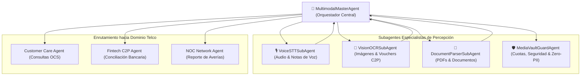

# 🤖 ESPECIFICACIÓN DE AGENTES, SUBAGENTES, SUITES MCP Y ORQUESTADOR SWARM
**Proyecto:** Telecomunicaciones Movilnet C.A. — Módulo Autónomo de Despacho Multimodal  
**Gobernanza:** Universal Best Practices Engineering Rule (Pilares I al VII) & Protocolo Decagonal  
**Arquitectura:** Enjambre de Agentes Swarm L5 con Comunicación Desacoplada y Fallback Resiliente  

---

## 1. 👥 Taxonomía del Enjambre de Agentes Multimodales

El procesamiento de medios no es una tarea monolítica. Se estructura mediante una jerarquía de agentes especializados donde cada entidad tiene una frontera estricta de responsabilidad:



---

## 2. 📝 Fichas Técnicas de los Agentes

### 2.1. `MultimodalMasterAgent` (Orquestador Principal)
* **Rol:** Coordinador Supremo del Flujo Multimodal.
* **Responsabilidades:**
  1. Recibe el payload enriquecido desde el API Gateway (`:8025`).
  2. Consulta al `MediaVaultGuardAgent` para validar la cuota y autorizar el almacenamiento.
  3. Enruta el archivo al subagente especialista según su tipo MIME verificado.
  4. Agrega la transcripción o extracción semántica al contexto conversacional.
  5. Despacha la intención hacia el enjambre departamental (Atención al Cliente, Pago C2P, Emergencias 911).
  6. Coordina el despacho de la respuesta final compuesta (Texto + Audio/PDF + Enlace PWA Universal).

### 2.2. `VoiceSTTSubAgent` (Especialista en Voz y Audio PTT)
* **Rol:** Percepción y Transcripción Fonética.
* **Entrada:** Archivos de audio (`audio/ogg`, `audio/mp3`, `audio/wav`).
* **Salida:** Transcripción textual normalizada, detección de idioma (español venezolano), tono emocional y velocidad del habla.
* **Motores Soportados:** OpenAI Whisper API, Faster-Whisper local, o motor heurístico mock de desarrollo rápido.
* **Latencia Objetivo:** `< 1.8 segundos` para audios de hasta 30 segundos.

### 2.3. `VisionOCRSubAgent` (Especialista en Imágenes y Vouchers)
* **Rol:** Percepción Visual y Extracción de Datos Transaccionales.
* **Entrada:** Imágenes (`image/jpeg`, `image/png`, `image/webp`).
* **Salida:** Detección de comprobantes bancarios SUDEBAN, cédulas de identidad laminadas, captura de pantallas con saldos o códigos de barras.
* **Campos Extraídos en Vouchers:** Banco emisor (código a 4 dígitos), número de referencia (6 a 10 dígitos), monto en Bs., fecha y teléfono receptor.
* **Motores Soportados:** Gemini 2.5 Flash Vision, Tesseract OCR, o extractor heurístico de patrones bancarios.

### 2.4. `DocumentParserSubAgent` (Especialista en Documentos PDF)
* **Rol:** Extracción Estructurada de Documentos Digitales.
* **Entrada:** Documentos PDF (`application/pdf`).
* **Salida:** Texto íntegro del documento, tablas de estados de cuenta, firmas digitales y metadatos del autor.
* **Herramientas Internas:** PyMuPDF (`fitz`), pdfplumber, o parser nativo en Python.

### 2.5. `MediaVaultGuardAgent` (Centinela de Seguridad y Bóveda)
* **Rol:** Gobernanza de Cuotas, Sanitización y Privacidad Zero-PII.
* **Responsabilidades:**
  1. Calcula el hash ciego HMAC del abonado para evitar exposición de PII en nombres de carpetas.
  2. Verifica que la suma total de archivos del abonado no exceda los **50 MB**.
  3. Ejecuta el escaneo de Magic Bytes para rechazar archivos ejecutables o scripts maliciosos camuflados.
  4. Supervisa la ejecución del cron nocturno para purgar archivos con más de 30 días de antigüedad.

---

## 3. 🛠️ Suites de Herramientas MCP (Model Context Protocol JSON-RPC 2.0)

El módulo implementa formalmente el protocolo MCP de Anthropic/Google para permitir que cualquier LLM o agente invoque las capacidades multimedia de forma tipada:

### Herramienta 1: `mcp_vault_check_quota`
* **Descripción:** Consulta el estado de almacenamiento, cuota usada y disponibilidad de la bóveda de un abonado.
* **Argumentos:**
  ```json
  {
    "phone_number": "+584166251587"
  }
  ```
* **Retorno:**
  ```json
  {
    "vault_id": "vlt-a1b2c3d4-e5f6-4789-a012-3456789abcde",
    "quota_limit_bytes": 52428800,
    "quota_used_bytes": 14285710,
    "available_bytes": 38143090,
    "status": "ACTIVE",
    "percent_used": 27.25
  }
  ```

### Herramienta 2: `mcp_audio_transcribe`
* **Descripción:** Transcribe un archivo de audio previamente almacenado en la bóveda de un usuario.
* **Argumentos:**
  ```json
  {
    "asset_id": "ast-98765432-10fe-dcba-9876-543210fedcba",
    "language": "es"
  }
  ```
* **Retorno:**
  ```json
  {
    "transcription": "Buenos días, llamo para verificar por qué no tengo datos 4G en Altamira",
    "confidence": 0.98,
    "duration_seconds": 4.5,
    "language_detected": "es"
  }
  ```

### Herramienta 3: `mcp_image_ocr_extract`
* **Descripción:** Extrae texto y metadatos estructurados de una imagen en la bóveda (comprobante C2P o cédula).
* **Argumentos:**
  ```json
  {
    "asset_id": "ast-11223344-5566-7788-9900-aabbccddeeff",
    "expected_document_type": "VOUCHER_C2P"
  }
  ```
* **Retorno:**
  ```json
  {
    "document_type": "VOUCHER_C2P",
    "extracted_data": {
      "bank_code": "0102",
      "bank_name": "Banco de Venezuela",
      "reference_number": "94827103",
      "amount_ves": 180.50,
      "date": "2026-10-18"
    },
    "is_valid_voucher": true
  }
  ```

### Herramienta 4: `mcp_generate_pdf_receipt`
* **Descripción:** Genera un comprobante oficial de pago o gestión en formato PDF y lo almacena en la bóveda del abonado.
* **Argumentos:**
  ```json
  {
    "phone_number": "+584166251587",
    "transaction_type": "RECARGA_C2P",
    "amount_ves": 180.50,
    "reference": "94827103",
    "title": "Comprobante Oficial de Recarga 4GMAX"
  }
  ```
* **Retorno:**
  ```json
  {
    "asset_id": "ast-pdf-generated-88392",
    "file_path": "vaults/usr_a1b2c3/documents/recibo_94827103.pdf",
    "file_size_bytes": 104520,
    "sha256": "3a8b4c2e...",
    "download_url": "http://127.0.0.1:8025/api/v1/vault/asset/ast-pdf-generated-88392/download"
  }
  ```

---

## 4. ⚡ Enrutamiento Inteligente: FastPath vs Razonamiento Profundo

Siguiendo el principio de **Cero Desperdicio de Tokens y Mínima Latencia**:
1. **FastPath Multimodal (<1ms):**
   Si la imagen recibida coincide con un hash SHA-256 ya procesado recientemente (duplicado en caché L1), o si el audio dura menos de 1 segundo (ruido de fondo), el sistema responde inmediatamente sin invocar el LLM ni motores externos costosos.
2. **Deep Reasoning (Gemini 2.5 Flash / Claude Sonnet):**
   Se activa únicamente cuando la entrada multimodal contiene preguntas ambiguas, imágenes complejas con múltiples textos o audios extensos que requieren desambiguación contextual de segundo orden.
