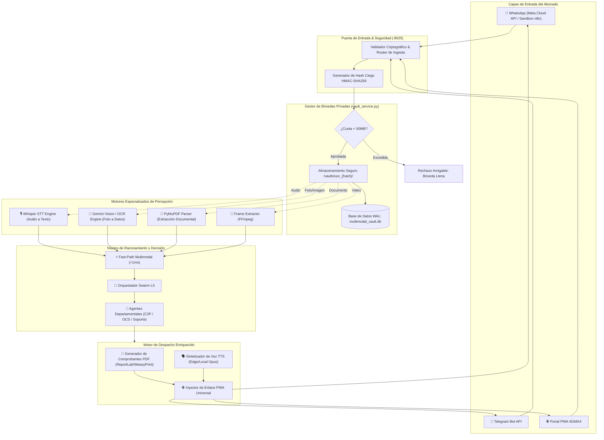
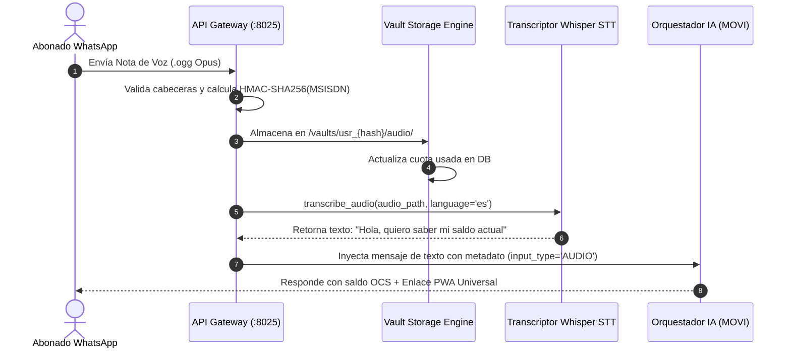
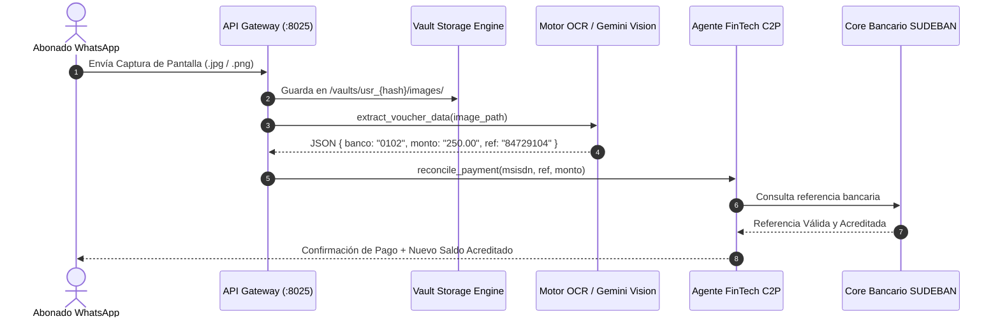
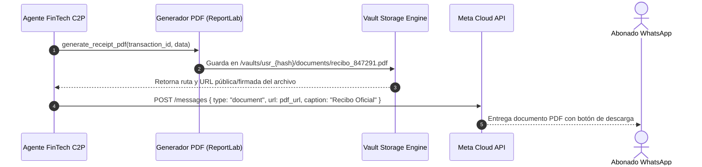
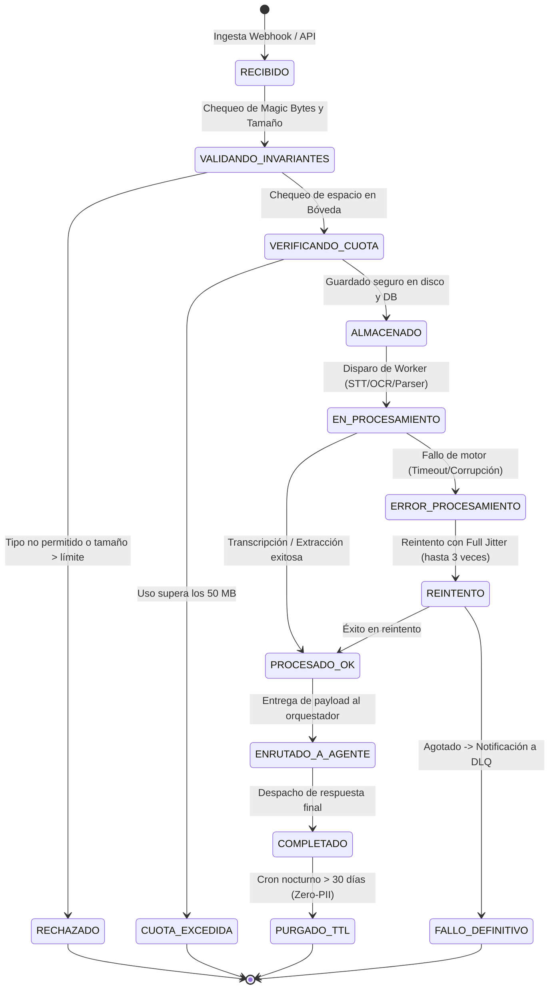

# 🏛️ MODELO CONCEPTUAL, TOPOLOGÍA Y ARQUITECTURA DE DESPACHO MULTIMODAL
**Proyecto:** Telecomunicaciones Movilnet C.A. — Módulo Autónomo de Despacho Multimodal  
**Gobernanza:** Universal Best Practices Engineering Rule (Pilares I al VII) & Protocolo Decagonal  
**Nivel de Ingeniería:** Grado Militar / Carrier-Grade Telco (Escalabilidad a 4.000.000 Abonados)  

---

## 1. 🎯 Visión Arquitectónica y Principios de Diseño

El **Módulo de Despacho Multimodal** es un microecosistema de software autónomo, desacoplado y portable diseñado para dotar a agentes de inteligencia artificial conversacional de capacidades de percepción y expresión a través de canales ricos de mensajería (WhatsApp, Telegram, PWA).

### Principios Fundamentales:
1. **Percepción Multimodal Asimétrica:** Capacidad de ingerir notas de voz, fotos de transferencias, capturas de pantalla, documentos PDF y videos cortos, transformándolos en texto estructurado y vectores semánticos en tiempo real (<2s).
2. **Expresión Rica Contextual:** El agente no responde únicamente con texto plano; genera comprobantes oficiales en PDF con código QR verificable, audios de voz sintética ultrarrealista (TTS en OGG Opus), e imágenes informativas con diseño institucional.
3. **Aislamiento Multi-Tenant Lógico ($1 \leftrightarrow N$):** Cada abonado dispone de una bóveda privada virtual (`/vaults/usr_{hash}/`), protegiendo su privacidad mediante funciones hash irreversibles HMAC-SHA256 y cuotas de almacenamiento estrictas (50 MB por usuario).
4. **Portabilidad de Nivel 5:** El módulo no depende de ningún framework web específico para su lógica central; opera bajo **Arquitectura Hexagonal (Puertos y Adaptadores)** y puede ser embebido como biblioteca en Python o ejecutado como microservicio REST autónomo en el puerto `:8025`.

---

## 2. 🗺️ Topología General del Sistema

El siguiente diagrama detalla la interacción entre el usuario, los canales de entrada, la capa de bóveda privada, los motores especializados de inteligencia artificial y el subsistema de despacho:



---

## 3. 🔄 Diagramas de Secuencia por Tipo de Flujo

### 3.1. Flujo 1: Ingesta de Nota de Voz (Audio PTT)
El abonado envía una nota de voz consultando su saldo o reportando una avería. El sistema descarga el audio, lo almacena en su bóveda, lo transcribe a texto y lo entrega al orquestador conversacional.



---

### 3.2. Flujo 2: Ingesta y Validación de Voucher de Pago Móvil C2P (Foto/Imagen)
El abonado envía la captura de pantalla del pago móvil para recargar su línea. El motor de visión extrae automáticamente la referencia bancaria, el banco emisor y el monto en bolívares.



---

### 3.3. Flujo 3: Despacho Saliente de Comprobante Oficial en PDF
Cuando el abonado completa exitosamente una recarga o trámite, el sistema compila un comprobante PDF con código QR y lo envía directamente por WhatsApp.



---

## 4. ⚙️ Máquina de Estados FSM del Activo Multimedia

Cada archivo que ingresa o sale del módulo atraviesa una máquina de estados determinista (FSM) que garantiza resiliencia, idempotencia y contención de fallos:



---

## 5. 🛡️ Políticas de Seguridad y Aislamiento de Bóvedas

### 5.1. Prevención de Ataques Path Traversal
El sistema prohíbe el uso de cadenas crudas ingresadas por el usuario para construir rutas de archivos en disco. Toda ruta se normaliza mediante:
```python
def resolve_secure_path(base_dir: str, filename: str) -> str:
    # Sanitiza el nombre de archivo eliminando secuencias peligrosas
    safe_name = os.path.basename(filename)
    full_path = os.path.abspath(os.path.join(base_dir, safe_name))
    if not full_path.startswith(os.path.abspath(base_dir)):
        raise SecurityException("Intento de violación de Path Traversal detectado")
    return full_path
```

### 5.2. Verificación de Integridad por Magic Bytes
No se confía en la extensión del archivo (`.jpg`, `.mp3`). El motor inspecciona los primeros 16 bytes del búfer para verificar la firma binaria real del formato:
* **JPEG:** `FF D8 FF`
* **PNG:** `89 50 4E 47 0D 0A 1A 0A`
* **PDF:** `25 50 44 46` (`%PDF`)
* **OGG/Opus:** `4F 67 67 53` (`OggS`)
* **MP4:** `66 74 79 70` (`ftyp`)

---

## 6. 📊 Resumen de Especificaciones de Rendimiento (SLAs)

| Operación | Latencia Objetivo | P95 Garantizado | Política de Timeout |
| :--- | :---: | :---: | :---: |
| **Verificación de Bóveda y Cuota (SQL)** | `<0.5 ms` | `<1.0 ms` | 50 ms |
| **Guardado de Archivo en Disco (I/O)** | `<10 ms` | `<25 ms` | 200 ms |
| **Transcripción de Nota de Voz (<30s)** | `<1.5 s` | `<2.5 s` | 5.0 s (Fallback a mensaje de espera) |
| **Extracción OCR de Voucher C2P** | `<1.2 s` | `<2.0 s` | 4.0 s |
| **Generación de Comprobante PDF** | `<150 ms` | `<300 ms` | 1.0 s |
| **Despacho Saliente HTTP (Meta API)** | `<100 ms` | `<250 ms` | 2.0 s |
