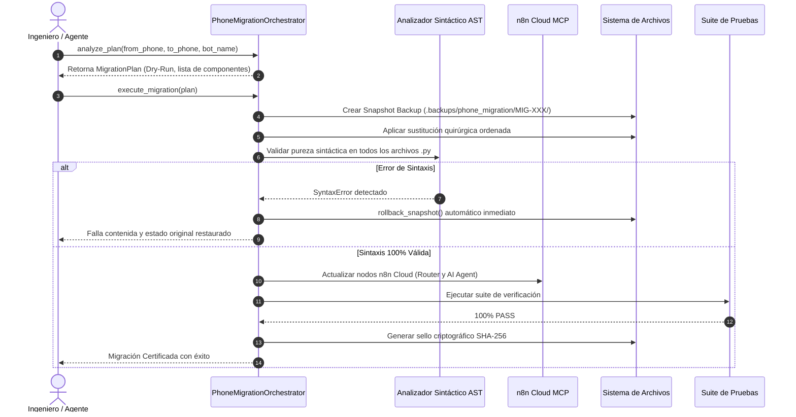

# 🛡️ Phone Migration Guardian — Orquestador de Migración Universal de Líneas Telefónicas

Este Skill proporciona el protocolo de ingeniería, herramientas MCP y scripts de automatización para ejecutar de forma **100% autónoma, atómica y segura** el cambio o reasignación de números de teléfono del Bot o de canales en el ecosistema **Movilnet Core 4GMAX**.

Cumple de forma obligatoria con los **7 Pilares de Excelencia Técnica en Ingeniería** y el **Protocolo Maestro Decagonal (10 Fases)**.

---

## 🎯 Cuándo Activar Este Skill

Activar inmediatamente cuando el usuario o un evento operativo solicite:
1. *"Cambia el número de celular del bot a X"*.
2. *"Migra la línea de atención de WhatsApp a un nuevo número"*.
3. *"Actualiza el número de teléfono en todo el proyecto"*.
4. *"Reasigna el bot a Movilnet 0416/0426 o Movistar 0424/0414 o Digitel 0412"*.
5. *"Verifica en qué componentes está hardcodeado el número de teléfono"*.

---

## 🏛️ Modelo Conceptual y Formatos Canónicos

Toda línea telefónica en el ecosistema Movilnet Core se modela formalmente mediante la entidad `PhoneDescriptor` ([`core/phone_migration_models.py`](file:///Users/ismael/Desktop/121026_CORE_MOVILNET/Movilnet_121026/Movilnet_PWA/core/phone_migration_models.py)):

| Formato Canónico | Ejemplo Representativo | Capas del Sistema Donde Aplica |
| :--- | :--- | :--- |
| **Internacional E.164** | `+58 424 153 3712` | Monitores UI, logs auditables, cabeceras del bot. |
| **WhatsApp JID** | `584241533712@s.whatsapp.net` | Webhooks n8n, pasarela Evolution API / Baileys. |
| **Nacional con Cero** | `04241533712` | Consultas de bases de datos, parámetros URL PWA. |
| **Nacional Formateado** | `0424-1533712` | Mensajes de texto, instrucciones de Pago Móvil C2P. |
| **Dígitos Internacionales** | `584241533712` | Enlaces `wa.me/584241533712`, endpoints REST. |
| **Prefijo 0058** | `00584241533712` | Simuladores de integración de canal, acuses. |
| **Clasificación CONATEL** | `MOVISTAR` / `MOVILNET` / `DIGITEL` | Reglas de Funnel de Portabilidad y segmentación. |

---

## 🗺️ Mapa de Componentes y Capas Afectadas

La sustitución abarca 8 capas de arquitectura de manera atómica:

1. **Capa 1: Módulos Core & Enrutamiento (`core/`)**
   - `core/carrier_funnel_classifier.py`: Prefijos y reglas de portabilidad.
   - `core/conversation_trace_engine.py`: Registro de trazas, bot_number y pasarela gateway.
   - `core/fastpath_intent_interceptor.py`: Links de prospección y enlaces QR.
   - `core/n8n_webhook_resolver.py`: Línea de origen de webhooks.
2. **Capa 2: API Gateway & Servicios Backend (`api/`)**
   - `api/service.py`: Payloads hacia Evolution API y n8n Cloud.
   - `api/n8n_workflows/`: JSONs de workflows locales versionados.
3. **Capa 3: n8n Cloud Workflow en Producción (`sNMbtiEiTkuQ9OCY`)**
   - Nodo `Movilnet Core & Marketing Router`: Datos de C2P y ofertas de bienvenida.
   - Nodo `AI Agent`: System Message de Google Gemini con la identidad y número del bot.
   - Nodo `HTTP Request`: Destinatarios y encabezados de Evolution API.
4. **Capa 4: Interfaces Web & Frontend (`ui/`)**
   - `ui/pwa_stitch/simulador.html`: Enlace QR `wa.me`, selectores de línea y badges.
   - `ui/pwa_stitch/index.html`: Enlace omnicanal y bienvenida.
   - `ui/monitor/conversatorio.html`: Visualizador forense en vivo.
5. **Capa 5: Bases de Datos & Caché**
   - SQLite ODA (`subscribers.db`), tablas de canales y registros de abonados.
   - `reports/shared_live_traces.json`.
6. **Capa 6: Variables de Entorno y Docker**
   - `.env`: `BOT_PHONE_NUMBER`, `EVOLUTION_BOT_JID`, `DEFAULT_SUBSCRIBER_PHONE`.
   - `docker-compose.yml`.
7. **Capa 7: Scripts Operativos & Daemons (`scripts/`)**
   - `scripts/live_core_supervisor.py`: Monitor en vivo y supervisión de procesos.
   - `scripts/measure_fastpath_latency.py`: Líneas de prueba sintéticas.
8. **Capa 8: Suites de Pruebas Automatizadas (`tests/`)**
   - Aserciones de integración y pruebas E2E.

---

## 🔄 Protocolo de Migración en 5 Pasos Atómicos



---

## 🛠️ Herramientas MCP y Comandos CLI

### 1. Servidor MCP (`phone-migration-guardian`)
Registrado en `.agents/mcp_config.json`:
* **`mcp_phone_migration_status()`**: Consulta el número del bot activo actual y snapshots disponibles.
* **`mcp_phone_migration_plan(from_phone, to_phone, bot_name)`**: Genera el informe de impacto sin modificar disco.
* **`mcp_phone_migration_execute(from_phone, to_phone, bot_name)`**: Ejecuta la migración atómica con rollback y SHA-256.
* **`mcp_phone_migration_rollback(snapshot_dir)`**: Restaura un snapshot previo.
* **`mcp_phone_migration_self_test()`**: Auto-verificación matemática de 5 pruebas.

### 2. Comandos CLI Autónomos
```bash
# 1. Diagnóstico en seco (Dry-Run)
python3 core/phone_migration_orchestrator.py --plan --from-phone 04241533712 --to-phone 04160000001 --bot-name MOVI

# 2. Ejecución atómica de migración
python3 core/phone_migration_orchestrator.py --execute --from-phone 04241533712 --to-phone 04160000001 --bot-name MOVI

# 3. Reversión instantánea (Rollback)
python3 core/phone_migration_orchestrator.py --rollback .backups/phone_migration/MIG-XXXXX

# 4. Auto-verificación matemática formal (Pilar II y V)
python3 core/phone_migration_orchestrator.py --test
```

---

## 🛡️ Guardarraíles de Seguridad Obligatorios

1. **Preservación Histórica:** Queda estrictamente vetado alterar archivos en `docs/` o bitácoras selladas criptográficamente. Esos documentos registran la historia real inmutable.
2. **Prioridad de Sustitución:** La sustitución debe aplicarse del patrón más específico (URL `wa.me/` y JID `@s.whatsapp.net`) al más general (`04xx`), para prevenir colisiones o corrupciones de texto.
3. **Cero Terminal para el Dueño:** Las operaciones de migración generan su propio reporte visual estructurado con sello criptográfico SHA-256.
