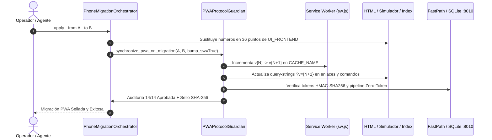

# 🛡️ PWA Protocol Guardian — Guardián Soberano del Protocolo PWA Movilnet Core

Este Skill rige la gobernanza, sincronización, verificación y blindaje del **Protocolo PWA (Progressive Web App)** de Movilnet Core 4GMAX ante cualquier migración de línea celular u operación de mantenimiento.

Cumple de forma obligatoria con los **7 Pilares de Excelencia Técnica en Ingeniería** y el **Protocolo Maestro Decagonal (10 Fases)**.

---

## 🎯 Cuándo Activar Este Skill

Activar inmediatamente cuando el usuario o un evento operativo mencione o solicite:
1. *"Verifica el protocolo PWA"* o *"Audita la PWA"*.
2. *"Ajusta la PWA tras cambiar el número de teléfono"*.
3. *"El usuario en el celular está viendo la versión vieja de la PWA"* (Invalidador de caché / SW bump).
4. *"Verifica los códigos QR del simulador o de onboarding"*.
5. *"Comprueba que la PWA no consuma tokens de IA en consultas de saldo y recargas"* (Pipeline Zero-Token).
6. Al ejecutar cualquier migración con `python3 core/phone_migration_orchestrator.py --apply`.

---

## 🏛️ Componentes Gobernados por el Protocolo PWA

El protocolo PWA comprende 6 componentes críticos interconectados:

```
┌────────────────────────────────────────────────────────────────────────┐
│                        PROTOCOLO PWA MOVILNET                          │
├────────────────────────────────┬───────────────────────────────────────┤
│ 1. Service Worker              │ ui/pwa_stitch/sw.js                   │
│    (Network-First Zero-Stale)  │ CACHE_NAME = 'movilnet-pwa-vX-...'     │
├────────────────────────────────┼───────────────────────────────────────┤
│ 2. Portal Móvil del Abonado    │ ui/pwa_stitch/index.html              │
│    (UI Stitch / Conmutador)    │ #carrier-select, onCarrierChange()    │
├────────────────────────────────┼───────────────────────────────────────┤
│ 3. Simulador NOC & Dual-QR     │ ui/pwa_stitch/simulador.html          │
│    (WhatsApp Direct & PWA Web) │ #qr-code-img, #local-url, wa.me/...   │
├────────────────────────────────┼───────────────────────────────────────┤
│ 4. Web App Manifest            │ ui/pwa_stitch/manifest.json           │
│    (Metadatos PWA Standalone)  │ scope: /ui/pwa_stitch/, start_url     │
├────────────────────────────────┼───────────────────────────────────────┤
│ 5. Monitor Conversacional E2E  │ ui/monitor/conversatorio.html         │
│    (Trazas Omnicanal :8010)    │ WhatsApp Asignado, Hilos y Metadatos  │
├────────────────────────────────┼───────────────────────────────────────┤
│ 6. Fast-Path & HMAC-SHA256     │ core/fastpath_intent_interceptor.py   │
│    (Session Token Cero-PII)    │ generate_session_token(), Zero-Token  │
└────────────────────────────────┴───────────────────────────────────────┘
```

---

## 🔄 Flujo de Trabajo en una Migración Telefónica

Cuando se ejecuta una migración de número celular:
```bash
python3 core/phone_migration_orchestrator.py --apply --from "<NUMERO_ACTUAL>" --to "<NUEVO_NUMERO>"
```

El Guardián ejecuta automáticamente la siguiente secuencia transaccional:



1. **Backup del Service Worker:** Se respalda `ui/pwa_stitch/sw.js` en el snapshot `.backups/phone_migration/` antes de cualquier edición.
2. **Sustitución en UI:** Reemplaza URLs `wa.me/58...`, números de asignación de WhatsApp y textos de bot en `simulador.html`, `index.html` y `conversatorio.html`.
3. **Bump de Versión del Service Worker:**
   - Detecta la versión actual (ej. `v168`).
   - Incrementa a la siguiente versión (ej. `v169`).
   - Actualiza `CACHE_NAME = 'movilnet-pwa-v169-network-first'`.
   - Modifica todos los query-strings `?v=168` a `?v=169` en los archivos de interfaz y en el lanzador `INICIAR_MOVILNET_PWA.command`.
4. **Purga Automática de Caché en Clientes Móviles:** Al cargar la nueva versión `?v=169`, el evento `activate` de `sw.js` borra de inmediato cualquier caché anterior en los navegadores móviles.
5. **Auditoría Forense de 14 Puntos:** Valida paridad de archivos, enlaces directos, selectores, metadata del manifest y contraste WCAG 2.1 AA/AAA.

---

## 🔌 Herramientas MCP Disponibles (`pwa-protocol-guardian`)

El servidor MCP [`mcp/pwa_protocol_mcp.py`](file:///Users/ismael/Desktop/121026_CORE_MOVILNET/Movilnet_121026/Movilnet_PWA/mcp/pwa_protocol_mcp.py) provee las siguientes herramientas:

| Herramienta MCP | Parámetros | Descripción |
| :--- | :--- | :--- |
| `mcp_pwa_protocol_audit` | `expected_bot_phone` *(opcional)* | Ejecuta los 14 chequeos de integridad y retorna reporte completo con sello SHA-256. |
| `mcp_pwa_protocol_sync` | `from_phone`, `to_phone`, `bump_sw` | Sincroniza el protocolo PWA de forma atómica ante una migración. |
| `mcp_pwa_sw_bump` | `target_version` *(opcional)* | Incrementa la versión del Service Worker e invalida cachés obsoletas. |
| `mcp_pwa_verify_zero_token`| `test_phone` *(opcional)* | Verifica que el pipeline Fast-Path resuelva en `<15ms` consumiendo estrictamente 0 tokens. |
| `mcp_pwa_self_test` | Ninguno | Auto-verificación matemática de 5 pruebas unitarias con aserciones formales. |

---

## 💻 Comandos CLI Autónomos (Pilar II)

Todo operador o agente puede ejecutar directamente el módulo sin dependencias externas:

```bash
# 1. Auditoría de Sincronización del Protocolo PWA
python3 core/pwa_protocol_guardian.py --audit

# 2. Verificación del Pipeline Zero-Token (<15ms, 0 tokens)
python3 core/pwa_protocol_guardian.py --verify-zero-token

# 3. Forzar Incremento de Versión del Service Worker (sw.js)
python3 core/pwa_protocol_guardian.py --bump

# 4. Sincronización Directa de Líneas Telefónicas
python3 core/pwa_protocol_guardian.py --sync "0424-1533712" "0416-6251587"

# 5. Auto-verificación formal de pruebas matemáticas
python3 core/pwa_protocol_guardian.py --test
```

---

## 🛡️ Guardarraíles Inflexibles del Protocolo PWA

1. **Guardarraíl Zero-Stale-Cache:** Todo Service Worker debe utilizar la estrategia `Network-First`. Jamás se debe utilizar `Cache-First` para archivos HTML dinámicos o scripts de autenticación.
2. **Guardarraíl Zero-PII en URLs:** Las URLs de la PWA jamás deben transportar cédulas, nombres o números telefónicos en texto plano para autenticar sesiones. Deben usar el token HMAC-SHA256 (`?session={token}`).
3. **Guardarraíl Zero-Token Telco:** Toda consulta de saldo, recarga C2P, planes o reporte de robo EIR dentro de la PWA debe resolver en `<15ms` contra SQLite WAL local consumiendo **0 tokens de Google Gemini**.
4. **Guardarraíl de Accesibilidad WCAG 2.1:** Todo elemento clave del simulador y de la interfaz debe cumplir con ratio de contraste $\ge 3.0:1$ (Grado AA/AAA).
