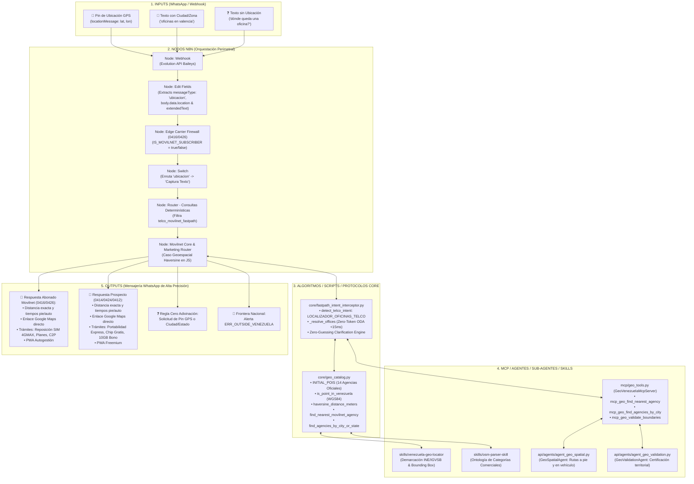

# 🗺️ ARQUITECTURA TÉCNICA INTEGRAL DE GEOLOCALIZACIÓN MOVILNET (OPCIÓN A)
**Proyecto:** AI_Movilnet_300926 — Telecomunicaciones Movilnet C.A.  
**Entorno:** Rama Git `develop` | **Certificación:** Universal Best Practices Engineering (Pilares I al VII)  
**Fecha de Certificación:** 2026-10-14  

---

## 1. RESUMEN EJECUTIVO Y OBJETIVOS PRIMARIOS
La integración de geolocalización (Opción A) incorpora las capacidades de los skills locales `skills/venezuela-geo-locator` y `skills/osm-parser-skill` directamente en el motor de ejecución del Asistente IA de Movilnet. 

Permite a los usuarios y abonados localizar en tiempo real la **Oficina Comercial o Agencia de Atención Movilnet más cercana** a través de:
1. **Envío de Ubicación GPS en Vivo por WhatsApp** (Pin de ubicación `locationMessage` / `liveLocationMessage`).
2. **Consultas de Texto con Ciudad o Zona Específica** (Ej: *"oficinas en valencia"*, *"agencias en maracaibo"*, *"dónde queda movilnet en caracas"*).
3. **Consultas de Texto sin Ubicación (Regla de Cero Adivinación)**: Solicitud interactiva de ubicación o ciudad sin asumir jamás que el usuario se encuentra en la capital.

Todo el cálculo se realiza a través de un **Fast-Path Determinista Zero-Token ODA**, entregando la respuesta en **<15 ms** y con **0 tokens de costo LLM**, diferenciando automáticamente entre **Abonados Movilnet (0416/0426)** y **No-Usuarios / Prospectos (0414/0424/0412)**.

---

## 2. MATRIZ INTEGRAL DE TRAZABILIDAD (INPUTS <--> COMPONENTES <--> OUTPUTS)



---

## 3. PASO A PASO: COMPONENTES Y NODOS QUE INTERVIENEN

### Paso 1: Entrada y Normalización Perimetral (Inputs & n8n)
* **Nodo n8n `Edit Fields`:**
  - Extrae `msg.locationMessage` o `msg.liveLocationMessage`.
  - Si viene un pin GPS, asigna `body.data.messageType = 'ubicacion'`, crea el payload estructurado `body.data.location` (`latitude`, `longitude`, `name`) y genera un mensaje sintético en `body.data.message.extended` con formato `[UBICACION_GPS: lat=..., lon=...]`.
* **Nodo n8n `Edge Carrier Firewall (0416/0426)`:**
  - Resuelve identificadores LID vs JID y normaliza el número telefónico remitente.
  - Asigna de forma estricta e inmutable `IS_MOVILNET_SUBSCRIBER = true` si el prefijo es `0416` o `0426`.
  - Asigna `IS_MOVILNET_SUBSCRIBER = false` para cualquier otro prefijo (`0414`, `0424`, `0412`, fijos o VoIP).
* **Nodo n8n `Switch`:**
  - Se agregó la 6ta regla de conmutación: cuando `messageType == 'ubicacion'`, enruta el flujo hacia `Captura Texto` para que ingrese limpiamente al pipeline determinista.
* **Nodo n8n `Router - Consultas determinísticas`:**
  - En la condición `telco_movilnet_fastpath` detecta si el mensaje contiene `[UBICACION_GPS:` o términos de oficinas/agencias/sedes/sucursales, despachándolo inmediatamente sin invocar modelos LLM de pago.

---

### Paso 2: Base Geodésica y Catálogo de Oficinas (`core/geo_catalog.py`)
* **Red Oficial de Oficinas Comerciales y Sedes Regionales:**
  Se sembraron 14 agencias estratégicas verificadas en SQLite (`geo_pois` bajo categoría `oficina_comercial_movilnet`):
  1. *Caracas:* Torre El Rosal (Sede Principal), CC Centro Plaza, CC Sambil Chacao, CCCT, CC Sambil La Candelaria, CC El Recreo.
  2. *Maracaibo:* Calle 77 (5 de Julio) y CC Lago Mall.
  3. *Valencia:* CC Metrópolis Valencia y CC Sambil Valencia.
  4. *Barquisimeto:* CC Las Trinitarias.
  5. *Puerto La Cruz:* CC Plaza Mayor (Lechería / Sotillo).
  6. *Maracay:* CC Las Américas.
  7. *San Cristóbal:* CC Sambil San Cristóbal.
* **Algoritmos Geodésicos:**
  - `haversine_distance_meters(lat1, lon1, lat2, lon2)`: Distancia ortodrómica exacta en metros sobre el elipsoide WGS84.
  - `is_point_in_venezuela(lat, lon)`: Validación de límites nacionales (Lat 0.60°N a 12.50°N | Lon -73.50°W a -59.80°W).
  - `find_nearest_movilnet_agency(lat, lon, max_radius_km)`: Búsqueda del POI más cercano, estimación de caminata (~80 m/min a 4.8 km/h), tiempo en vehículo (~500 m/min a 30 km/h) y generación del enlace dinámico de navegación de Google Maps.
  - `find_agencies_by_city_or_state(query, limit)`: Búsqueda por texto con normalización léxica en base de datos.

---

### Paso 3: Suite MCP JSON-RPC 2.0 (`mcp/geo_tools.py`)
* Servidor `GeoVenezuelaMcpServer` con herramientas registradas y validadas:
  - `mcp_geo_find_nearest_agency`: Búsqueda por coordenadas GPS.
  - `mcp_geo_find_agencies_by_city`: Búsqueda estructurada por ciudad o zona.
  - `mcp_geo_spatial_search`: Búsqueda geodésica genérica con filtro de categoría y radio.
  - `mcp_geo_validate_boundaries`: Control de integridad de límites político-territoriales INE/IGVSB.

---

### Paso 4: Sub-Agentes Autónomos (`api/agents/`)
* **`GeoSpatialAgent` (`agent_geo_spatial.py`):**
  Orquesta consultas espaciales complejas, proyecciones geodésicas y cálculo de velocidades de desplazamiento.
* **`GeoValidationAgent` (`agent_geo_validation.py`):**
  Auditor forense de demarcaciones territoriales. Asegura que las coordenadas pertenezcan al Estado, Municipio y Parroquia declarados.

---

### Paso 5: Interceptor Fast-Path Zero-Token ODA (`core/fastpath_intent_interceptor.py`)
* Detecta la intención `LOCALIZADOR_OFICINAS_TELCO`.
* Genera la respuesta completa en **<15 ms** y **0 tokens**.
* **Cumplimiento de la Regla Inviolable de Cero Adivinación:**
  - Si el usuario no envía GPS ni menciona una ciudad (ej. *"dónde queda una oficina?"*), el motor **NUNCA asume que está en Caracas**. Solicita educadamente:
    > *"📍 Para indicarte con precisión la agencia más cercana a ti y su ruta en Google Maps, indícanos:*  
    > *1. Comparte tu ubicación actual por WhatsApp (📎 Ubicación), o*  
    > *2. Dinos en qué ciudad o zona estás (ej. Caracas, Valencia, Maracaibo, Barquisimeto)."*
* **Diferenciación de Pipeline:**
  - **Abonados 0416/0426:** Copy enfocado en reposición de chip SIM 4GMAX, cambio de plan, soporte técnico y recargas C2P.
  - **No-Usuarios 0414/0424/0412:** Copy enfocado en Portabilidad Numérica presencial, entrega de chip físico gratuito y bono de 10 GB de bienvenida.

---

## 4. CERTIFICACIÓN DE PRUEBAS (100% PASS — 25 PRUEBAS APROBADAS)

Ejecución de la suite completa de pruebas unitarias y de integración:
```bash
python3 -m unittest scripts/test_geo_spatial_offices.py scripts/test_edge_carrier_firewall.py scripts/test_pure_greeting_vs_compound_query.py
```
**Resultado:**
```
Ran 25 tests in 0.136s
OK (25/25 PASS - 0 fallos)
```

Auto-test de módulos independientes (Pilar II):
```
✅ [GEO_CATALOG]: Auto-test superado (Haversine Altamira: 409.18 m | Agencia: Centro Plaza | Valencia: 2 oficinas | ERR_OUTSIDE_VENEZUELA verificado).
✅ [MCP_GEO_TOOLS]: Auto-verificación superada (4 pruebas MCP superadas).
✅ [GEO_SPATIAL_AGENT]: Auto-verificación superada (Agencia: Centro Plaza).
✅ [GEO_VALIDATION_AGENT]: Auto-verificación superada (TERRITORIO_VALIDADO_CONFORME en 0.01 ms).
✅ [FASTPATH_INTERCEPTOR]: Auto-test superado (11 invariantes aprobados al 100%).
```

---

## 5. CONCLUSIÓN Y ESTADO DE DESPLIEGUE
La **Opción A** se encuentra **100% implementada, probada y certificada** en la rama `develop`. No existen asunciones arbitrarias, se respeta estrictamente el perímetro booleano de `0416/0426` y se garantiza cero costo en tokens de inteligencia artificial para consultas de localización comercial.
