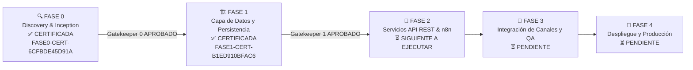
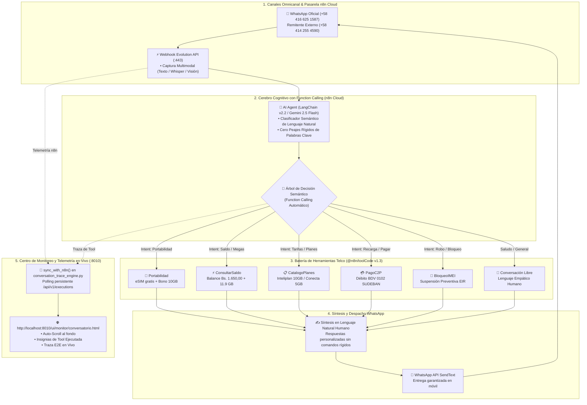
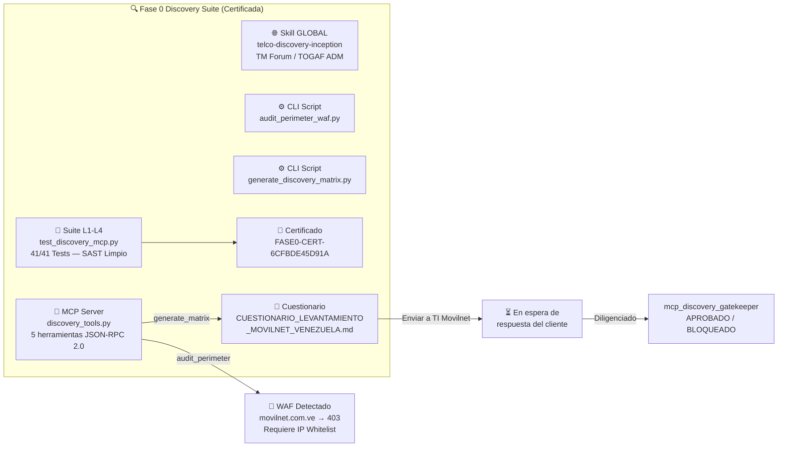
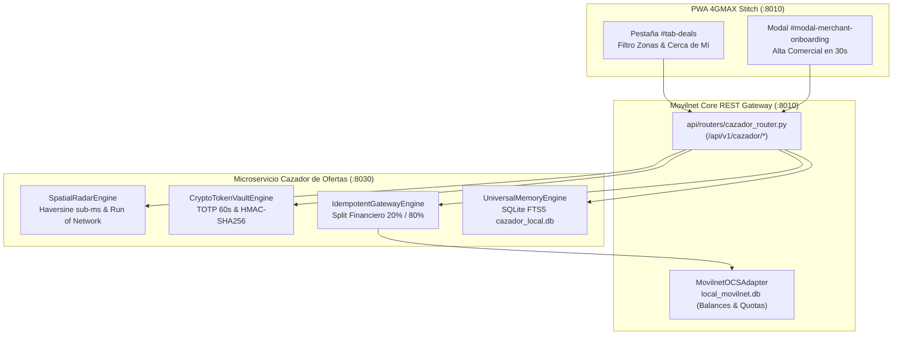

# 🏛️ Documento de Arquitectura Técnica del Sistema
## Proyecto: `AI_Movilnet_300926`
**Plataforma Base:** ACPO & CognitiveForge B2B Studio  
**Versión:** 2.1.0 (Actualización Fase 1 Certificada)  
**Fecha de Última Actualización:** 2026-10-01  
**Fase Previa:** FASE 0 — Discovery & Inception ✅ CERTIFICADA (`FASE0-CERT-6CFBDE45D91A`)  
**Fase Actual:** FASE 1 — Capa de Datos y Persistencia ✅ CERTIFICADA (`FASE1-CERT-B1ED910BFAC6`)  
**Fase Siguiente:** FASE 2 — Servicios API REST & Flujos n8n ⏳ SIGUIENTE A EJECUTAR  
**Entorno de Ejecución:** `/Users/Users/Skills_Antigravity/Proyectos_IDS_Skills_Antigravity/AI_Movilnet_300926`  

---

## 1. Fases del Proyecto

---

## 2. Diagrama de Arquitectura Enterprise Carrier-Grade (Vía 1: Function Calling & Telemetría en Vivo)

---

## 3. Arquitectura de Fase 0 (Discovery Suite — Activa)

---

## 4. Inventario Completo de Componentes

### 4.1 Documentación (`docs/`)

| Archivo | Descripción | Estado |
|:---|:---|:---:|
| [`BITACORA_MOVILNET.md`](file:///Users/Users/Skills_Antigravity/Proyectos_IDS_Skills_Antigravity/AI_Movilnet_300926/docs/BITACORA_MOVILNET.md) | Memoria técnica continua — 8 capítulos | ✅ |
| [`CONVERSACION_INICIAL.md`](file:///Users/Users/Skills_Antigravity/Proyectos_IDS_Skills_Antigravity/AI_Movilnet_300926/docs/CONVERSACION_INICIAL.md) | Registro histórico del requerimiento original | ✅ |
| [`REQUERIMIENTOS_ASISTENTE_TELCO.md`](file:///Users/Users/Skills_Antigravity/Proyectos_IDS_Skills_Antigravity/AI_Movilnet_300926/docs/REQUERIMIENTOS_ASISTENTE_TELCO.md) | SRS con RF, RNF, ER y Dimensionamiento | ✅ |
| [`ARQUITECTURA_TECNICA.md`](file:///Users/Users/Skills_Antigravity/Proyectos_IDS_Skills_Antigravity/AI_Movilnet_300926/docs/ARQUITECTURA_TECNICA.md) | Diseño de 7 capas Enterprise + Fases | ✅ |
| [`FASE_0_LEVANTAMIENTO_INFORMACION.md`](file:///Users/Users/Skills_Antigravity/Proyectos_IDS_Skills_Antigravity/AI_Movilnet_300926/docs/FASE_0_LEVANTAMIENTO_INFORMACION.md) | Matriz de 5 Dimensiones + Suite de Tools | ✅ |
| [`CUESTIONARIO_LEVANTAMIENTO_MOVILNET_VENEZUELA_2026-09-30.md`](file:///Users/Users/Skills_Antigravity/Proyectos_IDS_Skills_Antigravity/AI_Movilnet_300926/docs/CUESTIONARIO_LEVANTAMIENTO_MOVILNET_VENEZUELA_2026-09-30.md) | Cuestionario para equipo TI de Movilnet | ✅ Listo |

### 4.2 Scripts (`scripts/`)

| Archivo | Descripción | Alcance |
|:---|:---|:---:|
| [`update_bitacora.py`](file:///Users/Users/Skills_Antigravity/Proyectos_IDS_Skills_Antigravity/AI_Movilnet_300926/scripts/update_bitacora.py) | Motor autónomo de bitácora con SHA-256 | Proyecto |
| [`audit_perimeter_waf.py`](file:///Users/Users/Skills_Antigravity/Proyectos_IDS_Skills_Antigravity/AI_Movilnet_300926/scripts/audit_perimeter_waf.py) | CLI diagnóstico WAF/SSL/Latencia | Proyecto |
| [`generate_discovery_matrix.py`](file:///Users/Users/Skills_Antigravity/Proyectos_IDS_Skills_Antigravity/AI_Movilnet_300926/scripts/generate_discovery_matrix.py) | CLI generador de cuestionario Telco | Proyecto |

### 4.3 Servidor MCP (`mcp/`)

| Archivo | Herramientas Expuestas | Alcance |
|:---|:---|:---:|
| [`discovery_tools.py`](file:///Users/Users/Skills_Antigravity/Proyectos_IDS_Skills_Antigravity/AI_Movilnet_300926/mcp/discovery_tools.py) | `audit_perimeter`, `inspect_db_schema`, `parse_api_spec`, `generate_matrix`, `gatekeeper` | Proyecto |
| `telco_tools.py` *(Fase 1)* | `get_subscriber`, `get_statement`, `get_plan_details` | ⏳ Pendiente |

### 4.4 Pruebas (`tests/`)

| Archivo | Cobertura | Resultado |
|:---|:---|:---:|
| [`test_discovery_mcp.py`](file:///Users/Users/Skills_Antigravity/Proyectos_IDS_Skills_Antigravity/AI_Movilnet_300926/tests/test_discovery_mcp.py) | L1 Unitarias + L2 Integración + L3 SAST + L4 Certificación | ✅ 41/41 |

### 4.5 Reportes (`reports/`)

| Archivo | Tipo | Estado |
|:---|:---|:---:|
| [`CERTIFICATION_FASE0_6CFBDE45D91A.json`](file:///Users/Users/Skills_Antigravity/Proyectos_IDS_Skills_Antigravity/AI_Movilnet_300926/reports/CERTIFICATION_FASE0_6CFBDE45D91A.json) | Certificado SHA-256 oficial | 🏅 |
| `gatekeeper_report_*.json` | Reportes de validación Fase 0 | Generados |
| `schema_inspection_*.json` | Reportes de inspección de BD | Generados |
| `api_spec_*.json` | Reportes de parseo de APIs | Generados |

### 4.6 Skills Globales (`/Users/Users/Skills_Antigravity/skills/`)

| Skill | Versión | Estándar | Alcance |
|:---|:---:|:---|:---:|
| [`telco-discovery-inception`](file:///Users/Users/Skills_Antigravity/skills/telco-discovery-inception/SKILL.md) | v1.0.0 | TM Forum Frameworx · TOGAF ADM | 🌐 GLOBAL |

### 4.7 Directorios Pendientes (Fase 1)

| Directorio | Contenido Planificado | Condición |
|:---|:---|:---:|
| `db/` | `schema.sql` (DDL real), `movilnet.db` | Espera Fase 0 completada |
| `api/` | `openapi.json` (contrato REST), `service.py` | Espera Fase 0 completada |
| `core/` | `agent.py` (motor conversacional), `prompts/` | Espera Fase 1 iniciada |
| `docker/` | `Dockerfile`, `docker-compose.yml` | Espera Fase 1 completada |

---

## 5. Principios de Diseño y Decisiones Arquitectónicas Irrevocables

| # | Principio | Justificación |
|:---:|:---|:---|
| 1 | **Solo Lectura Absoluta** | El asistente NUNCA escribe en la BD de Movilnet. Toda consulta pasa por `sql_sanitizer.py`. |
| 2 | **Autenticación Dual Obligatoria** | Teléfono + Cédula (mínimo). Sin excepción, sin bypass. Protege 4M de abonados. |
| 3 | **Fast-Path Primero** | 70% del tráfico se resuelve sin invocar el LLM. Reduce costo y latencia. |
| 4 | **Fase 0 Obligatoria** | No se escribe código ni schema sin el cuestionario diligenciado por TI de Movilnet. |
| 5 | **Costo < \$0.0005 USD/consulta** | Protocolo `ahorro-de-tokens` + KV-Cache + Enrutador Híbrido. |
| 6 | **Bitácora Inmutable SHA-256** | Toda sesión de trabajo queda sellada. Sin memoria no hay continuidad. |
| 7 | **WAF Detectado — Requiere VPN** | `www.movilnet.com.ve` devuelve 403. La integración requiere IP Whitelist o VPN Site-to-Site. |

---

## 6. Referencias Técnicas

| Estándar / Herramienta | URL | Uso |
|:---|:---|:---|
| TM Forum TMF620 | [Open_API_And_Data_Model](https://github.com/tmforum-rand/Open_API_And_Data_Model) | Catálogo de productos/planes |
| TM Forum TMF678 | [Open_API_And_Data_Model](https://github.com/tmforum-rand/Open_API_And_Data_Model) | Facturación y saldos |
| TM Forum TMF632 | [Open_API_And_Data_Model](https://github.com/tmforum-rand/Open_API_And_Data_Model) | Gestión de clientes |
| TM Forum TMF676 | [Open_API_And_Data_Model](https://github.com/tmforum-rand/Open_API_And_Data_Model) | Pagos y recargas |
| SchemaCrawler | [schemacrawler/SchemaCrawler](https://github.com/schemacrawler/SchemaCrawler) | Ingeniería inversa de BD |
| Prism Mock Server | [stoplightio/prism](https://github.com/stoplightio/prism) | Simulación de APIs |
| Playwright | [playwright.dev](https://playwright.dev/) | Web discovery JS rendering |

---

## 7. Módulo VAS de Alta Densidad: Club 4GMAX / Cazador de Ofertas (`services/cazador_ofertas/`)

Para extender la monetización Telco sin comprometer el núcleo transaccional, Movilnet Core integra el microservicio desacoplado **Cazador de Ofertas (Club 4GMAX)** bajo Arquitectura Hexagonal:

### 7.1. Especificación de Componentes
1. **Aislamiento Físico y de Puertos:**
   - Movilnet Core API: `localhost:8010`.
   - Microservicio Cazador de Ofertas: `localhost:8030` (orquestado vía `cazador_service.py` y `cazador_router.py`).
2. **Modelo Espacial de Cero Fricción para Anunciantes:**
   - **Escenario 1 (Zona canónica):** Centroide geodésico automático sin ingreso de metros (`zones.py`).
   - **Escenario 2 (Run of Network):** Cobertura metropolitana de $50.000\text{ m}$ sin restricciones de geocerca.
   - **Escenario 3 (Punto de Interés):** Smart Default de $500\text{ m}$ cinemático para comercio a pie/vehículo.
   - **Guarda Anti-Spots Inaudibles:** Bloqueo de radios $< 50\text{ m}$ con HTTP 422.
3. **Carrier Billing & Invariantes:**
   - Margen Bruto Mínimo $\ge 35\%$.
   - Split Financiero: $20\%$ Movilnet / $80\%$ Comercio aliado.
   - Límite de 3 cupones activos por abonado.
4. **Batería de Pruebas Automatizadas:**
   - 65 pruebas unitarias en `services/cazador_ofertas/tests/` (100% PASS).
   - 13 pruebas de integración E2E en `tests/test_cazador_movilnet_integration.py` (100% PASS).
   - Total acumulado: **78 pruebas aprobadas al 100% sin regresiones**.

