# 🔋 Batería Tecnológica Integral y Benchmark de la Competencia (Movistar y Digitel)
## Proyecto: `AI_Movilnet_300926` — Telecomunicaciones Movilnet C.A.
**Propósito:** Especificación de la arquitectura completa de herramientas, librerías open-source, agentes, MCPs, estándares Telco y comparación competitiva nacional.  
**Fecha:** 2026-09-30  
**Gobernanza:** Nivel 5 Antigravity & Open-Source Telco Architecture  

---

## 1. ⚔️ Benchmark de la Competencia en Venezuela: Digitel y Movistar

Para que Movilnet lidere el mercado nacional, analizamos las fortalezas y debilidades de los canales de autogestión de la competencia privada:

| Operadora | Canales Digitales Existentes | Proveedor / Stack Técnico | Capacidades y Fortalezas | Fallas Críticas y Dolores del Usuario (Puntos Débiles) | Oportunidad para Movilnet AI |
|:---|:---|:---|:---|:---|:---|
| **Movistar Venezuela** *(Telefónica)* | • App *Mi Movistar* • Portal Web Autogestión • WhatsApp Bot (*Aura Movistar*) | • Plataforma Amdocs BSS • Botmaker / LivePerson • Salesforce Service Cloud | • Consulta de saldo y detalle de factura pospago. • Integración con botón de pago de Banesco y BDV. | • **Bot Rígido:** Respuestas pre-fabricadas; si el usuario escribe en lenguaje natural se rompe el flujo. • Caídas continuas de la App en horas pico. • Cierra sesión constantemente. • Manda al usuario a un webview externo para pagar. | **Atención Cognitiva Real:** Comprensión fluida de modismos venezolanos y pago móvil C2P nativo en el chat sin salir a páginas externas. |
| **Digitel Venezuela** | • App *Digitel* (Flutter/React) • *Digitel en Línea* • WhatsApp Bot (*Digi*) | • Oracle / Ericsson BSS • Infobip / Auronix (WhatsApp) • Plataformas SaaS propietarias | • Menú interactivo rápido de botones y listas. • Bloqueo de línea inmediato por robo. • Compra de paquetes de datos radicados. | • **Árboles de Menú Frustrantes:** Obliga al usuario a pulsar opciones numéricas ("1", "2", "3"). Si escribe una duda, entra en bucles infinitos. • Altos montos mínimos de recarga. • Licenciamiento SaaS en dólares sumamente costoso. | **Cero Licenciamiento ($0):** Stack 100% Open-Source autohospedado en Movilnet, sin depender de intermediarios SaaS como Infobip o Botmaker. |

---

## 2. 🏗️ La Batería Tecnológica Completa de `AI_Movilnet_300926` (9 Capas)

```mermaid
flowchart TD
    subgraph C1 ["CAPA 1: Canales & Ingesta Multicanal"]
        WH["WhatsApp (Meta Cloud API / n8n Webhook)"]
        WEB["Web Chat Widget (Tailwind / WebSockets)"]
        TG["Telegram Bot Gateway (@n8n-nodes)"]
    end

    subgraph C2 ["CAPA 2: Perímetro, Seguridad & Rate Limiting"]
        SEC["SecurityShield Middleware (FastAPI)"]
        RL["Redis Token Bucket (Máx 5 req/min)"]
        PII["Enmascaramiento de Cédulas y Teléfonos"]
        SAN["sql_sanitizer.py (Solo Lectura Estricto)"]
    end

    subgraph C3 ["CAPA 3: Enrutamiento Semántico de Dominios"]
        ROUTER["core/semantic_router.py (<15ms en CPU)"]
        SUPERVISOR["core/multi_agent_supervisor.py (LangGraph Pattern)"]
        GATEWAY["Smart MCP Gateway (mcplex / smart-mcp)"]
    end

    subgraph C4 ["CAPA 4: Enjambre Cognitivo Multi-Agente (Cognitive Mesh)"]
        AG_TELCO["📶 Agente Telco Core (Saldos/Planes)"]
        AG_FIN["💳 Agente Pagos C2P (Fintech Bancaria)"]
        AG_TOUR["🌿 Agente Turismo & Parques (Inatur)"]
        AG_VAS["🎟️ Agente Marketplace & Promociones"]
        AG_QA["⚖️ Agente Verificador Adversarial (Maker/Checker)"]
    end

    subgraph C5 ["CAPA 5: Pasarela Multi-Modelo de IA (Model Gateway)"]
        GW_AI["core/model_gateway.py (LiteLLM Compatible)"]
        MOD_MVP["Fase MVP: Google AI Studio, DeepSeek, Groq ($0)"]
        MOD_PROD["Fase Prod: Servidor Local vLLM Qwen 72B / R1 On-Premise"]
    end

    subgraph C6 ["CAPA 6: Servidores MCP (Model Context Protocol)"]
        MCP_T["mcp_telco_tools (Consultas de Red)"]
        MCP_F["mcp_fintech_c2p (Cobro Interbancario)"]
        MCP_D["mcp_discovery_tools (Auditoría Fase 0)"]
    end

    subgraph C7 ["CAPA 7: Persistencia, Caché & Alta Concurrencia"]
        PG["PostgreSQL 15 Particionado (0416/0426 - 4M Abonados)"]
        PGB["PgBouncer Connection Pooling (400 QPS)"]
        REDIS["Redis 7 In-Memory Cache (TTL 120s)"]
    end

    subgraph C8 ["CAPA 8: Estándares de Telecomunicaciones"]
        TMF["TM Forum ODA (TMF620, TMF678, TMF680, TMF632)"]
        GSMA["GSMA Open Gateway (Carrier Billing & SIM Swap)"]
    end

    subgraph C9 ["CAPA 9: DevOps, Contenedores & Observabilidad"]
        DOC["Docker Multi-Stage & docker-compose.yml"]
        MON["Prometheus + Grafana (Métricas de Latencia y QPS)"]
        LOG["Bitácora Inmutable Continua con Firmas SHA-256"]
    end

    C1 --> C2 --> C3 --> C4 --> C5 --> C6 --> C7
    C4 -.-> C8
    C7 -.-> C9
```

---

## 3. 📋 Inventario Detallado de Librerías, Herramientas y Frameworks

### 3.1. Librerías de Código Abierto (Python Core)
* **`fastapi` (v0.109+):** Framework asíncrono de alto rendimiento para exponer los microservicios REST y webhooks con latencia sub-milisegundo.
* **`uvicorn[standard]`:** Servidor ASGI basado en `uvloop` y `httptools` para concurrencia masiva (400 QPS).
* **`pydantic` (v2.5+):** Validación tipada y serialización Typesafe de todas las entradas y salidas de datos.
* **`litellm` (v1.20+):** Pasarela agnóstica para orquestar más de 100 modelos de IA (Gemini, DeepSeek, Groq, Ollama, vLLM) con un solo formato de llamada.
* **`redis` (v5.0+):** Cliente asíncrono para caché en memoria de saldos y control de velocidad de peticiones (*Token Bucket*).
* **`psycopg2-binary`:** Conector nativo de alto rendimiento para PostgreSQL particionado con soporte de connection pooling.
* **`pytest` & `pytest-asyncio`:** Suite de pruebas automatizadas L1 a L4 y verificación de no-regresión.

### 3.2. Servidores y Motores de Infraestructura Open-Source
* **`vLLM` (v0.6+):** Motor de inferencia local open-source con *PagedAttention* y *Continuous Batching*, optimizado para correr **Qwen 2.5 72B** o **DeepSeek-R1 Distill** en servidores locales con GPUs NVIDIA sin costo de licencias.
* **`n8n` (Self-Hosted):** Orquestador de flujos visuales que maneja los webhooks de WhatsApp, reduce la fricción de integración y ofrece observabilidad gráfica a la directiva de Movilnet.
* **`PgBouncer`:** Multiplexor de conexiones para PostgreSQL que evita que 400 consultas concurrentes agoten los sockets del sistema operativo.
* **`Prometheus` + `Grafana`:** Pila de observabilidad en tiempo real para monitorear latencia p95, tasa de aciertos de caché (*Cache Hit Rate*), consumo de tokens y tasa de error.

### 3.3. Estándares y Protocolos de Telecomunicaciones
* **TM Forum Open Digital Architecture (ODA):**
  * `TMF620` (Product Catalog): Catálogo de planes 4GMAX y paquetes de datos.
  * `TMF678` (Customer Bill): Estados de cuenta, fechas de corte y saldos.
  * `TMF680` (Recommendation API): Alertas proactivas de agotamiento de datos.
  * `TMF632` (Party Management): Identidad y datos del titular de la línea.
* **GSMA Open Gateway / CAMARA APIs:**
  * `Carrier Billing API`: Mecanismo para cargar consumos y compras directamente a la factura telefónica.
  * `SIM Swap API`: Prevención de fraudes detectando si el chip fue clonado recientemente antes de autorizar pagos.

---

## 4. 💡 La Gran Ventaja Competitiva de Movilnet frente a Movistar y Digitel

1. **Cero Menús Rígidos:** Ni Movistar ni Digitel tienen un asistente verdaderamente cognitivo; usan árboles de botones. Movilnet AI entiende frases como *"Pana, me quedé sin megas en la autopista, ¿cómo hago?"* y resuelve en el acto.
2. **Pago Móvil C2P Nativo en el Chat:** La competencia envía al usuario a abrir una página web externa. Movilnet AI ejecuta el débito bancario dentro del mismo chat mediante clave dinámica en menos de 5 segundos.
3. **Cero Costo de Licenciamiento:** Movistar y Digitel pagan cientos de miles de dólares anuales a corporaciones extranjeras (Salesforce, Botmaker, Infobip). Movilnet AI opera sobre una **pila 100% de código abierto soberana**, con costo de licencias de software en **\$0.00**.
