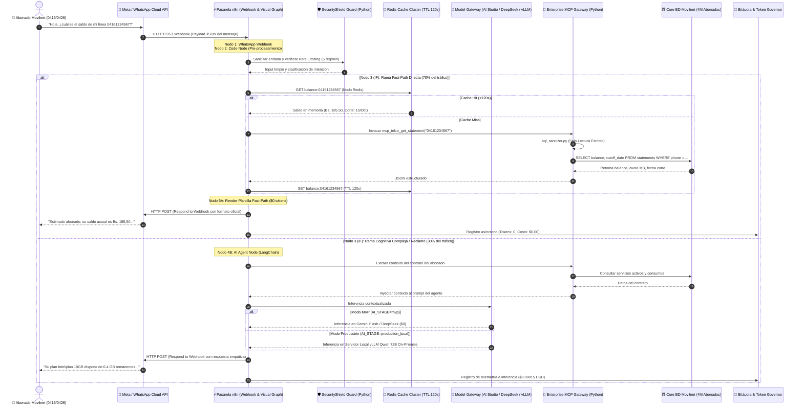
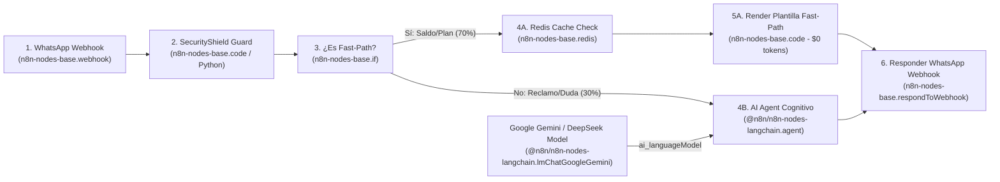
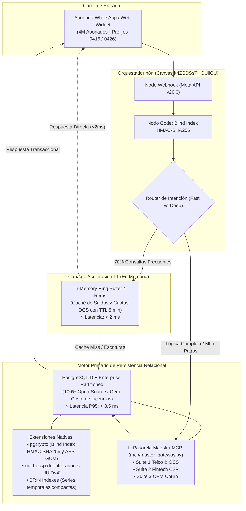
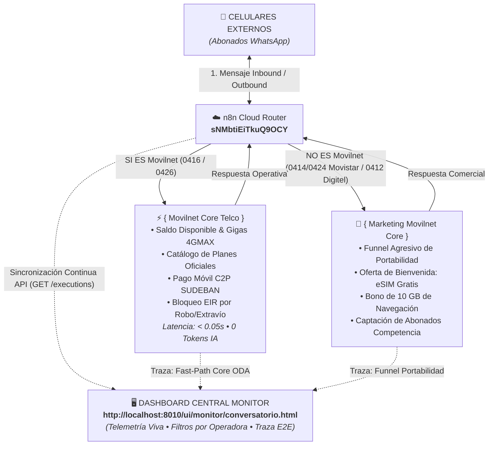

# 🌐 Diagrama Operativo y de Flujo Integral del Sistema con n8n
## Proyecto: `AI_Movilnet_300926` — Asistente de IA para Telecomunicaciones Movilnet
**Escala:** 4.000.000 de Abonados | **Gobernanza:** Nivel 5 Antigravity & Loop Engineering  
**Integración:** Núcleo en Python / MCP + Pasarela Visual de Canales en n8n  
**Fecha:** 2026-09-30  
**Versión:** 2.0.0 Maestro (n8n Integrado)  

---

## 1. Mapa Global de Fases y Compuertas de Calidad (Phase-Gate Lifecycle)

Este diagrama representa el ciclo de vida completo de ingeniería de software para el proyecto Movilnet, estructurado en **5 fases progresivas** con **n8n integrado** como acelerador de canales y orquestación visual:

```mermaid
flowchart TD
    subgraph FASE0 ["FASE 0: Discovery, Inception & Gobernanza (CERTIFICADA ✅)"]
        F0_1["Matriz 5 Dimensiones TM Forum<br/>(BSS/OSS, APIs, KYC, Planes, Regulación)"]
        F0_2["Diagnóstico Perimetral & WAF<br/>(Detección 403 en www.movilnet.com.ve)"]
        F0_3["Suite MCP Discovery (5 Tools)<br/>& Pruebas L1-L4 (41/41 Tests)"]
        F0_4["Motor Loop Engineering<br/>(/goal, /loop, /cost, /pause)"]
        G0{"GATEKEEPER 0<br/>Certificado FASE0-CERT-6CFBDE45D91A<br/>Score 4/4 Verificaciones"}
        
        F0_1 --> F0_2 --> F0_3 --> F0_4 --> G0
    end

    subgraph FASE1 ["FASE 1: Capa de Datos, Persistencia y Conectores MCP (EN DISEÑO ⏳)"]
        F1_1["DDL db/schema.sql<br/>(Particionado 0416/0426, Índices B-Tree)"]
        F1_2["Generador Sintético 4M Abonados<br/>(Líneas, Planes 4GMAX, Estados de Cuenta)"]
        F1_3["Servidor MCP Telco (mcp/telco_tools.py)<br/>(Consultas Solo Lectura: Saldo, Plan, Pagos)"]
        F1_4["Microservicio API REST (api/service.py)<br/>& Contrato OpenAPI 3.1 (api/openapi.json)"]
        G1{"GATEKEEPER 1<br/>Latencia DB < 2ms<br/>100% Sanitización SQL"}
        
        F1_1 --> F1_2 --> F1_3 --> F1_4 --> G1
    end

    subgraph FASE2 ["FASE 2: Capa Cognitiva, Enrutador Híbrido & Pasarela Multi-Modelo (PENDIENTE ⏳)"]
        F2_1["Enrutador Híbrido de Alto Rendimiento<br/>(70% Fast-Path / 30% LLM)"]
        F2_2["Caché Distribuido Redis Cluster<br/>(TTL 120s para Saldo y Sesiones)"]
        F2_3["SecurityShield Studio Perimetral<br/>(injection_hunter.py + PII Masking)"]
        F2_4["Universal Model Gateway (core/model_gateway.py)<br/>• Fase MVP: AI Studio, DeepSeek, Grok, Groq, MiMo ($0)<br/>• Fase Prod: Servidor Local vLLM/Ollama (Qwen 72B / DeepSeek-R1)"]
        G2{"GATEKEEPER 2<br/>Latencia p95 < 800ms<br/>Zero Prompt Injection Bypass"}
        
        F2_1 --> F2_2 --> F2_3 --> F2_4 --> G2
    end

    subgraph FASE3 ["FASE 3: Integración de Canales n8n, QA E2E & Staging (PENDIENTE ⏳)"]
        F3_1["Pasarela de Canales n8n (api/n8n_workflows/)<br/>• Webhook WhatsApp Meta Graph API<br/>• Web Chat Widget & Telegram Adapter"]
        F3_2["Nodos n8n de Orquestación Visual & Fast-Path"]
        F3_3["Integración SMS OTP Gateway (Doble Factor KYC)"]
        F3_4["Pruebas de Estrés y Carga Masiva (400 QPS)"]
        G3{"GATEKEEPER 3<br/>Disponibilidad 99.5%<br/>Tasa de Error < 0.1%"}
        
        F3_1 --> F3_2 --> F3_3 --> F3_4 --> G3
    end

    subgraph FASE4 ["FASE 4: Despliegue en Producción & Loops Operativos en n8n (PENDIENTE ⏳)"]
        F4_1["Contenerización Docker Multi-Stage (Python Core + n8n)"]
        F4_2["Loop 1 n8n: Schedule Trigger Tarifas & BCV (6:00 AM)"]
        F4_3["Loop 2 n8n: Centinela Seguridad & Anti-Scraping (15 min)"]
        F4_4["Loop 3 n8n: Token Velocity Governor (Cap $15/día)"]
        F4_5["Loop 4 n8n: Conciliación Nocturna & Telemetría Grafana"]
    end

    G0 -- "Aprobado (Respuestas TI)" --> FASE1
    G1 -- "Aprobado (Tests Unitarios)" --> FASE2
    G2 -- "Aprobado (SAST + Latencia)" --> FASE3
    G3 -- "Aprobado (Staging Validado)" --> FASE4
```

---

## 2. Diagrama de Flujo Operativo en Tiempo Real con n8n (Runtime Request Flow)

Este diagrama detalla la interacción en tiempo real donde **n8n actúa como la pasarela de recepción y respuesta de canales**, coordinando con el núcleo de seguridad, la caché Redis, el Model Gateway de IA y la base de datos de Movilnet.

---

## 3. Diagrama Visual del Grafo de Nodos en n8n (`api/n8n_workflows/`)

Este es el grafo de nodos exacto compilado por [`scripts/n8n_flow_generator.py`](file:///Users/Users/Skills_Antigravity/Proyectos_IDS_Skills_Antigravity/AI_Movilnet_300926/scripts/n8n_flow_generator.py) y listo para ejecutarse en el lienzo visual de n8n:

---

## 3.1 Diagrama Operativo de 3 Niveles: n8n ↔ Caché L1 ↔ PostgreSQL 15

Este diagrama ilustra la arquitectura de 3 niveles del flujo del proyecto Movilnet, demostrando cómo **n8n orquesta el canal de entrada, la memoria ultrarrápida L1 y la persistencia relacional**:

---

## 4. Matriz de Roles: n8n vs. Núcleo Python

| Función / Responsabilidad | Módulo Responsable | Tecnología | Beneficio Clave |
|:---|:---|:---|:---|
| **Recepción de Webhooks WhatsApp/Web** | **Pasarela n8n** | Nodos Webhook n8n | Conexión en minutos sin escribir código de infraestructura Meta. |
| **Enrutamiento Visual de Mensajes** | **Pasarela n8n** | Nodos IF / Switch | Flujo gráfico auditable en tiempo real por el equipo de TI de Movilnet. |
| **Sanitización SQL y Enclave Zero-Trust** | **Núcleo Python** | `mcp/discovery_tools.py` & `sql_sanitizer` | Garantía de que la BD nunca reciba escrituras ni inyecciones. |
| **Caché y Persistencia de Alta Carga** | **Núcleo Python / Redis** | Redis Cluster + PostgreSQL Particionado | Manejo de 4 millones de abonados con latencia sub-milisegundo. |
| **Pasarela Multi-Modelo (Model Gateway)** | **Núcleo Python** | `core/model_gateway.py` | Switch transparente entre APIs gratuitas y vLLM On-Premise. |
| **Loops Programados (Tarifas / Centinela)** | **Pasarela n8n** | Nodos Schedule Trigger | Tareas recurrentes configurables con un clic en interfaz visual. |

---

## 5. Macro-Arquitectura Tripartita y Supervisión Central del Dashboard

Actualizado al 2026-10-07 bajo el mandato del dueño del negocio. Representa el circuito cerrado entre abonados externos (WhatsApp), el motor de enrutamiento n8n Cloud, los dos carriles de negocio (Movilnet Core para propios vs. Marketing Movilnet Core para competidores) y la torre de control en tiempo real del **Dashboard Central (`http://localhost:8010/ui/monitor/conversatorio.html`)**:

