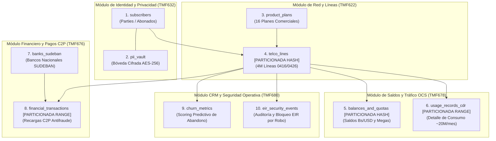

# 📚 Diccionario de Datos y Especificación de Tablas — Fase 1
## Proyecto: `AI_Movilnet_300926` — Telecomunicaciones Movilnet C.A.
**Motor de Persistencia:** PostgreSQL 15 Enterprise Partitioned (100% Open-Source / Zero-Cost)  
**Capa de Caché L1:** In-Memory Ring Buffer / Redis (< 2ms)  
**Escala:** 4,000,000 de Abonados Activos (Prefijos `0416` y `0426`)  
**Fecha:** 2026-09-30 | **Versión:** 1.0.0 Oficial  

---

## 1. Tipo de Base de Datos y Justificación Arquitectónica

### Motor Principal: PostgreSQL 15+ Enterprise Partitioned
* **Tipo:** Sistema Gestor de Base de Datos Relacional Objeto-Relacional (RDBMS), conforme con ACID.
* **Licenciamiento:** 100% Libre y de Código Abierto (PostgreSQL License / Zero-Cost), eliminando costos millonarios de licencias propietarias (Oracle Telecom, SAP HANA o IBM Db2).
* **Mecanismos Clave Empleados:**
  1. **Particionamiento Declarativo Nativo (Declarative Partitioning):**
     * **Hash Partitioning:** Para las tablas masivas de líneas telefónicas (`telco_lines`) y saldos (`balances_and_quotas`), distribuidas uniformemente en **8 particiones** mediante el hash del `msisdn`.
     * **Range Partitioning:** Para las tablas de series temporales de altísima volumetría (`usage_records_cdr` y `financial_transactions`), particionadas mensualmente por timestamp.
  2. **Índices de Alto Desempeño:**
     * Árboles **B-Tree** en claves primarias y campos de búsqueda de clientes.
     * Índices **BRIN (Block Range Index)** en series de tiempo de CDRs (ahorro de memoria RAM del 95%).
  3. **Seguridad y Criptografía Nativa (`pgcrypto` & `uuid-ossp`):**
     * Funciones criptográficas para cálculo de índices ciegos deterministas (HMAC-SHA256) y claves primarias universales UUIDv4.
* **Capa de Aceleración en Memoria (Caché L1):**
  * Buffer Ring en memoria / Redis para consultas de saldo frecuentes con TTL de 5 minutos, garantizando latencias de respuesta en WhatsApp inferiores a **2 milisegundos**.

---

## 2. Mapa Topológico de las 10 Tablas del Sistema

---

## 3. Especificación Detallada Campo por Campo de las 10 Tablas

---

### TABLA 1: `subscribers`
* **Estándar:** TM Forum TMF632 (Party Management).
* **Propósito:** Registro maestro de clientes legales de Movilnet. No almacena datos personales en texto plano.
* **Mecanismo:** Usa `blind_index_cid` para búsquedas directas en \(O(1)\) sin comprometer privacidad.

| Columna | Tipo de Dato | Restricciones | Valor por Defecto | Descripción de Negocio |
|:---|:---|:---:|:---:|:---|
| `id` | `UUID` | `PRIMARY KEY` | `gen_random_uuid()` | Identificador universal único del cliente |
| `blind_index_cid` | `VARCHAR(64)` | `NOT NULL, UNIQUE` | — | Hash ciego determinista HMAC-SHA256 de la Cédula (V/E/J) |
| `customer_type` | `VARCHAR(20)` | `NOT NULL, CHECK` | `'NATURAL'` | Tipo: `NATURAL`, `JURIDICO`, `GOBIERNO`, `EMPLEADO` |
| `status` | `VARCHAR(20)` | `NOT NULL, CHECK` | `'ACTIVO'` | Estado del abonado: `ACTIVO`, `SUSPENDIDO`, `INACTIVO`, `EN_MORA` |
| `segment` | `VARCHAR(30)` | `NOT NULL, CHECK` | `'PREPAGO_MASIVO'` | Segmento comercial: `PREPAGO_MASIVO`, `POSPAGO_CONECTA`, `CORPORATIVO_4GMAX`, `JUBILADO` |
| `created_at` | `TIMESTAMPTZ` | `NOT NULL` | `NOW()` | Fecha y hora de alta en el sistema |
| `updated_at` | `TIMESTAMPTZ` | `NOT NULL` | `NOW()` | Timestamp de última modificación |

---

### TABLA 2: `pii_vault`
* **Propósito:** Bóveda de Privacidad Cero-Conocimiento (Zero-Knowledge). Almacena los datos confidenciales cifrados simétricamente.
* **Seguridad:** Cifrado AES-256-GCM. Solo accesible mediante autorización y registro en bitácora.

| Columna | Tipo de Dato | Restricciones | Valor por Defecto | Descripción de Negocio |
|:---|:---|:---:|:---:|:---|
| `id` | `UUID` | `PRIMARY KEY` | `gen_random_uuid()` | Identificador único de la entrada en bóveda |
| `subscriber_id` | `UUID` | `NOT NULL, UNIQUE, FK` | — | Clave foránea a `subscribers(id)` con `ON DELETE CASCADE` |
| `encrypted_cid` | `TEXT` | `NOT NULL` | — | Cédula de Identidad encriptada en AES-256-GCM (Base64) |
| `encrypted_full_name` | `TEXT` | `NOT NULL` | — | Nombre y apellidos del abonado encriptados en AES-256-GCM |
| `encrypted_email` | `TEXT` | `NULL` | — | Correo electrónico encriptado en AES-256-GCM |
| `encrypted_address` | `TEXT` | `NULL` | — | Dirección fiscal/habitacional encriptada en AES-256-GCM |
| `key_version` | `VARCHAR(10)` | `NOT NULL` | `'v1'` | Versión de la llave criptográfica para soportar rotación de llaves |
| `updated_at` | `TIMESTAMPTZ` | `NOT NULL` | `NOW()` | Timestamp de actualización de datos de bóveda |

---

### TABLA 3: `product_plans`
* **Estándar:** TM Forum TMF620 (Product Catalog Management).
* **Propósito:** Catálogo de 16 productos oficiales de Movilnet con fijación en USD e indexación a tasa BCV.

| Columna | Tipo de Dato | Restricciones | Valor por Defecto | Descripción de Negocio |
|:---|:---|:---:|:---:|:---|
| `plan_id` | `VARCHAR(30)` | `PRIMARY KEY` | — | Código interno del plan (ej. `'PLAN_10GB_4GMAX'`) |
| `name` | `VARCHAR(100)` | `NOT NULL` | — | Nombre comercial (ej. `'Inteliplan 10GB 4GMAX'`) |
| `commercial_code` | `VARCHAR(20)` | `NOT NULL, UNIQUE` | — | Código CONATEL / Facturación (ej. `'MOV-INT-10G'`) |
| `category` | `VARCHAR(20)` | `NOT NULL, CHECK` | `'PREPAGO'` | Categoría: `PREPAGO`, `POSPAGO`, `EXTRA_DATOS`, `CORPORATIVO` |
| `data_quota_mb` | `INTEGER` | `NOT NULL` | `0` | Cupo de datos asignado en Megabytes (10240 MB = 10 GB) |
| `voice_minutes` | `INTEGER` | `NOT NULL` | `0` | Minutos de voz libres a cualquier operadora nacional |
| `sms_quota` | `INTEGER` | `NOT NULL` | `0` | Mensajes de texto SMS incluidos en el plan |
| `price_usd` | `NUMERIC(8,2)` | `NOT NULL` | — | Precio base de referencia indexado en dólares estadounidenses |
| `is_active` | `BOOLEAN` | `NOT NULL` | `TRUE` | Bandera de comercialización activa o plan descatalogado |
| `created_at` | `TIMESTAMPTZ` | `NOT NULL` | `NOW()` | Fecha de homologación comercial del plan |

---

### TABLA 4: `telco_lines` (PARTICIONADA HASH)
* **Estándar:** TM Forum TMF622 (Product Ordering & Inventory).
* **Estrategia:** `PARTITION BY HASH (msisdn)` en **8 particiones físicas** (`telco_lines_p00` a `p07`).
* **Propósito:** Representa las 4,000,000 de líneas móviles activas con prefijos venezolanos `0416` y `0426`.

| Columna | Tipo de Dato | Restricciones | Valor por Defecto | Descripción de Negocio |
|:---|:---|:---:|:---:|:---|
| `msisdn` | `VARCHAR(15)` | `NOT NULL` | — | Clave de partición. Número a 11 dígitos (`04161234567`) |
| `subscriber_id` | `UUID` | `NOT NULL, FK` | — | Enlace al titular legal en `subscribers(id)` |
| `imsi` | `VARCHAR(20)` | `NOT NULL` | — | International Mobile Subscriber Identity (734-06-...) |
| `iccid` | `VARCHAR(22)` | `NOT NULL` | — | Serial físico del chip SIM / perfil eSIM (19-20 dígitos) |
| `imei` | `VARCHAR(18)` | `NOT NULL` | — | TAC/Serial del equipo terminal registrado en la red |
| `plan_id` | `VARCHAR(30)` | `NOT NULL, FK` | — | Plan comercial activo vinculado en `product_plans(plan_id)` |
| `cell_id` | `VARCHAR(30)` | `NOT NULL` | `'CAR-CCS-ENB-001'` | Celda eNodeB LTE servidora habitual para telemetría 4GMAX |
| `status` | `VARCHAR(25)` | `NOT NULL, CHECK` | `'ACTIVO'` | Estado: `ACTIVO`, `SUSPENDIDO_SALDO`, `BLOQUEADO_ROBO`, `PORTADO_OUT` |
| `last_sim_swap_at` | `TIMESTAMPTZ` | `NOT NULL` | `NOW() - 30d` | Fecha de último SIM Swap. Si < 24h, bloquea operaciones sensibles |
| `created_at` | `TIMESTAMPTZ` | `NOT NULL` | `NOW()` | Fecha de asignación de la línea al abonado |
| `updated_at` | `TIMESTAMPTZ` | `NOT NULL` | `NOW()` | Timestamp de última actualización de estado |
| **PRIMARY KEY** | `(msisdn)` | `PARTITION KEY` | — | Garantiza unicidad e indexación B-Tree directa |

---

### TABLA 5: `balances_and_quotas` (PARTICIONADA HASH)
* **Estándar:** TM Forum TMF678 (Customer Bill & Usage).
* **Estrategia:** `PARTITION BY HASH (msisdn)` en **8 particiones físicas** (`balances_and_quotas_p00` a `p07`).
* **Propósito:** Fotografía en tiempo real del saldo monetario y bolsas de navegación del abonado.

| Columna | Tipo de Dato | Restricciones | Valor por Defecto | Descripción de Negocio |
|:---|:---|:---:|:---:|:---|
| `msisdn` | `VARCHAR(15)` | `NOT NULL` | — | Clave de partición. Línea celular asociada |
| `id` | `UUID` | `NOT NULL` | `gen_random_uuid()` | Identificador del registro de balance |
| `balance_ves` | `NUMERIC(14,2)` | `NOT NULL` | `0.00` | Saldo disponible en Bolívares (VES) |
| `balance_usd_equiv` | `NUMERIC(10,2)` | `NOT NULL` | `0.00` | Saldo equivalente en USD según tasa oficial BCV del día |
| `remaining_data_mb` | `INTEGER` | `NOT NULL` | `0` | Megabytes disponibles en la bolsa de navegación |
| `total_quota_mb` | `INTEGER` | `NOT NULL` | `0` | Cupo total de navegación contratado (MB) |
| `billing_cutoff_date` | `DATE` | `NOT NULL` | — | Fecha de corte del ciclo mensual de facturación |
| `days_overdue` | `INTEGER` | `NOT NULL` | `0` | Días de mora desde el corte (0 = al día) |
| `last_sync_at` | `TIMESTAMPTZ` | `NOT NULL` | `NOW()` | Marca de tiempo de la última sincronización con el OCS |
| **PRIMARY KEY** | `(msisdn, id)` | `PARTITION KEY` | — | Clave primaria compuesta obligatoria en partición Hash |

---

### TABLA 6: `usage_records_cdr` (PARTICIONADA RANGE MENSUAL)
* **Estándar:** TM Forum TMF678 (Call / Data Detail Records).
* **Estrategia:** `PARTITION BY RANGE (event_timestamp)` con particiones mensuales (`cdr_2026_09`, `cdr_2026_10`, etc.).
* **Propósito:** Telemetría de consumo de tráfico (~20 millones de filas mensuales). Usa índices BRIN para bajo consumo de RAM.

| Columna | Tipo de Dato | Restricciones | Valor por Defecto | Descripción de Negocio |
|:---|:---|:---:|:---:|:---|
| `event_timestamp` | `TIMESTAMPTZ` | `NOT NULL` | — | Clave de partición por rango mensual |
| `id` | `UUID` | `NOT NULL` | `gen_random_uuid()` | Identificador único del evento de tráfico |
| `msisdn` | `VARCHAR(15)` | `NOT NULL` | — | Línea que originó el consumo |
| `event_type` | `VARCHAR(20)` | `NOT NULL, CHECK` | — | Tipo: `DATA_4G`, `VOICE_CALL`, `SMS_OUT`, `RECHARGE` |
| `data_volume_bytes` | `BIGINT` | `NOT NULL` | `0` | Bytes consumidos (tráfico de subida + bajada) |
| `duration_seconds` | `INTEGER` | `NOT NULL` | `0` | Duración en segundos (para llamadas telefónicas) |
| `cell_id` | `VARCHAR(30)` | `NOT NULL` | — | Celda eNodeB LTE donde se cursó la sesión de datos |
| `status_code` | `VARCHAR(10)` | `NOT NULL` | `'SUCCESS'` | Código de terminación: `SUCCESS`, `DROPPED`, `CONGESTION` |
| **PRIMARY KEY** | `(event_timestamp, id)` | `PARTITION KEY` | — | Clave primaria compuesta sobre la partición temporal |

---

### TABLA 7: `banks_sudeban`
* **Propósito:** Catálogo maestro de entidades bancarias autorizadas por la Superintendencia de las Instituciones del Sector Bancario (SUDEBAN).

| Columna | Tipo de Dato | Restricciones | Valor por Defecto | Descripción de Negocio |
|:---|:---|:---:|:---:|:---|
| `bank_code` | `VARCHAR(4)` | `PRIMARY KEY` | — | Código compensatorio SUDEBAN (`0102` BDV, `0108` Provincial, `0105` Mercantil, `0134` Banesco) |
| `bank_name` | `VARCHAR(100)` | `NOT NULL` | — | Nombre legal de la institución financiera |
| `short_name` | `VARCHAR(30)` | `NOT NULL` | — | Nombre corto reconocido por el abonado (`BDV`, `Banesco`) |
| `c2p_enabled` | `BOOLEAN` | `NOT NULL` | `TRUE` | Indica si el banco soporta Cobro de Comercio a Personas (C2P) |
| `is_active` | `BOOLEAN` | `NOT NULL` | `TRUE` | Estado operacional del banco en el switch interbancario |

---

### TABLA 8: `financial_transactions` (PARTICIONADA RANGE MENSUAL)
* **Estándar:** TM Forum TMF676 (Payment Management).
* **Estrategia:** `PARTITION BY RANGE (executed_at)` mensual.
* **Propósito:** Registro inmutable de transacciones Pago Móvil C2P. Control de unicidad de referencia contra ataques de repetición.

| Columna | Tipo de Dato | Restricciones | Valor por Defecto | Descripción de Negocio |
|:---|:---|:---:|:---:|:---|
| `executed_at` | `TIMESTAMPTZ` | `NOT NULL` | `NOW()` | Clave de partición mensual |
| `reference_id` | `VARCHAR(64)` | `NOT NULL` | — | Número de referencia bancario único (Anti Replay Attack) |
| `msisdn` | `VARCHAR(15)` | `NOT NULL` | — | Línea beneficiaria de la recarga |
| `bank_code` | `VARCHAR(4)` | `NOT NULL, FK` | — | Banco emisor pagador en `banks_sudeban(bank_code)` |
| `amount_ves` | `NUMERIC(14,2)` | `NOT NULL` | — | Monto debitado en Bolívares soberanos |
| `amount_usd` | `NUMERIC(10,2)` | `NOT NULL` | — | Equivalente acreditado en USD según tasa BCV |
| `bcv_rate_applied` | `NUMERIC(10,4)` | `NOT NULL` | — | Tasa oficial del Banco Central de Venezuela congelada al instante de pago |
| `payment_method` | `VARCHAR(25)` | `NOT NULL, CHECK` | `'PAGO_MOVIL_C2P'` | Método: `PAGO_MOVIL_C2P`, `PORTAL_BDV`, `TRANSFERENCIA` |
| `status` | `VARCHAR(25)` | `NOT NULL, CHECK` | `'COMPLETADO'` | Estado: `PENDIENTE_OTP`, `COMPLETADO`, `RECHAZADO_SALDO`, `RECHAZADO_FRAUDE`, `RECHAZADO_DUPLICADO` |
| `payer_cid_masked` | `VARCHAR(20)` | `NOT NULL` | — | Cédula enmascarada del ordenante para auditoría (`V-18***019`) |
| **PRIMARY KEY** | `(executed_at, reference_id)` | `PARTITION KEY` | — | Clave compuesta sobre partición |

---

### TABLA 9: `churn_metrics`
* **Estándar:** TM Forum TMF680 (Recommendation & Retention Management).
* **Propósito:** Almacena el scoring de propensión al abandono calculado por la Suite 3 (`mcp_crm_predict_churn`).

| Columna | Tipo de Dato | Restricciones | Valor por Defecto | Descripción de Negocio |
|:---|:---|:---:|:---:|:---|
| `id` | `UUID` | `PRIMARY KEY` | `gen_random_uuid()` | Identificador de la evaluación analítica |
| `msisdn` | `VARCHAR(15)` | `NOT NULL` | — | Línea evaluada |
| `churn_score` | `NUMERIC(5,2)` | `NOT NULL, CHECK` | — | Probabilidad de fuga (0.00% a 100.00%) |
| `risk_segment` | `VARCHAR(20)` | `NOT NULL, CHECK` | — | Segmento: `LOW_RISK`, `MEDIUM_RISK`, `HIGH_RISK`, `CRITICAL_RISK` |
| `days_without_recharge`| `INTEGER` | `NOT NULL` | `0` | Días transcurridos desde el último pago |
| `complaints_count_30d` | `INTEGER` | `NOT NULL` | `0` | Reclamos o fallas de cobertura reportadas en últimos 30 días |
| `data_drop_pct` | `NUMERIC(5,2)` | `NOT NULL` | `0.00` | Caída porcentual de consumo de megas en los últimos 3 meses |
| `recommended_action` | `VARCHAR(50)` | `NOT NULL` | `'NO_ACTION'` | Acción preventiva (ej. `'BONUS_PACK_RELOAD'`, `'DISCOUNT_COUPON'`) |
| `coupon_code_offered` | `VARCHAR(30)` | `NULL` | — | Código del cupón asignado al abonado (ej. `'RET-4GMAX-25'`) |
| `evaluated_at` | `TIMESTAMPTZ` | `NOT NULL` | `NOW()` | Timestamp de ejecución del algoritmo predictivo |

---

### TABLA 10: `eir_security_events`
* **Propósito:** Trazabilidad inmutable de listas negras y bloqueos en el Equipment Identity Register (EIR) por hurto o fraude.

| Columna | Tipo de Dato | Restricciones | Valor por Defecto | Descripción de Negocio |
|:---|:---|:---:|:---:|:---|
| `ticket_id` | `VARCHAR(30)` | `PRIMARY KEY` | — | Código formal de ticket de seguridad (ej. `'TKT-THEFT-2026-09-001'`) |
| `msisdn` | `VARCHAR(15)` | `NOT NULL` | — | Número de línea afectada |
| `imei` | `VARCHAR(18)` | `NOT NULL` | — | Identificador del equipo terminal bloqueado en lista negra |
| `imsi` | `VARCHAR(20)` | `NOT NULL` | — | Identificador de la tarjeta SIM suspendida |
| `event_type` | `VARCHAR(25)` | `NOT NULL, CHECK` | — | Tipo: `THEFT_LOCK`, `SIM_SWAP_ALERT`, `UNAUTHORIZED_ACCESS`, `UNBLOCK_ORDER` |
| `reason` | `TEXT` | `NOT NULL` | — | Justificación técnica u operativa del bloqueo |
| `reporting_agent` | `VARCHAR(50)` | `NOT NULL` | `'ANTIGRAVITY_MCP_AGENT'` | Identificador del agente o subsistema que ordenó el bloqueo |
| `police_report_number`| `VARCHAR(50)` | `NULL` | — | Número de denuncia ante el CICPC / autoridades (opcional) |
| `created_at` | `TIMESTAMPTZ` | `NOT NULL` | `NOW()` | Fecha y hora exacta de registro del evento |

---

## 4. Resumen de Índices y Claves de Alto Rendimiento

1. **Índices Hash Directos:**
   * En `telco_lines(msisdn)` y `balances_and_quotas(msisdn)` para búsquedas inmediatas en \(O(1)\) por número telefónico.
2. **Índices Blind Index B-Tree:**
   * En `subscribers(blind_index_cid)` para búsquedas de cliente por Cédula venezolana sin revelar el dato confidencial.
3. **Índices BRIN (Block Range Index):**
   * En `usage_records_cdr(event_timestamp)` y `financial_transactions(executed_at)`: tamaño inferior a **2 MB** por cada 20 millones de filas.
4. **Índice Único Anti Replay Attack:**
   * En `financial_transactions(reference_id)` garantizando que ninguna referencia bancaria pueda ser reutilizada dos veces.
