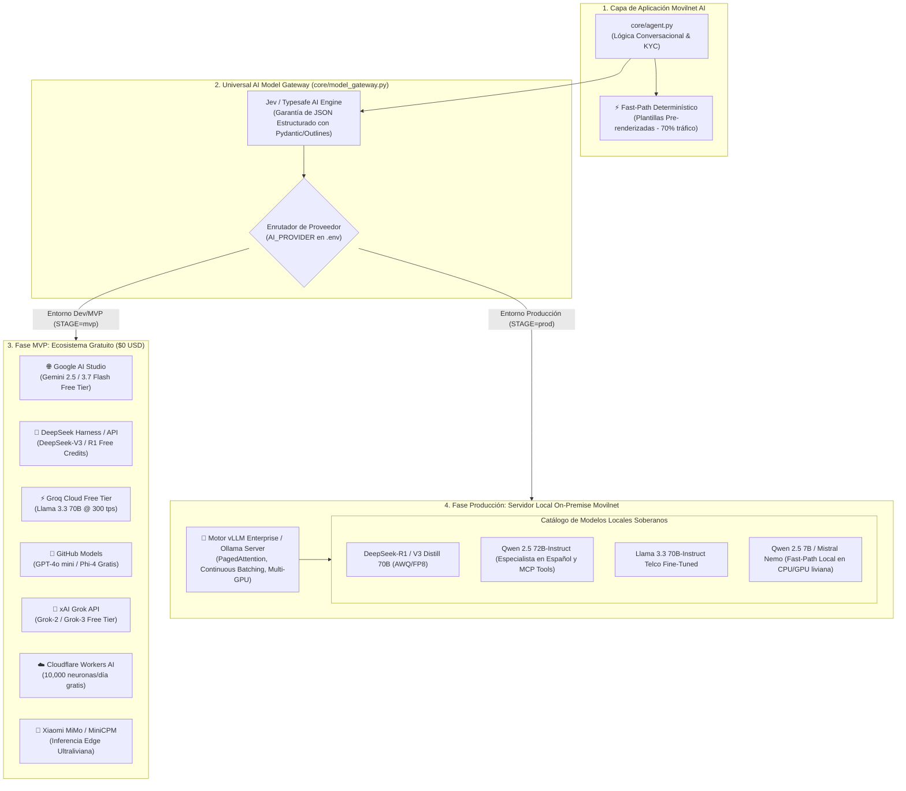

# 🧠 Estrategia de Modelos de IA: Del MVP Gratuito a Producción On-Premise
## Proyecto: `AI_Movilnet_300926` — Telecomunicaciones Movilnet C.A.
**Escala:** 4.000.000 de Abonados | **Gobernanza:** Soberanía de Datos y Optimización de Costos  
**Fecha:** 2026-09-30  
**Versión:** 1.0.0 Maestro  

---

## 1. Justificación de la Estrategia Dual de IA

Para desarrollar y desplegar el Asistente Inteligente de Movilnet con máxima eficiencia, se establece una **arquitectura desacoplada de modelos en dos fases**:

1. **Fase MVP / Prototipado / Validación ($0 Costo):**  
   Utilizar la capa de **proveedores gratuitos, sandboxes y APIs de cuota libre** (Google AI Studio, DeepSeek API, Grok Beta, Groq Free, GitHub Models, Cloudflare Workers AI) para construir, probar y refinar la lógica conversacional, validación KYC y herramientas MCP sin incurrir en costos operativos.

2. **Fase Producción Enterprise (Servidor Local On-Premise Telco):**  
   Una vez aprobado el MVP por la directiva de Movilnet, migrar el motor de inferencia a **servidores propios con GPUs en el datacenter de Movilnet**. Esto garantiza:
   * **Soberanía y Secreto de Telecomunicaciones (CONATEL / Ley de Telecomunicaciones):** Cero fuga de PII o saldos hacia nubes internacionales.
   * **Costo Marginal Cero por Token:** Con modelos Open-Weights (DeepSeek-V3/R1, Qwen 2.5 72B, Llama 3.3 70B) corriendo sobre **vLLM / Ollama**, el costo no escala con el número de consultas.
   * **Latencia Ultra-Baja (<300 ms):** Tráfico 100% en la red interna de Movilnet.

---

## 2. Diagrama de la Capa de Abstracción Multi-Modelo (Model Gateway)



---

## 3. Catálogo Comparativo de Modelos para la Fase MVP ($0 Costo)

| Proveedor / Motor | Modelo Recomendado | Cuota / Ventaja en MVP | Caso de Uso en Movilnet AI |
|:---|:---|:---|:---|
| **Google AI Studio** | Gemini 2.5 / 3.7 Flash | 15 RPM gratis / 1M tokens/min con KV-Cache | Consultas conversacionales complejas y reclamos |
| **DeepSeek API / Harness** | DeepSeek-V3 / DeepSeek-R1 | 5M tokens gratis de bienvenida / Razonamiento profundo | Auditoría de contratos y resolución de discrepancias |
| **Groq Cloud** | Llama 3.3 70B-Versatile | Cuota gratuita diaria / 300 tokens/segundo | Respuestas en lenguaje natural con latencia <250ms |
| **GitHub Models** | GPT-4o-mini / Phi-4 | 150 requests/día gratis con token personal | Validación de pruebas unitarias y generación de sintéticos |
| **xAI Grok** | Grok-2 / Grok-3 Beta | Créditos promocionales de prueba | Comprensión de jerga y modismos venezolanos |
| **Cloudflare Workers AI** | Qwen 2.5 7B / Llama 3.1 8B | 10.000 neuronas/día gratis | Micro-clasificador de intenciones (Fast-Path) |
| **Xiaomi MiMo / MiniCPM** | MiniCPM-V 2.6 / MiMo-7B | Open-weight liviano para edge | Lectura de recibos o comprobantes de pago (OCR) |
| **Jev Typesafe AI / Instructor** | Abstracción Typesafe | Garantía de schema JSON estricto | Conexión con herramientas MCP sin errores de parsing |

---

## 4. Arquitectura de Inferencia Local On-Premise (Fase Producción)

Cuando Movilnet apruebe el pase a producción, el sistema se conecta al **cluster local** de la operadora:

### 4.1 Especificación de Hardware y Motor de Inferencia
* **Servidor Recomendado:** 2 a 4 GPUs NVIDIA L40S (48GB) o RTX 4090 / A100 / H100.
* **Motor:** **vLLM (v0.6+)** con soporte de `PagedAttention`, cuantización FP8/AWQ y OpenAI-Compatible API en `http://localhost:8000/v1`.
* **Rendimiento:** 150 a 400 tokens/seg por GPU con concurrencia de hasta 120 sesiones simultáneas.

### 4.2 Selección de Modelos Open-Weights para Producción Local
1. **Qwen 2.5 72B-Instruct:**  
   * *Por qué:* El mejor modelo open-source actual para seguimiento de instrucciones en español y llamada estricta a herramientas MCP (*Function Calling*).
2. **DeepSeek-R1-Distill-Llama-70B:**  
   * *Por qué:* Capacidad de razonamiento superior para auditar facturas complejas y cálculo de deudas en mora.
3. **Qwen 2.5 7B / Mistral-Nemo 12B (Fast-Path Local):**  
   * *Por qué:* Inferencia en <40 milisegundos en servidores CPU/GPU ligeros para clasificación de intenciones antes de consultar Redis.

---

## 5. Implementación del Conector Universal (`core/model_gateway.py`)

Para que el cambio entre modelos gratuitos de MVP y servidores locales sea **transparente (cero refactorización de código)**, se define el siguiente estándar de configuración en `.env`:

```bash
# ==========================================================
# CONFIGURACIÓN DEL MODEL GATEWAY MOVILNET AI
# ==========================================================

# Modo actual: 'mvp' (Gratuitos) | 'production_local' (On-Premise)
AI_STAGE=mvp

# 1. En Modo MVP (Gratuito)
AI_PROVIDER=aistudio           # Opciones: aistudio, deepseek, groq, github, grok, cloudflare
AISTUDIO_API_KEY=tu_api_key_aqui
DEEPSEEK_API_KEY=tu_api_key_aqui
GROQ_API_KEY=tu_api_key_aqui
GITHUB_TOKEN=tu_github_token_aqui

# 2. En Modo Producción Local (On-Premise vLLM)
# AI_STAGE=production_local
# AI_PROVIDER=vllm_local
# VLLM_BASE_URL=http://10.0.100.50:8000/v1
# LOCAL_MODEL_NAME=Qwen/Qwen2.5-72B-Instruct-AWQ
```
