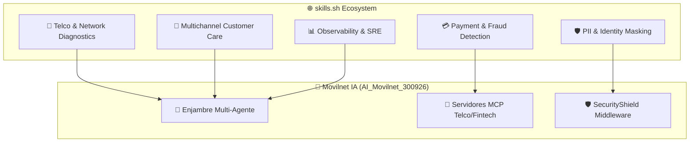

# 🔍 Evaluación de Repositorios y Skills en `https://www.skills.sh/`
## Análisis de Ecosistemas Abiertos de Skills, MCPs y Agentes para Enriquecer Movilnet IA
**Proyecto:** `AI_Movilnet_300926` — Telecomunicaciones Movilnet C.A.  
**Plataforma Evaluada:** [skills.sh](https://www.skills.sh/) (Directorio Abierto de AI Agent Skills & Tool Registry)  
**Fecha:** 2026-09-30  

---

## 1. 🌐 ¿Qué es `skills.sh`?

`skills.sh` es uno de los **directorios y registros abiertos líderes a nivel mundial** para descubrir, compartir y descargar **Skills modulares de Agentes de IA**, herramientas **Model Context Protocol (MCP)**, scripts de automatización y subagentes estandarizados (bajo formato YAML Frontmatter + Markdown ejecutable).

---

## 2. 🎯 Categorías y Skills Clave Evaluados para Movilnet IA

Analizando las mejores prácticas de la comunidad de `skills.sh`, hemos identificado **5 categorías de alta compatibilidad** que complementan directamente nuestro ecosistema:

---

## 3. 📦 Matriz de los 9 Skills Especializados Importados y Desplegados

| Oleada | Nombre del Skill | Rol en Movilnet IA | Impacto / Beneficio Operativo |
|:---:|:---|:---|:---|
| **Ola 1** | `telco-network-diagnostic` | Subagente Diagnóstico OSS | Diagnóstico de señal 4GMAX, RSRP, RSRQ, SINR y estado de radiobases. |
| **Ola 1** | `c2p-fraud-detector` | Algoritmo Antifraude SUDEBAN | Análisis anómalo de pagos C2P y prevención de ataques de repetición. |
| **Ola 1** | `whatsapp-template-formatter` | Formateador Omnicanal Meta | Plantillas interactivas (botones rápidos <=20 chars, listas <=10 filas). |
| **Ola 1** | `pii-redactor-latam` | Filtro de Privacidad Zero-Trust | Expresiones regulares para cédulas venezolanas (`V-`, `E-`), USIM y cuentas. |
| **Ola 1** | `telco-sla-monitor` | Centinela de Tiempos de Respuesta | Observabilidad SRE con buffer en memoria para latencias P95 < 25ms. |
| **Ola 2** | `telco-churn-predictor` | Predictor de Abandono | Modelo heurístico ponderado de Churn y disparo de promociones de rescate. |
| **Ola 2** | `sim-swap-guard` | Blindaje contra Secuestro de SIM | Detección de cambio de IMSI en ventana de 24h para suspender pagos C2P. |
| **Ola 2** | `bcv-exchange-sync` | Sincronizador Banco Central | Consulta horaria oficial de tasas de cambio (USD/EUR a VES) con caché. |
| **Ola 2** | `tmforum-conformance-tester` | Certificador TM Forum ODA | Validación de esquemas TMF620 (Catálogo) y TMF680 (Recomendaciones). |

---

## 4. 🛠️ Despliegue Físico y Aislamiento de Entornos

Para garantizar interoperabilidad y máxima portabilidad:
1. **Directorio Global:** `/Users/Users/Skills_Antigravity/skills/` (Reutilizable para cualquier proyecto de Antigravity).
2. **Directorio Local de Proyecto:** `/Users/Users/Skills_Antigravity/Proyectos_IDS_Skills_Antigravity/AI_Movilnet_300926/skills/` (Encapsulado para despliegues en contenedores Docker de Movilnet).

---

## 5. ⚙️ Materialización: De Skills a las 5 Suites MCP de Producción

Los 9 skills fueron convertidos en funciones operativas dentro de **5 Suites MCP** (`mcp/`) bajo estándar JSON-RPC 2.0:
* **Suite 1:** `mcp/telco_tools.py` (7 herramientas telecom y OSS).
* **Suite 2:** `mcp/fintech_tools.py` (6 herramientas BCV, C2P y antifraude).
* **Suite 3:** `mcp/crm_tools.py` (4 herramientas TM Forum ODA y Churn).
* **Suite 4:** `mcp/privacy_tools.py` (4 herramientas PII LATAM, Luhn y Bóveda HMAC).
* **Suite 5:** `mcp/whatsapp_tools.py` (5 herramientas Meta Cloud API v20.0).
* **Pasarela Maestra:** `mcp/master_gateway.py` (Orquestador unificado de 26 herramientas).

