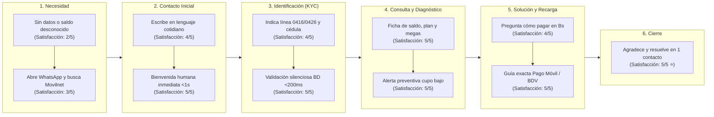
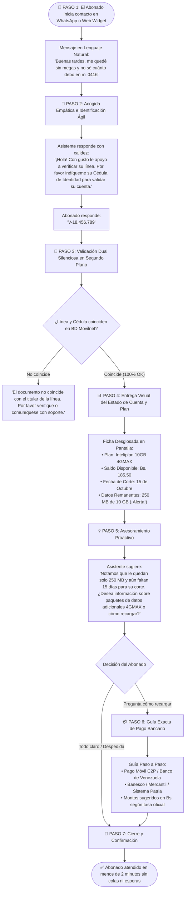

# 📱 Experiencia del Usuario (Customer Journey Map): Asistente Movilnet AI
## Proyecto: `AI_Movilnet_300926` — Telecomunicaciones Movilnet C.A.
**Perspectiva:** Abonado Móvil Prepago / Pospago (Prefijos `0416` / `0426`)  
**Canal Principal:** WhatsApp Business API / Web Chat Widget de Autogestión  
**Fecha:** 2026-09-30  
**Versión:** 1.0.0 Oficial  

---

## 1. Mapa de Experiencia del Usuario (Customer Journey Map)



---

## 2. Diagrama de Flujo Paso a Paso de la Interacción del Usuario



---

## 3. Simulación Visual de la Conversación (Mockup de Pantalla WhatsApp)

A continuación se muestra la representación visual exacta de cómo se ve la conversación en la pantalla del teléfono del usuario:

```text
┌──────────────────────────────────────────────────────────────┐
│  🟢 Telecomunicaciones Movilnet  ✓ Cuenta Oficial Verificada  │
│  En línea                                                    │
├──────────────────────────────────────────────────────────────┤
│                                                              │
│  [14:15] Usuario:                                            │
│  Hola buenas tardes, me quedé sin internet en el teléfono y   │
│  no sé cuánto debo en mi 0416, ¿me pueden ayudar?            │
│                                                              │
│  [14:15] 🤖 Asistente Movilnet AI:                           │
│  ¡Buenas tardes! Es un placer saludarle. Claro que sí, con   │
│  gusto le ayudo a verificar el estatus de su línea y sus     │
│  datos de navegación.                                        │
│                                                              │
│  Para proteger la privacidad de su cuenta, por favor         │
│  confírmeme su número de Cédula de Identidad (ej. V-12345678)│
│  y su número de línea completo.                              │
│                                                              │
│  [14:16] Usuario:                                            │
│  Cédula V-18456789 y el número es 04161234567               │
│                                                              │
│  [14:16] 🤖 Asistente Movilnet AI:                           │
│  ¡Gracias por confirmar sus datos, Sr(a). Rodríguez!         │
│  Hemos validado su cuenta exitosamente.                      │
│                                                              │
│  📱 *ESTADO DE SU SERVICIO MOVILNET*                         │
│  ━━━━━━━━━━━━━━━━━━━━━━━━━━━━━━                              │
│  • *Línea:* 0416-1234567 (Modalidad Prepago)                 │
│  • *Plan Activo:* Inteliplan 10GB 4GMAX                      │
│  • *Estatus de Línea:* ACTIVA                                │
│                                                              │
│  💵 *ESTADO DE CUENTA:*                                      │
│  • *Saldo Disponible:* Bs. 45,20                             │
│  • *Próxima Fecha de Corte:* 15 de Octubre                   │
│                                                              │
│  📊 *CONSUMO DE DATOS:*                                      │
│  • *Cupo Total:* 10.00 GB                                    │
│  • *Datos Consumidos:* 9.75 GB (97%)                         │
│  • *Datos Remanentes:* 250 MB ⚠️ (Cupo casi agotado)         │
│  • *Minutos a todas las operadoras:* 420 min libres          │
│  • *SMS Libres:* 350 SMS                                     │
│  ━━━━━━━━━━━━━━━━━━━━━━━━━━━━━━                              │
│                                                              │
│  💡 *Sugerencia:* Le quedan pocos megas para su navegación   │
│  habitual. Puede recargar saldo para adquirir un paquete     │
│  adicional de datos 4GMAX o esperar su fecha de corte.       │
│                                                              │
│  ¿Desea conocer los canales para recargar saldo en Bolívares │
│  o los paquetes de datos disponibles?                        │
│                                                              │
│  [14:17] Usuario:                                            │
│  Sí por favor, ¿cómo puedo recargar por Pago Móvil del BDV?  │
│                                                              │
│  [14:17] 🤖 Asistente Movilnet AI:                           │
│  Es muy sencillo y el saldo se acredita de inmediato:        │
│                                                              │
│  🏦 *RECARGA POR BANCO DE VENEZUELA (BDV):*                  │
│  1. Ingrese a BDV en línea con su usuario y clave.           │
│  2. Vaya a *Pagos* ➔ *Pago de Servicios*.                    │
│  3. Seleccione *Tipo de Servicio:* Telecomunicaciones.       │
│  4. Elija *Servicio a Pagar:* Movilnet Prepago.              │
│  5. Ingrese el número `04161234567` y el monto deseado.      │
│                                                              │
│  📲 También puede pagar desde la App BDV por *Pago Móvil*    │
│  o por las taquillas bancarias de Mercantil y Banesco.       │
│                                                              │
│  ¿Hay algo más en lo que le pueda colaborar hoy?             │
│                                                              │
│  [14:18] Usuario:                                            │
│  Listo, ya entendí todo perfecto. ¡Muchas gracias!           │
│                                                              │
│  [14:18] 🤖 Asistente Movilnet AI:                           │
│  ¡Ha sido un placer atenderle! Gracias por ser parte de      │
│  Movilnet. Recuerde que este canal está activo las 24 horas. │
│  ¡Que tenga una excelente tarde! 📶🇻🇪                         │
└──────────────────────────────────────────────────────────────┘
```

---

## 4. Los 4 Pilares de la Experiencia del Usuario (UX/CX)

1. **Cero Fricción en la Entrada:** El usuario no navega por menús numéricos ni opciones forzadas. Escribe como conversa con un amigo y el sistema comprende la intención.
2. **Claridad Inmediata de Cifras:** Los datos clave (saldo en Bs., gigas restantes, fecha de corte) se presentan en un bloque limpio, estructurado y fácil de leer en pantallas móviles.
3. **Seguridad Transparente:** La verificación de identidad (cédula + línea) se realiza en un solo paso respetuoso, sin solicitar contraseñas complejas que frustren al abonado.
4. **Resolución en Menos de 2 Minutos:** Entre la primera pregunta y la solución completa del caso transcurren menos de 120 segundos, reduciendo drásticamente la carga de llamadas al *Call Center* de Movilnet.
