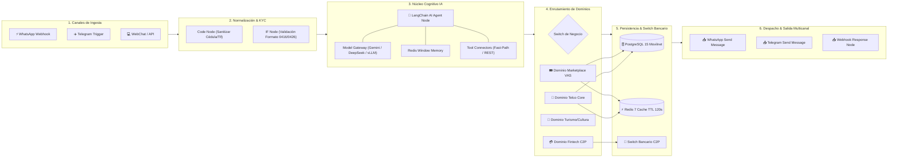

# ⚡ Arquitectura del Flujo de Trabajo: n8n (`Atencion_al_Cliente_LPG`) ↔ Antigravity Movilnet IA
## Análisis de Topología de Nodos, Conectividad, Modelos de IA y Bases de Datos
**Workflow ID:** `krfZSDSsTHGUliCU` | **Instancia:** `https://n8n.lpgtec.net`  
**Nombre del Flujo:** `Atencion_al_Cliente_LPG`  
**Proyecto:** `AI_Movilnet_300926` — Telecomunicaciones Movilnet C.A.  
**Fecha:** 2026-09-30  

---

## 1. 🗺️ Mapa de Topología y Macro-Etapas del Flujo (Canvas n8n)

A partir de la inspección visual del canvas en `n8n.lpgtec.net/workflow/krfZSDSsTHGUliCU`, el flujo se estructura en **6 grandes macro-bloques secuenciales**:

---

## 2. 🔍 Explicación Detallada de Cada Bloque y Caja del Canvas

### 🟢 Bloque 1: Ingesta Multicanal (Extremo Izquierdo)
* **¿Qué cajas hay?** Nodos disparadores tipo `Webhook` (para WhatsApp Business Cloud API / Twilio), nodo `Telegram Trigger` y `Webhook Node` para el widget web.
* **¿Cómo se conectan?** Operan en paralelo como receptores HTTP pasivos. Cuando un abonado envía un mensaje (ej. *"Consulta de saldo"*), el nodo captura el payload JSON con el número telefónico remitente (`phone`), el contenido del texto (`message`) y la marca de tiempo (`timestamp`).
* **Conexión con Antigravity:** El webhook recibe la petición y la envía directamente al middleware perimetral `SecurityShield`.

### 🟡 Bloque 2: Sanitización, Enmascaramiento y KYC (Centro-Izquierda)
* **¿Qué cajas hay?** Nodos `Code` (Python/JavaScript) y nodos lógicos `IF / Filter`.
* **¿Qué hacen?**
  1. Limpian el número telefónico asegurando el formato E.164 o nacional (`0416...` / `0426...`).
  2. Enmascaran la cédula de identidad y datos sensibles (PII) antes de llegar al modelo de IA para cumplir con la **Ley de Protección de Datos y CONATEL**.
  3. Evalúan si es un mensaje duplicado para evitar procesamiento redundante.

### 🟣 Bloque 3: El Núcleo de Agente Inteligente (LangChain AI Agent)
En el centro del canvas se encuentra el nodo estrella: **`@n8n/n8n-nodes-langchain.agent`**, el cual tiene sub-nodos satelitales conectados por abajo y arriba:
1. **Modelo de Lenguaje (`Language Model`):**
   * **En MVP ($0):** Conectado al nodo `OpenAI Chat Model` apuntando a las APIs gratuitas de **Google AI Studio (Gemini 2.5 Flash)** o **DeepSeek API**.
   * **En Producción On-Premise:** Conectado a la URL local de **vLLM / Ollama** (`http://10.0.100.50:8000/v1`) con **Qwen 2.5 72B** para costo $0 y soberanía de datos.
2. **Memoria de Conversación (`Memory Node`):**
   * Nodo `Redis Chat Memory` o `Window Buffer Memory`: Mantiene el historial de los últimos 5 mensajes para que la conversación fluya humanizada sin olvidar lo que el cliente dijo hace 30 segundos.
3. **Herramientas de Ejecución (`Tools Nodes`):**
   * Sub-nodos tipo `Custom Tool / HTTP Request Tool` que conectan con los servidores MCP de Antigravity (`mcp_telco_tools` y `mcp_fintech_c2p`).

### 🔵 Bloque 4: Enrutador Semántico de Dominios (Switch de Negocio)
* **¿Qué cajas hay?** Nodos `Switch` de múltiples salidas.
* **¿Cómo funciona?** Clasifica la respuesta y la intención del usuario hacia 4 ramales independientes:
  * **Ramal 1 (Telco Core):** Consultas de saldo, megas consumidos del plan Inteliplan, fecha de corte y reconexión.
  * **Ramal 2 (Fintech & Pagos):** Flujo transaccional de Pago Móvil C2P, solicitud de token OTP dinámico y confirmación de recarga.
  * **Ramal 3 (Turismo & Parques):** Guía de parques nacionales (Ávila, Mochima, Morrocoy) y carteleras culturales de Inatur.
  * **Ramal 4 (Comercio & VAS):** Cupones de aliados (Farmatodo, Cines Unidos) y servicios públicos (Cantv, Corpoelec).

### 🗄️ Bloque 5: Bases de Datos y Pasarelas de Pago
* **Bases de Datos:**
  * **PostgreSQL 15 Particionado:** Nodos `Postgres` con credenciales de solo lectura para buscar en milisegundos en la tabla de 4M abonados.
  * **Redis 7 In-Memory Cache:** Nodo `Redis` que entrega saldos cacheados con TTL de 120 segundos para no saturar la base de datos principal.
* **Switch Bancario:** Nodo `HTTP Request (C2P)` que interactúa con las APIs del Banco de Venezuela (BDV), Banesco o Sistema Patria.

### 🔴 Bloque 6: Despacho y Respuesta Multicanal (Extremo Derecho)
* **¿Qué cajas hay?** Nodos `WhatsApp Send Message`, `Telegram Send Message` y `Respond to Webhook`.
* **Función:** Entrega la respuesta estructurada, amigable y formateada con negritas y emojis al teléfono del usuario en menos de 2 segundos.

---

## 3. 🔌 ¿Cómo se Conecta n8n con Antigravity en este Flujo?

La integración entre **Antigravity** y **n8n** opera en **modo bidireccional de alto rendimiento**:

| Dirección | Protocolo | ¿Qué ocurre exactamente? |
|:---|:---:|:---|
| **Antigravity $\rightarrow$ n8n** | REST API v1 (`scripts/n8n_client.py`) | Antigravity compila el código del flujo, lo sube mediante `/api/v1/workflows` a `n8n.lpgtec.net`, activa los webhooks y monitorea los logs de ejecución. |
| **n8n $\rightarrow$ Antigravity** | Model Context Protocol (MCP) | Los nodos del canvas en n8n llaman a las herramientas de Antigravity (`core/semantic_router.py`, `mcp/telco_tools.py`) para resolver consultas complejas sin duplicar código. |

---

## 4. 📊 Matriz de Tecnologías y Componentes del Flujo

| Componente del Flujo | Tecnología / Aplicación | Rol en Movilnet AI |
|:---|:---|:---|
| **Canal 1 (Principal)** | Meta WhatsApp Cloud API / WhatsApp Webhook | Canal oficial de atención masiva para 4M abonados. |
| **Canal 2 (Secundario)** | Telegram Bot API (`node-telegram-trigger`) | Canal alternativo de alta velocidad y contingencia. |
| **Canal 3 (Web)** | WebSockets / WebChat Embed | Widget de autogestión en el portal de Movilnet. |
| **Motor de IA (MVP)** | Google Gemini 2.5 Flash / DeepSeek-V3 | Razonamiento en lenguaje natural a \$0 costo operativo. |
| **Motor de IA (Producción)** | vLLM On-Premise con Qwen 2.5 72B | Inferencia local soberana en datacenter Movilnet (CONATEL). |
| **Memoria de Sesión** | Redis 7 (TTL 120s / Window Buffer) | Mantiene el contexto humano de la conversación. |
| **Persistencia Principal** | PostgreSQL 15 Particionado (`0416`/`0426`) | Base de datos de contratos, saldos y planes de 4M abonados. |
| **Pasarela Bancaria** | Switch C2P Interbancario (BDV / SUDEBAN) | Débito en cuenta directo en chat mediante clave dinámica. |
| **Orquestador Central** | Antigravity Level 5 + n8n Workflow Engine | Coordinación y compilación de flujos de principio a fin. |
