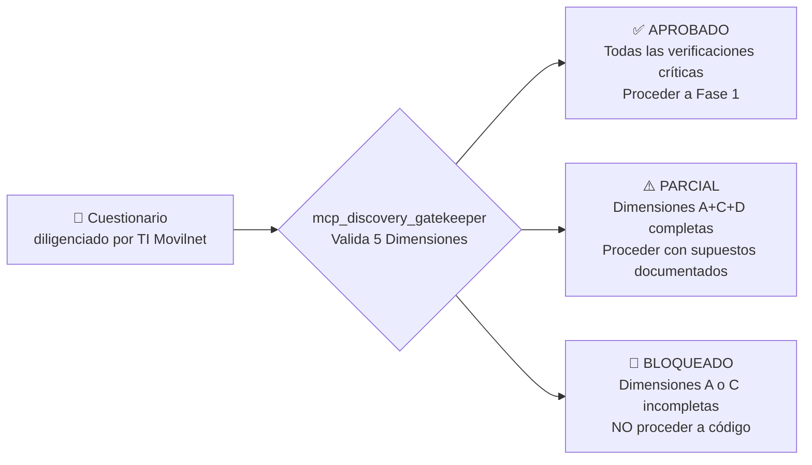

# 🔍 Documento de Fase 0: Levantamiento de Información y Descubrimiento Telco
## Proyecto: `AI_Movilnet_300926` — Telecomunicaciones Movilnet C.A.
**Metodología:** TM Forum Frameworx (eTOM / ODA) + TOGAF ADM Fases A-B + Antigravity Inception  
**Versión:** 1.1.0 (Actualización Capítulo 8)  
**Fecha:** 2026-09-30  
**Estado:** 🔍 ACTIVO — Suite de herramientas certificada. En espera de respuesta del equipo TI de Movilnet.  
**Certificado de Suite:** [`FASE0-CERT-6CFBDE45D91A`](file:///Users/Users/Skills_Antigravity/Proyectos_IDS_Skills_Antigravity/AI_Movilnet_300926/reports/CERTIFICATION_FASE0_6CFBDE45D91A.json)  

---

## 1. Justificación y Propósito

La arquitectura de software empresarial y los marcos TM Forum exigen **no escribir código ni modelos de datos sin antes relevar la realidad técnica del cliente**. Este documento consolida:

1. Las herramientas de descubrimiento disponibles (Skills, MCP, Scripts).
2. La Matriz de 5 Dimensiones de preguntas críticas para el equipo TI de Movilnet.
3. El estado actual de la información recopilada.
4. El protocolo Gatekeeper para autorizar el paso a Fase 1.

> [!IMPORTANT]
> Ningún componente de `db/`, `api/`, `core/` o `docker/` puede ser construido hasta que el **Gatekeeper** retorne `APROBADO ✅` basado en las respuestas reales del cliente.

---

## 2. Suite de Herramientas de Fase 0 (Certificada)

### 2.1 Skill Global

| Componente | Ubicación | Alcance | Estado |
|:---|:---|:---:|:---:|
| `telco-discovery-inception` v1.0.0 | [`skills/telco-discovery-inception/SKILL.md`](file:///Users/Users/Skills_Antigravity/skills/telco-discovery-inception/SKILL.md) | 🌐 Global | ✅ Activo |

### 2.2 Servidor MCP — 5 Herramientas (JSON-RPC 2.0)

| Herramienta MCP | Función | Estado |
|:---|:---|:---:|
| `mcp_discovery_audit_perimeter` | Diagnóstico WAF/SSL/Firewall/Latencia del endpoint del cliente | ✅ Certificado |
| `mcp_discovery_inspect_db_schema` | Introspección de BD SQLite/PostgreSQL entregada por el cliente | ✅ Certificado |
| `mcp_discovery_parse_api_spec` | Parseo de contratos OpenAPI 3.x / Swagger 2.0 / Postman | ✅ Certificado |
| `mcp_discovery_generate_matrix` | Generador de cuestionario Markdown para equipo TI | ✅ Certificado |
| `mcp_discovery_gatekeeper` | Certificador de completitud — emite APROBADO/PARCIAL/BLOQUEADO | ✅ Certificado |

**Servidor:** [`mcp/discovery_tools.py`](file:///Users/Users/Skills_Antigravity/Proyectos_IDS_Skills_Antigravity/AI_Movilnet_300926/mcp/discovery_tools.py)

### 2.3 Scripts CLI

| Script | Uso | Estado |
|:---|:---|:---:|
| [`scripts/audit_perimeter_waf.py`](file:///Users/Users/Skills_Antigravity/Proyectos_IDS_Skills_Antigravity/AI_Movilnet_300926/scripts/audit_perimeter_waf.py) | `python3 scripts/audit_perimeter_waf.py --url <URL>` | ✅ |
| [`scripts/generate_discovery_matrix.py`](file:///Users/Users/Skills_Antigravity/Proyectos_IDS_Skills_Antigravity/AI_Movilnet_300926/scripts/generate_discovery_matrix.py) | `python3 scripts/generate_discovery_matrix.py --client "Movilnet Venezuela"` | ✅ |

### 2.4 Suite de Pruebas y Certificación

| Componente | Resultado | Certificado |
|:---|:---:|:---:|
| [`tests/test_discovery_mcp.py`](file:///Users/Users/Skills_Antigravity/Proyectos_IDS_Skills_Antigravity/AI_Movilnet_300926/tests/test_discovery_mcp.py) — L1-L4 | **41/41 ✅** | `FASE0-CERT-6CFBDE45D91A` |

### 2.5 Repositorios GitHub de Referencia

| Repositorio | Estándar | Uso en el Proyecto |
|:---|:---:|:---|
| [tmforum-rand/Open_API_And_Data_Model](https://github.com/tmforum-rand/Open_API_And_Data_Model) | TM Forum | Catálogo productos (TMF620), facturación (TMF678), clientes (TMF632), pagos (TMF676) |
| [schemacrawler/SchemaCrawler](https://github.com/schemacrawler/SchemaCrawler) | Open Source | Ingeniería inversa de BD reales del cliente |
| [stoplightio/prism](https://github.com/stoplightio/prism) | Open Source | Simulación (mock) de APIs del cliente antes de la integración real |
| [microsoft/playwright](https://playwright.dev/) | Open Source | Web discovery con JS rendering si el portal supera el bloqueo WAF |

---

## 3. Hallazgo Perimetral: Portal Web Movilnet — WAF Detectado

> [!WARNING]
> Durante la auditoría perimetral ejecutada con `mcp_discovery_audit_perimeter`, el portal `www.movilnet.com.ve` devolvió **HTTP 403 — Request not allowed by policy**. Se detectó un **WAF (Web Application Firewall)** activo que bloquea peticiones de origen externo.

**Implicaciones para la integración:**
- ❌ No es posible extracción web automatizada del catálogo público sin acceso controlado.
- ✅ **Acción requerida:** Solicitar al equipo TI de Movilnet una de las siguientes opciones:
  1. **IP Whitelist** del servidor del asistente en el WAF.
  2. **VPN Site-to-Site** hacia la red interna de Movilnet.
  3. **API Gateway dedicada** con credenciales de integración.

---

## 4. Matriz de Levantamiento — 5 Dimensiones Técnicas

*(Cuestionario completo disponible en [`CUESTIONARIO_LEVANTAMIENTO_MOVILNET_VENEZUELA_2026-09-30.md`](file:///Users/Users/Skills_Antigravity/Proyectos_IDS_Skills_Antigravity/AI_Movilnet_300926/docs/CUESTIONARIO_LEVANTAMIENTO_MOVILNET_VENEZUELA_2026-09-30.md))*

### Dimensión A: Sistemas de Facturación y CRM (BSS/OSS)
| Pregunta | Estado | Respuesta Confirmada |
|:---|:---:|:---|
| Motor de facturación activo (Ericsson/Huawei/Oracle/Amdocs/otro) | ⏳ Pendiente | — |
| Modalidad de acceso (réplica BD / API / Data Warehouse) | ⏳ Pendiente | — |
| Saldos prepago: ¿OCS tiempo real o por lotes? | ⏳ Pendiente | — |
| CRM activo para gestión de clientes | ⏳ Pendiente | — |

### Dimensión B: APIs e Interfaces de Integración
| Pregunta | Estado | Respuesta Confirmada |
|:---|:---:|:---|
| API Gateway corporativo existente (Kong/Apigee/WSO2/MuleSoft) | ⏳ Pendiente | — |
| Protocolos expuestos (REST/SOAP/gRPC/Kafka) | ⏳ Pendiente | — |
| Endpoints disponibles (getBalance/getPlan/validateSubscriber) | ⏳ Pendiente | — |
| Ambiente sandbox para pruebas de integración | ⏳ Pendiente | — |
| Resolución acceso WAF (IP Whitelist / VPN / API Key) | ⏳ Pendiente | — |

### Dimensión C: Autenticación y KYC del Abonado
| Pregunta | Estado | Respuesta Confirmada |
|:---|:---:|:---|
| Datos mínimos para validar identidad (Teléfono+Cédula / OTP / PIN) | ⏳ Pendiente | — |
| Servicio centralizado de identidad (LDAP/SSO) | ⏳ Pendiente | — |
| Número máximo de intentos fallidos y tiempo de bloqueo | ⏳ Pendiente | — |

### Dimensión D: Catálogo Comercial Vigente
| Pregunta | Estado | Respuesta Confirmada |
|:---|:---:|:---|
| Planes de datos activos (nombres, GB, Bs., minutos, SMS) | ⏳ Pendiente | — |
| Canales de pago habilitados (BDV/Banesco/Patria/PagoMóvil) | ⏳ Pendiente | — |
| Ciclo de facturación pospago y política de suspensión por mora | ⏳ Pendiente | — |

### Dimensión E: Seguridad, Gobernanza y Regulatorio
| Pregunta | Estado | Respuesta Confirmada |
|:---|:---:|:---|
| Providencias CONATEL aplicables al asistente virtual | ⏳ Pendiente | — |
| Tiempo de retención de registros de auditoría | ⏳ Pendiente | — |
| Restricciones de geolocalización de datos (Venezuela vs. cloud) | ⏳ Pendiente | — |
| Datos que NUNCA puede exponer el asistente | ⏳ Pendiente | — |

---

## 5. Criterio de Certificación — Gatekeeper



**Verificaciones Críticas Obligatorias para APROBADO:**
1. ✅/❌ Motor de Facturación (Billing Engine) identificado.
2. ✅/❌ Mecanismo de Autenticación KYC definido.
3. ✅/❌ Catálogo de planes documentado con cuotas exactas.
4. ✅/❌ Modelo de exposición de datos clarificado (API/réplica/DW).

---

## 6. Próximas Acciones de Fase 0

```bash
# 1. Enviar cuestionario al equipo TI de Movilnet
# Archivo: docs/CUESTIONARIO_LEVANTAMIENTO_MOVILNET_VENEZUELA_2026-09-30.md

# 2. Una vez diligenciado, agregar respuestas en este documento (sección 4)

# 3. Ejecutar el Gatekeeper para certificar si se puede proceder a Fase 1
python3 -c "
from mcp.discovery_tools import gatekeeper_validate
import json
result = gatekeeper_validate('docs/FASE_0_LEVANTAMIENTO_INFORMACION.md')
print(json.dumps(result, indent=2, ensure_ascii=False))
"

# 4. Si APROBADO: iniciar Fase 1
# python3 scripts/generate_discovery_matrix.py  (para el resumen técnico)
# → Proceder con db/schema.sql basado en datos reales del cliente
```
