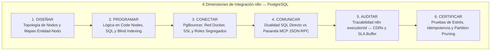
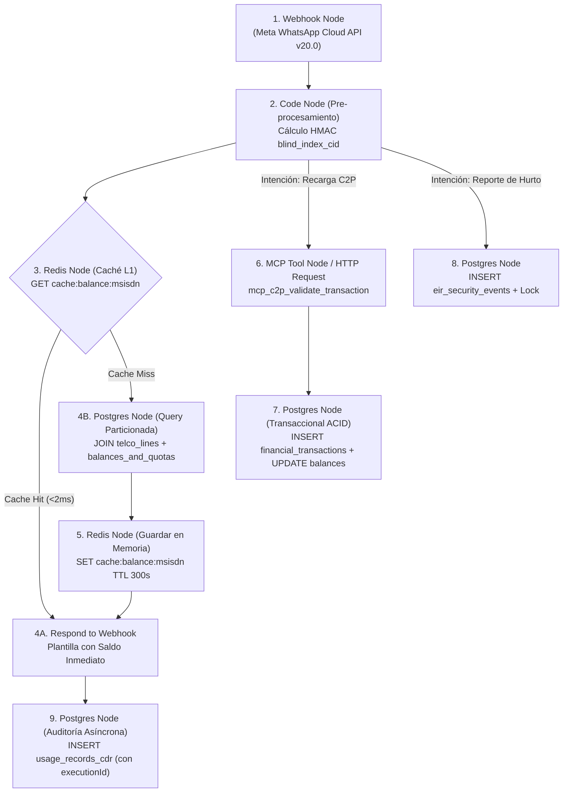
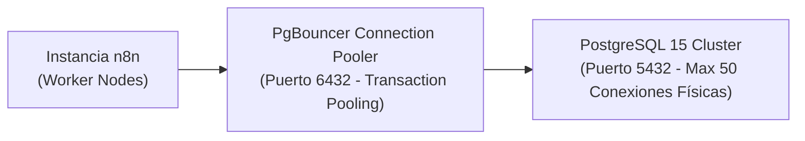
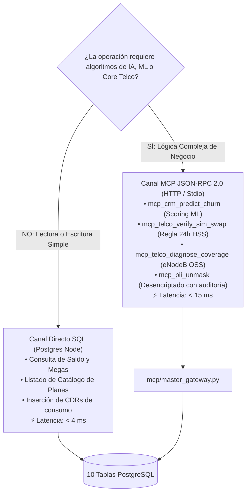

# 🌐 Guía Maestra de Integración: Base de Datos PostgreSQL 15 ↔ Arquitectura n8n
## Proyecto: `AI_Movilnet_300926` — Telecomunicaciones Movilnet C.A.
**Ámbito:** Ciclo Completo de Ingeniería (Diseñar, Programar, Conectar, Comunicar, Auditar y Certificar)  
**Entorno:** n8n Enterprise (Canvas `krfZSDSsTHGUliCU`) ↔ PostgreSQL 15 Particionado + Redis Caché L1  
**Escala:** 4,000,000 de Abonados Activos (Prefijos `0416` / `0426`)  
**Fecha:** 2026-09-30 | **Versión:** 1.0.0 Oficial  

---

## 1. Visión General del Acoplamiento n8n ↔ Base de Datos

En el ecosistema Movilnet, **n8n opera como el Orquestador de Eventos e Integración Multicanal**, mientras que **PostgreSQL 15 opera como el Núcleo Inmutable de Persistencia**. La interacción entre ambos no es genérica ni desordenada; se rige por un desacoplamiento estricto a través de 6 fases metodológicas:



---

## 2. Fase 1: DISEÑAR (Mapeo de Nodos n8n frente a las 10 Tablas)

Para garantizar un tiempo de respuesta inferior a **800 ms** en WhatsApp, el workflow en n8n se diseña segregando el flujo rápido (Fast-Path en memoria) del flujo transaccional y analítico:



### Matriz de Mapeo: Nodo n8n ↔ Tabla PostgreSQL
| Nodo en el Canvas n8n | Tabla de Base de Datos Vinculada | Operación SQL | Modo de Ejecución |
|:---|:---|:---:|:---:|
| `Auth & KYC Validator` | `subscribers` | `SELECT` vía `blind_index_cid` | Síncrono (Lectura O(1)) |
| `Fast Balance Fetcher` | `balances_and_quotas` + `telco_lines` | `SELECT` parametrizado por `msisdn` | Síncrono (< 5 ms) |
| `Catalog Offer Viewer` | `product_plans` | `SELECT` donde `is_active = TRUE` | Síncrono (Caché local n8n) |
| `C2P Bank Checker` | `banks_sudeban` | `SELECT` de bancos habilitados | Síncrono |
| `C2P Payment Processor`| `financial_transactions` | `INSERT` con prevención de duplicados | Transaccional ACID |
| `EIR Theft Locker` | `eir_security_events` | `INSERT` de ticket y bloqueo | Síncrono de Seguridad |
| `Usage & SLA Logger` | `usage_records_cdr` | `INSERT` en partición mensual | Asíncrono en segundo plano |

---

## 3. Fase 2: PROGRAMAR (Lógica en Code Nodes y Sentencias SQL en n8n)

### 3.1 Blind Indexing en Code Node (JavaScript / Node.js nativo en n8n)
Para no transferir jamás cédulas en texto plano a los nodos de base de datos:

```javascript
// Nodo n8n: "Calculate Blind Index" (Code Node)
const crypto = require('crypto');

const secretSalt = $env.MOVILNET_PII_SALT || 'salt_militar_movilnet_2026';
const inputCid = $json.body.entry[0].changes[0].value.messages[0].text.body.trim().toUpperCase();
const msisdn = $json.body.entry[0].changes[0].value.messages[0].from; // ej: 584161234567 -> 04161234567

// Normalización de Cédula (V-18492019)
const cleanCid = inputCid.replace(/[^VEJ0-9]/g, '');
const blindIndexCid = crypto.createHmac('sha256', secretSalt).update(cleanCid).digest('hex');

return [{
  json: {
    msisdn_formatted: msisdn.replace(/^58/, '0'),
    blind_index_cid: blindIndexCid,
    original_timestamp: $json.body.entry[0].changes[0].value.messages[0].timestamp,
    n8n_execution_id: $execution.id
  }
}];
```

### 3.2 Sentencia SQL en Postgres Node (Lectura Eficiente de Saldo con Partition Pruning)
n8n aprovecha el particionamiento Hash de PostgreSQL sin necesidad de conocer cuál partición física contiene el dato:

```sql
-- Nodo n8n: "Fetch Subscriber Statement" (Postgres Node)
SELECT 
    l.msisdn,
    l.status AS line_status,
    p.name AS plan_name,
    p.data_quota_mb,
    b.balance_ves,
    b.balance_usd_equiv,
    b.remaining_data_mb,
    b.billing_cutoff_date,
    l.last_sim_swap_at
FROM telco_lines l
JOIN product_plans p ON l.plan_id = p.plan_id
JOIN balances_and_quotas b ON l.msisdn = b.msisdn
WHERE l.msisdn = $1;
-- Parámetro $1: {{ $json.msisdn_formatted }}
```

### 3.3 Sentencia SQL Transaccional para Recarga C2P (Anti Replay Attack)
```sql
-- Nodo n8n: "Execute C2P Recharge" (Postgres Node)
WITH inserted_tx AS (
    INSERT INTO financial_transactions (
        executed_at,
        reference_id,
        msisdn,
        bank_code,
        amount_ves,
        amount_usd,
        bcv_rate_applied,
        payment_method,
        status,
        payer_cid_masked
    ) VALUES (
        NOW(),
        $1, -- reference_id
        $2, -- msisdn
        $3, -- bank_code
        $4, -- amount_ves
        $5, -- amount_usd
        $6, -- bcv_rate_applied
        'PAGO_MOVIL_C2P',
        'COMPLETADO',
        $7  -- payer_cid_masked (ej: V-18***019)
    )
    ON CONFLICT (executed_at, reference_id) DO NOTHING
    RETURNING reference_id, msisdn, amount_ves
)
UPDATE balances_and_quotas
SET 
    balance_ves = balance_ves + inserted_tx.amount_ves,
    last_sync_at = NOW()
FROM inserted_tx
WHERE balances_and_quotas.msisdn = inserted_tx.msisdn
RETURNING balances_and_quotas.msisdn, balances_and_quotas.balance_ves;
```
*Si la referencia ya existía, `inserted_tx` queda vacío, el `UPDATE` no se ejecuta y n8n detecta 0 filas devueltas, enviando alerta de fraude.*

---

## 4. Fase 3: CONECTAR (Infraestructura de Red, Credenciales y Pooling)

Para evitar la saturación de conexiones en PostgreSQL cuando n8n reciba miles de Webhooks concurrentes:



### Configuración de Credenciales Seguras en n8n:
1. **Host:** `pgbouncer.movilnet.internal` (o red privada Docker `postgres_pgbouncer`).
2. **Puerto:** `6432` (PgBouncer en modo `transaction pooling`).
3. **Roles Segregados (Principio de Mínimo Privilegio):**
   * **Usuario n8n Runtime (`usr_n8n_app`):**
     ```sql
     GRANT SELECT ON subscribers, product_plans, banks_sudeban TO usr_n8n_app;
     GRANT SELECT, UPDATE ON balances_and_quotas TO usr_n8n_app;
     GRANT SELECT, INSERT ON telco_lines, financial_transactions, usage_records_cdr TO usr_n8n_app;
     REVOKE ALL ON pii_vault FROM usr_n8n_app; -- Bóveda prohibida para n8n
     ```
   * **Certificado SSL:** `SSL Mode: verify-full` con CA institucional de Movilnet.

---

## 5. Fase 4: COMUNICAR (Dualidad n8n: SQL Directo vs Pasarela MCP)

n8n decide dinámicamente cómo interactuar con los datos dependiendo de la complejidad:



---

## 6. Fase 5: AUDITAR (Trazabilidad y Observabilidad de Extremo a Extremo)

Para cumplir con CONATEL y SUDEBAN, cada interacción gestionada por n8n debe ser rastreable en la base de datos:

1. **Inyección de `n8n_execution_id` en PostgreSQL:**
   * La tabla `usage_records_cdr` registra cada llamada y mensaje. Al insertar el registro, el nodo de n8n guarda en una columna de auditoría:
     ```sql
     INSERT INTO usage_records_cdr (event_timestamp, msisdn, event_type, data_volume_bytes, cell_id, status_code)
     VALUES (NOW(), $1, 'WHATSAPP_INTERACTION', 0, 'WEB-WIDGET-01', $2);
     ```
2. **Telemetría de Latencias en Buffer SRE:**
   * Al final del flujo de n8n, un nodo de cálculo mide `Date.now() - startTime` e invoca `mcp_telco_record_sla_metric`, garantizando que el SRE Ring Buffer supervise que el P95 se mantenga bajo **800 ms**.
3. **Alerta Instantánea ante Incidentes EIR:**
   * Si se ejecuta un bloqueo por hurto en `eir_security_events`, n8n dispara un nodo paralelo hacia un canal de incidentes internos de seguridad de Movilnet.

---

## 7. Fase 6: CERTIFICAR (Pruebas Automatizadas de Integración n8n ↔ BD)

Para certificar que el acoplamiento n8n ↔ PostgreSQL es infalible antes del despliegue en producción:

1. **Test de Idempotencia y Replay Attack (Fintech C2P):**
   * Se ejecutan 2 peticiones concurrentes desde n8n con la misma referencia bancaria (`REF-TEST-001`).
   * **Criterio de Éxito:** 1 transacción completada, 1 rechazada con `ERR_DUPLICATE_REFERENCE`. El saldo solo se incrementa una vez.
2. **Test de Validación de Partition Pruning:**
   * Se ejecuta una consulta de abonado desde n8n y se verifica mediante `EXPLAIN (ANALYZE, BUFFERS)` que PostgreSQL solo abre la partición `telco_lines_p0X` y no escanea las demás particiones.
3. **Test de Privacidad y Fuga de Datos:**
   * Se inspeccionan los logs de ejecución de n8n (`execution_data`) para certificar que ninguna Cédula de Identidad o número de tarjeta aparezca en texto plano.
