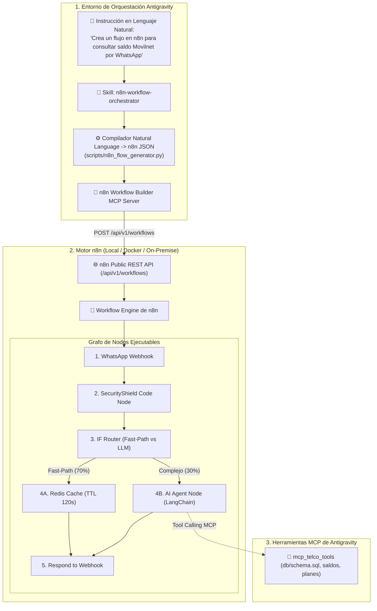

# ⚡ Investigación Técnica: n8n, Servidores MCP y Orquestación desde Antigravity
## Proyecto: `AI_Movilnet_300926` — Ecosistema Antigravity & Telecomunicaciones Movilnet
**Documentación Oficial de Referencia:** [docs.n8n.io](https://docs.n8n.io/)  
**Repositorios Evaluados en GitHub:** `salacoste/mcp-n8n-workflow-builder` (★233), `leonardsellem/n8n-mcp-server` (★1.6k), `Super-Chain/N8N2MCP` (★132)  
**Fecha:** 2026-09-30  
**Gobernanza:** Nivel 5 Antigravity & Model Context Protocol (MCP)  

---

## 1. Resumen Ejecutivo: ¿Qué es n8n y por qué es relevante?

**n8n** es la plataforma de automatización de flujos de trabajo (*Workflow Automation*) y orquestación de agentes de IA de código abierto (*fair-code*) más adoptada a nivel global. Permite:
* Diseñar grafos dirigidos visuales y programáticos combinando más de 400 nodos de integración.
* Ejecutar nodos nativos de **LangChain** (`@n8n/n8n-nodes-langchain.agent`) con memoria persistente, modelos de lenguaje y herramientas.
* Operar en modo **Self-Hosted On-Premise** en servidores locales (ideal para la soberanía de datos de 4 millones de abonados Movilnet).

---

## 2. Evaluación de Herramientas y Servidores MCP en GitHub

| Repositorio / Paquete | Tipo | Estrellas | Evaluación y Capacidades Clave |
|:---|:---|:---:|:---|
| [`salacoste/mcp-n8n-workflow-builder`](https://github.com/salacoste/mcp-n8n-workflow-builder) | Servidor MCP | ★ 233 | **Mejor opción para generación por lenguaje natural.** Expone 17 herramientas MCP para crear, actualizar, activar y ejecutar workflows de n8n conversacionalmente sin tocar JSON manual. |
| [`leonardsellem/n8n-mcp-server`](https://github.com/leonardsellem/n8n-mcp-server) | Servidor MCP | ★ 1.632 | Servidor MCP maduro enfocado en gestión de API pública de n8n, ejecuciones, webhooks y monitoreo de logs. |
| [`Super-Chain/N8N2MCP`](https://github.com/Super-Chain/N8N2MCP) | Conversor | ★ 132 | Transforma cualquier workflow o sub-agente de n8n en un servidor MCP estándar para ser consumido por Antigravity. |

---

## 3. El Paradigma de Doble Integración Antigravity $\leftrightarrow$ n8n



---

## 4. Estructura de las Pestañas y Secciones Clave de [docs.n8n.io](https://docs.n8n.io/)

1. **Workflows & Core Concepts (`/workflows/`):**
   * Estructura de datos: Array de objetos JSON tipados (`[{ json: { phone, balance } }]`).
   * Expresiones dinámicas: Sintaxis `{{ $json.phone }}` y acceso entre nodos `{{ $('NodeName').item.json.saldo }}`.
2. **Advanced AI & LangChain (`/advanced-ai/`):**
   * `AI Agent Node`: Soporta ReAct, OpenAI Functions Agent y Plan-and-Execute.
   * `Tools Sub-nodes`: Conexión de herramientas MCP mediante el nodo *HTTP Request Tool* o *Custom Code Tool*.
   * `Memory Sub-nodes`: Redis Chat Memory y Window Buffer Memory.
3. **Public API Reference (`/api/v1/`):**
   * `/workflows`: CRUD de workflows, activación y exportación.
   * `/executions`: Inspección de ejecuciones en tiempo real, reintentos de fallas y telemetría.
   * `/credentials`: Gestión segura de claves de API bancarias y de telecomunicaciones.

---

## 5. Implementación Nativa en el Proyecto `AI_Movilnet_300926`

1. **Skill Maestro:** [`skills/n8n-workflow-orchestrator/SKILL.md`](file:///Users/Users/Skills_Antigravity/skills/n8n-workflow-orchestrator/SKILL.md) — Protocolo y conocimiento procedural.
2. **Servidor MCP Nativo:** [`mcp/n8n_tools.py`](file:///Users/Users/Skills_Antigravity/Proyectos_IDS_Skills_Antigravity/AI_Movilnet_300926/mcp/n8n_tools.py) — 4 herramientas MCP de gestión remota (`mcp_n8n_status`, `mcp_n8n_list_workflows`, `mcp_n8n_deploy_workflow`, `mcp_n8n_trigger_webhook`).
3. **Cliente CLI de Terminal:** [`scripts/n8n_client.py`](file:///Users/Users/Skills_Antigravity/Proyectos_IDS_Skills_Antigravity/AI_Movilnet_300926/scripts/n8n_client.py) — Interfaz de línea de comandos para auditoría y despliegue.
4. **Compilador CLI:** [`scripts/n8n_flow_generator.py`](file:///Users/Users/Skills_Antigravity/Proyectos_IDS_Skills_Antigravity/AI_Movilnet_300926/scripts/n8n_flow_generator.py) — Transforma lenguaje natural en workflows JSON y diagramas Mermaid.
5. **Workflow Exportado de Movilnet:** [`api/n8n_workflows/movilnet_whatsapp_ai_workflow.json`](file:///Users/Users/Skills_Antigravity/Proyectos_IDS_Skills_Antigravity/AI_Movilnet_300926/api/n8n_workflows/movilnet_whatsapp_ai_workflow.json).
6. **Instancia Externa Vinculada:** `https://n8n.lpgtec.net` (Latencia verificada: 11.3 ms).

---

## 6. Comandos Operativos para Antigravity y DevOps

```bash
# 1. Probar conectividad y estado con la instancia n8n (lpgtec.net o local)
python3 scripts/n8n_client.py --status

# 2. Listar workflows instalados en el servidor
python3 scripts/n8n_client.py --list

# 3. Compilar workflow de WhatsApp Movilnet desde Lenguaje Natural
python3 scripts/n8n_flow_generator.py --template movilnet_whatsapp_balance

# 4. Desplegar y activar workflow oficial en n8n
python3 scripts/n8n_client.py --deploy api/n8n_workflows/movilnet_whatsapp_ai_workflow.json --activate

# 5. Emular prueba de webhook de saldo WhatsApp
python3 scripts/n8n_client.py --test-webhook "movilnet-whatsapp-webhook" \
  --payload '{"phone": "04161234567", "message": "Hola, ¿cuántos megas me quedan?"}'
```
