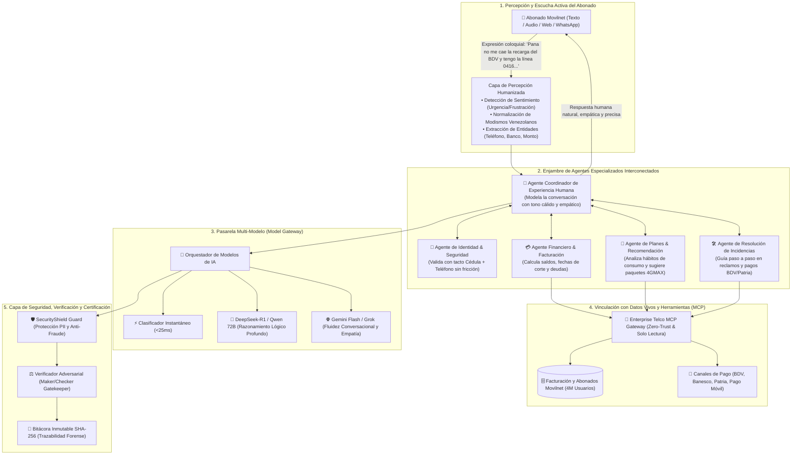

# 🤝 Manifiesto de Inteligencia Artificial Humanizada e Interactiva
## Proyecto: `AI_Movilnet_300926` — Telecomunicaciones Movilnet C.A.
**Principio Rector:** *"No es un bot de respuestas automáticas; es una Aplicación Cognitiva Interactiva con Experiencia de Comunicación Natural y Empatía Humana."*  
**Fecha:** 2026-09-30  
**Gobernanza:** Arquitectura Multi-Agente & Multi-Modelo Certificada  

---

## 1. Declaración de Identidad y Diferenciación

| Dimensión | Bot Tradicional / IVR Rígido | Aplicación Cognitiva Interactiva Movilnet AI |
|:---|:---|:---|
| **Paradigma** | Árbol de decisiones estático, menús numéricos ("Marque 1 para...") | **Razonamiento en lenguaje natural fluido, contextual y humano**. |
| **Flexibilidad** | Si el usuario no usa palabras exactas, falla ("No te he entendido"). | **Comprende modismos venezolanos, faltas ortográficas, audios y contexto implícito**. |
| **Memoria** | Amnesia entre turnos; el usuario debe repetir sus datos. | **Memoria conversacional episódica y seguimiento de objetivos**. |
| **Inteligencia** | Reglas IF/ELSE cableadas en código. | **Malla Multi-Modelo (DeepSeek, Gemini, Qwen, Grok, Llama) colaborando en tiempo real**. |
| **Empatía** | Respuestas frías, robóticas y genéricas. | **Tono empático, resolutivo, respetuoso y corporativo oficial de Movilnet**. |
| **Integración** | Desconectado de la realidad del cliente o datos estáticos. | **Fundamentado en datos vivos (Grounding en tiempo real vía MCP seguro)**. |

---

## 2. Diagrama de la Red Cognitiva y Humana Interconectada (Cognitive Mesh)

---

## 3. Las 5 Dimensiones de la Experiencia Conversacional Humana

### 1. Escucha Activa y Detección de Estado Emocional
El sistema analiza el sentimiento del abonado. Si detecta molestia por una línea suspendida o recarga no acreditada, la respuesta **prioriza la empatía y la tranquilidad** antes de dar datos fríos:
> *"Comprendo perfectamente su preocupación, señor Rodríguez. Permítame revisar de inmediato el estado de su recarga para darle una solución..."*

### 2. Conversación Contextual sin Repetición (Memoria Episódica)
El usuario no tiene que volver a decir su cédula o problema si cambia de tema momentáneamente. La aplicación mantiene el hilo:
* *Usuario:* "¿Y qué incluye mi plan?"
* *Asistente:* *"Su plan Inteliplan 10GB incluye 10 GB de datos, 1.000 minutos y 500 SMS. Actualmente le quedan 4.2 GB disponibles."*
* *Usuario:* "¿Y si quiero recargar 5 dólares?"
* *Asistente:* *"Al cambio oficial del BCV serían Bs. 185,50. Puede cancelarlos directamente por Pago Móvil BDV o Banesco..."*

### 3. Asesoramiento Consultivo (No solo consulta pasiva)
La IA no se limita a mostrar un número; **asesora proactivamente**:
* Si el abonado consume sus datos antes de la fecha de corte, le sugiere el paquete de datos extra más conveniente.
* Si tiene fecha de corte próxima, le recuerda los canales para no quedar suspendido.

### 4. Conexión Certificada y Verificada con los Sistemas Telco
Todo lo que la IA responde proviene de **datos reales certificados a través del Enterprise MCP Gateway**. Jamás inventa saldos ni condiciones contractuales.

### 5. Multi-Modelo Simbiótico
* **Gemini / Grok:** Para la naturalidad del lenguaje, la empatía y la cultura venezolana.
* **DeepSeek / Qwen 72B:** Para el razonamiento estricto de cálculos tarifarios, facturas y fechas de corte.
* **vLLM On-Premise:** Para la soberanía y privacidad de los 4 millones de abonados en producción.
