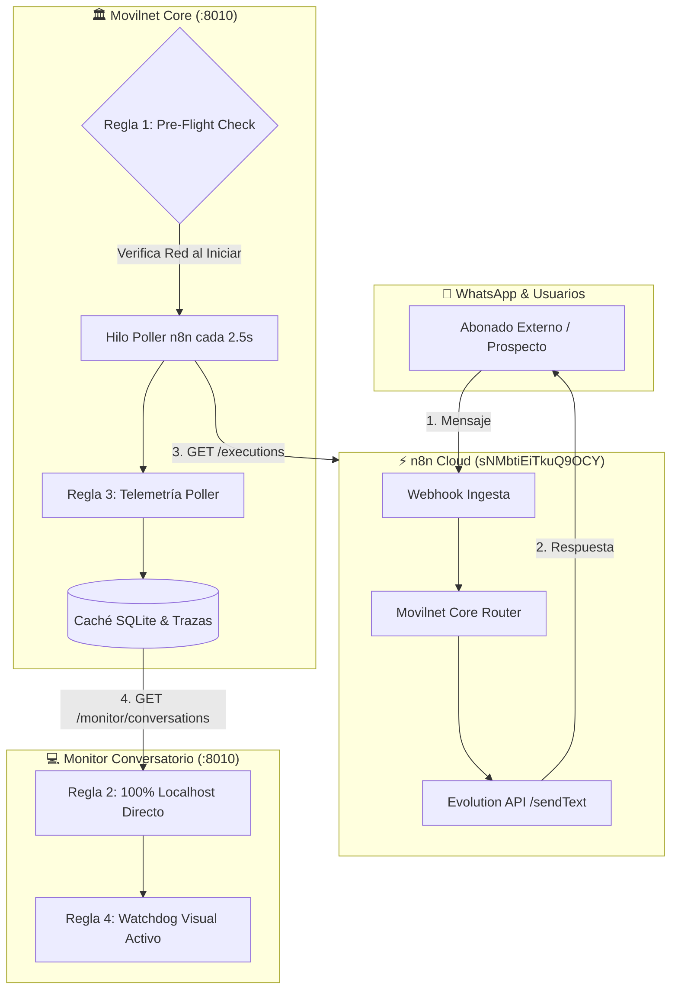

# 🛡️ Reglas de Blindaje Técnico: Telemetría en Vivo & Dashboard Conversatorio

**Proyecto:** Telecomunicaciones Movilnet C.A. — AI_Movilnet_300926  
**Ecosistema:** Movilnet Core Microservice (:8010) ↔ n8n Cloud ↔ WhatsApp ↔ Dashboard Conversatorio  
**Estado:** VIGENTE / CERTIFICACIÓN MILITAR ACTIVA  
**Fecha de Emisión:** Octubre 2026  

---

## 1. Justificación y Análisis de Causa Raíz

Durante la fase de supervisión interactiva del flujo omnicanal:
$$\text{Usuario (WhatsApp)} \longleftrightarrow \text{n8n Cloud} \longleftrightarrow \text{Movilnet Core (:8010)} \longleftrightarrow \text{Dashboard Conversatorio}$$

Se identificaron dos vulnerabilidades de diseño operacional que provocaron la desincronización transitoria del monitor en vivo:

1. **Aislamiento de Red del Proceso Backend (Sandbox Restrictivo):**  
   Al instanciarse el servicio `api/service.py` desde terminales con perfiles de aislamiento por defecto (sandbox sin red), las llamadas salientes del hilo demonio `_background_n8n_poller` hacia `https://n8n.lpgtec.net/api/v1/executions` eran bloqueadas a nivel de socket. La captura ciega de excepciones (`except Exception: pass`) impedía que el sistema alertara del bloqueo.
2. **Interferencia de Timeout hacia Nube Externa en Frontend (`conversatorio.html`):**  
   El monitor ejecutándose en `localhost:8010` ejecutaba una consulta paralela a la nube de Render (`https://movilnet-core.onrender.com`) con un timeout rígido de 2,000 ms. Al sobrepasar Render dicho límite, el aborto de red provocaba cancelaciones o sobreescritura de cachés locales con datos desactualizados.

---

## 2. Las 5 Reglas Inviolables de Blindaje



---

### 🛡️ Regla 1: Soberanía de Red del Microservicio Local (Pre-Flight Obligatorio)
* **Principio:** Ningún microservicio de Movilnet Core que dependa de sincronización omnicanal puede operar a ciegas sin verificar su conectividad saliente.
* **Implementación:**
  1. En el arranque de `api/service.py` (función `main()`), se ejecuta obligatoriamente un chequeo de pre-vuelo (*Pre-Flight Check*) contra `https://n8n.lpgtec.net/api/v1/executions?limit=1`.
  2. Si el proceso está confinado en un sandbox sin red o existe un fallo DNS/SSL, se emite una alerta crítica visual inmediata:
     ```bash
     🚨 ALERTA CRÍTICA: Proceso sin acceso saliente de red.
        Causa: Ejecución dentro de un Sandbox aislado sin acceso a internet.
        Acción: Inicie el servicio ejecutando scripts/reiniciar_todo_limpio.command
     ```
  3. Toda ejecución autónoma por parte de agentes o scripts debe invocar siempre el entorno sin aislamiento de red para permitir HTTPS saliente a n8n Cloud.

---

### 🛡️ Regla 2: Soberanía Local del Dashboard (`conversatorio.html`)
* **Principio:** Cuando el dashboard se consume en entorno local (`localhost` o `127.0.0.1`), la única fuente de verdad es el microservicio local en el puerto `:8010`.
* **Prohibición:** Queda terminantemente vetado realizar peticiones concurrentes a servidores externos (Render / Nubes Públicas) mientras el usuario opera en `localhost`.
* **Manejo de Caídas:** Si el microservicio local `:8010` no responde, la UI no debe colgarse ni llamar a la nube externa; debe mostrar inmediatamente el estado:
  ```html
  🟡 RECONECTANDO CON MOVILNET CORE (:8010)...
  ```
  y si persiste la desconexión, guiar al operador a ejecutar `scripts/reiniciar_todo_limpio.command`.

---

### 🛡️ Regla 3: Anti-Capturas Ciegas & Telemetría Viva del Poller (Pilar IV Universal)
* **Principio:** Cero excepciones silenciadas. La salud del poller debe ser observable en tiempo real.
* **Estructura de Datos Obligatoria (`ConversationTraceEngine`):**
  ```python
  self._n8n_poller_telemetry = {
      "is_connected": bool,
      "last_sync_attempt_utc": str,
      "last_successful_sync_utc": str,
      "consecutive_failures": int,
      "last_error": Optional[str],
      "total_synced_in_session": int,
      "network_status": "ONLINE" | "BLOCKED_OR_OFFLINE"
  }
  ```
* **Exposición Pública:** Esta telemetría se expone activamente en:
  - `GET /health` ➔ Campo `"n8n_poller"` (marca estado `"degraded"` si `consecutive_failures >= 3`).
  - `GET /api/v1/monitor/conversations` ➔ Campo `"n8n_poller_telemetry"`.

---

### 🛡️ Regla 4: Watchdog Visual Activo en Frontend (Cero Incertidumbre)
* **Principio:** El operador humano o supervisor del NOC nunca debe dudar de si la pantalla está viva o congelada.
* **Comportamiento del Monitor:**
  - **Estado Normal:** Punto verde pulsante `🟢 MODO ONLINE SUPERVISANDO EN VIVO (LOCAL :8010 ↔ n8n Cloud ↔ WhatsApp)` con contador dinámico de líneas y mensajes.
  - **Estado Bloqueado / Sin Red:** Si `localData.n8n_poller_telemetry.is_connected === false` o fallos $\ge 3$, la cabecera conmuta automáticamente a rojo/ámbar:
    ```html
    🔴 🚨 SINCRONIZADOR N8N BLOQUEADO / SIN RED (Fallo de conexión) • Inicie mediante scripts/reiniciar_todo_limpio.command
    ```
  - **Diagnóstico en Consola:** Todos los incidentes registran detalles precisos mediante `console.warn` y `console.error` para inspección con Chrome DevTools.

---

### 🛡️ Regla 5: Inviolabilidad de Puertos y Lanzador Certificado (`agy-port-guardian`)
* **Principio:** Coexistencia pacífica y sin colisiones entre proyectos locales.
* **Matriz de Puertos Asignada:**
  - **Puerto `:8000`:** Reservado **exclusivamente** para Docker DSS GPS (Intocable).
  - **Puerto `:8010`:** Reservado **exclusivamente** para Movilnet Core ODA & Dashboard Conversatorio.
* **Lanzador Oficial Soberano:**
  - Todo reinicio o mantenimiento debe realizarse mediante [scripts/reiniciar_todo_limpio.command](file:///Users/ismael/Desktop/121026_CORE_MOVILNET/Movilnet_141026/141026_Movilnet_Core_PWA/scripts/reiniciar_todo_limpio.command).
  - Este script libera selectivamente el puerto `:8010` sin tocar el `:8000`, verifica que `curl http://127.0.0.1:8010/health` responda 200 OK y que `"is_connected": true`, y abre el navegador automáticamente.

---

## 3. Matriz de Componentes y Funciones Blindadas

| Componente | Archivo Fuente | Función Blindada | Mecanismo de Garantía |
| :--- | :--- | :--- | :--- |
| **Dominio y Trazas** | [`core/conversation_trace_engine.py`](file:///Users/ismael/Desktop/121026_CORE_MOVILNET/Movilnet_141026/141026_Movilnet_Core_PWA/core/conversation_trace_engine.py) | `sync_with_n8n()` | Registro atómico de `_n8n_poller_telemetry` y conmutación de estado a `BLOCKED_OR_OFFLINE` ante 3 fallos. |
| **API Backend** | [`api/service.py`](file:///Users/ismael/Desktop/121026_CORE_MOVILNET/Movilnet_141026/141026_Movilnet_Core_PWA/api/service.py) | `main()` y `handle_health()` | Pre-Flight Check en arranque; exposición de alerta y degraded health en `/health`. |
| **Frontend UI** | [`ui/monitor/conversatorio.html`](file:///Users/ismael/Desktop/121026_CORE_MOVILNET/Movilnet_141026/141026_Movilnet_Core_PWA/ui/monitor/conversatorio.html) | `loadConversationsFromServer()` | Aislamiento estricto de Render en localhost; Watchdog visual reactivo en cabecera. |
| **Lanzador Mac** | [`scripts/reiniciar_todo_limpio.command`](file:///Users/ismael/Desktop/121026_CORE_MOVILNET/Movilnet_141026/141026_Movilnet_Core_PWA/scripts/reiniciar_todo_limpio.command) | Script Bash de Doble Clic | Liberación de `:8010`, validación de `health` + `is_connected` y preservación de `:8000`. |
| **Suite de Pruebas** | [`tests/`](file:///Users/ismael/Desktop/121026_CORE_MOVILNET/Movilnet_141026/141026_Movilnet_Core_PWA/tests/) | 331 Pruebas Automatizadas | 100% PASS garantizado con warm-up en `pwa_protocol_guardian.py` y fixtures resilientes. |

---

## 4. Protocolo de Verificación Rápida (1 Minuto)

Para certificar en cualquier momento que el blindaje está operando al 100%:

1. **Chequeo de Salud en Terminal:**
   ```bash
   curl -s http://localhost:8010/health | grep '"is_connected": true'
   ```
   *Debe responder con estado `healthy` y `is_connected: true`.*
2. **Chequeo Visual en Pantalla:**
   - Abrir [http://localhost:8010/ui/monitor/conversatorio.html](http://localhost:8010/ui/monitor/conversatorio.html).
   - Verificar la presencia del punto verde parpadeante y el texto `MODO ONLINE SUPERVISANDO EN VIVO`.
3. **Prueba en Vivo desde WhatsApp:**
   - Enviar un mensaje desde cualquier teléfono al bot oficial (`+58 424 153 3712`).
   - El mensaje y la respuesta deben aparecer en la columna izquierda y en el hilo central en menos de **2.5 segundos** con el doble check `✓✓ Entregado (DELIVERY_ACK)`.
