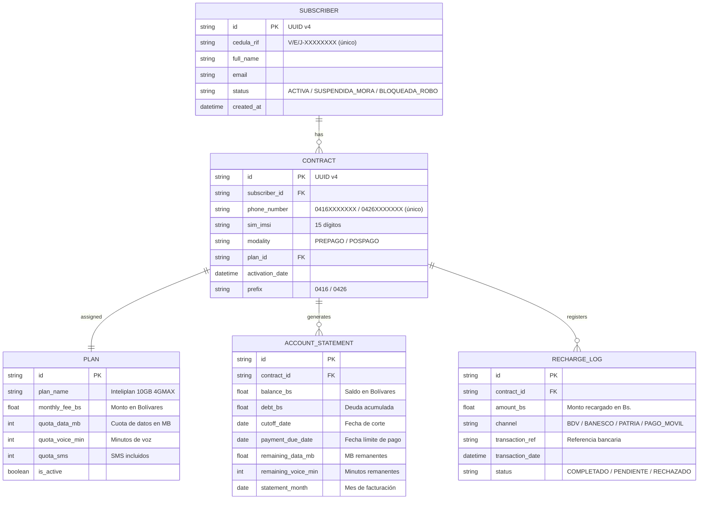

# 📋 Especificación de Requerimientos del Sistema (SRS)
## Asistente de Inteligencia Artificial para Movilnet Venezuela
**Identificador del Proyecto:** `AI_Movilnet_300926`  
**Versión:** 1.1.0 (Actualización Capítulo 8 — Dimensionamiento y Fase 0 incorporados)  
**Fecha:** 2026-09-30  
**Fase Actual:** FASE 0 — Discovery & Inception ✅ CERTIFICADA  
**Estado:** ⚠️ SUPUESTOS PARCIALES — Sujeto a confirmación con equipo TI de Movilnet  
**Contexto de Operación:** Red de Telecomunicaciones Móvil GSM/4G LTE (Prefijos `0416` y `0426`)  

> [!IMPORTANT]
> Los requerimientos funcionales y el modelo de datos de las secciones 2, 3 y 4 son **supuestos de arquitectura de referencia** basados en estándares TM Forum. Deben ser **validados y ajustados** con el equipo TI de Movilnet una vez diligenciado el [`CUESTIONARIO_LEVANTAMIENTO_MOVILNET_VENEZUELA_2026-09-30.md`](file:///Users/Users/Skills_Antigravity/Proyectos_IDS_Skills_Antigravity/AI_Movilnet_300926/docs/CUESTIONARIO_LEVANTAMIENTO_MOVILNET_VENEZUELA_2026-09-30.md).

---

## 1. Objetivos del Negocio

Desarrollar un **Asistente Virtual Inteligente y Seguro** capaz de:
1. **Autenticar** a los abonados de Movilnet mediante su número de línea y documento de identidad (Cédula/RIF).
2. **Consultar en tiempo real** toda la información de sus servicios contratados y estado de cuenta.
3. **Orientar** sobre canales de pago, recargas y procedimientos de autogestión.
4. **Escalar** hasta los **4 millones de abonados** activos de la operadora con costo operativo mínimo.

---

## 2. Requerimientos Funcionales (RF)
*(Referencia — Sujetos a validación en Fase 0)*

### RF-01: Identificación y Validación del Abonado
* El sistema solicitará el número telefónico (formato `0416XXXXXXX` o `0426XXXXXXX`) y la cédula de identidad (`V-XXXXXXXX`, `E-XXXXXXXX`, `J-XXXXXXXX`).
* Verificará la existencia del abonado en la base de datos de clientes y su estatus operativo:
  * `ACTIVA` — Servicio completo habilitado.
  * `SUSPENDIDA_MORA` — Solo lectura de deuda, sin servicios de datos.
  * `BLOQUEADA_ROBO` — Sin acceso, derivar a servicio al cliente.
* Máximo 3 intentos fallidos antes de bloqueo temporal de 15 minutos.

### RF-02: Consulta de Servicios y Plan Contratado
* Recuperar y presentar de forma amigable:
  * Nombre del plan comercial (ej. *Inteliplan 10GB 4GMAX*, *Plan Conectados 2.0*).
  * Tipo de modalidad: *Prepago* o *Pospago*.
  * Cupo total vs. cupo remanente de megabytes/gigabytes para navegación.
  * Cupo de minutos a todas las operadoras y mensajes de texto (SMS).
  * Fecha de vencimiento del paquete de datos (si aplica).

### RF-03: Consulta de Estado de Cuenta y Facturación
* Mostrar saldo actual disponible o monto a pagar para la próxima fecha de corte.
* Fecha de corte mensual y fecha límite de pago.
* Última recarga o pago registrado (fecha, canal y monto en Bs.).
* Deuda acumulada y estado de mora (si aplica).

### RF-04: Guía de Canales de Pago y Recargas
* Orientar al usuario sobre los bancos y plataformas electrónicas afiliadas:
  * Banco de Venezuela (BDV) en línea.
  * Banesco Online.
  * Mercantil en línea.
  * Banco Bicentenario.
  * Sistema Patria (plataforma gubernamental).
  * Pago Móvil (cualquier banco nacional).

### RF-05: Derivación a Servicio al Cliente
* Cuando el asistente no pueda resolver la consulta o el usuario lo solicite, derivar a agente humano o canales presenciales de Movilnet.

---

## 3. Requerimientos No Funcionales (RNF)

| Código | Categoría | Especificación |
|:---:|:---|:---|
| RNF-01 | **Seguridad SAST** | El asistente NUNCA procesará escritura en bases de datos. Toda consulta pasa por `sql_sanitizer.py` (solo lectura). |
| RNF-02 | **Anti-Prompt Injection** | Detección heurística de ataques de ingeniería social (`injection_hunter.py`). Bloqueo inmediato. |
| RNF-03 | **Latencia Ultra-Baja** | Tiempo de respuesta menor a **800 ms** para Fast-Path. Menor a **2.000 ms** para rutas LLM. Usa Gemini Flash + KV-Cache. |
| RNF-04 | **Costo Operativo Mínimo** | Costo por interacción menor a **\$0.0005 USD**. Protocolo `ahorro-de-tokens`. Costo total estimado: **\$200-\$400 USD/mes** para 4M abonados. |
| RNF-05 | **Auditoría Forense** | Toda consulta y respuesta sellada en bitácora inmutable con firma SHA-256. |
| RNF-06 | **Disponibilidad** | Disponibilidad mínima del **99.5%** (máx. 43.8 h de inactividad/año). |
| RNF-07 | **Protección de PII** | Datos de cédulas, teléfonos y saldos nunca expuestos en logs ni en respuestas de error. Enmascaramiento activo. |
| RNF-08 | **Concurrencia Masiva** | Soporte para **400 QPS** en picos de días de corte. Redis Cluster + PgBouncer + réplicas de lectura. |

---

## 4. Modelo de Entidades de Datos
*(Referencia TM Forum — Sujeto a ajuste según BD real de Movilnet)*



---

## 5. Dimensionamiento Enterprise (4.000.000 Abonados)

| Métrica Telco | Estimación para Movilnet | Solución de Arquitectura |
|:---|:---|:---|
| **Población de Abonados** | 4.000.000 suscriptores únicos | Tabla particionada con índices B-Tree en `cedula_rif` — $O(\log N)$ |
| **Líneas / Contratos Activos** | ~5.500.000 líneas activas (0416 + 0426) | Particionado por prefijo + índice compuesto `(phone_number, subscriber_id)` |
| **Volumen Histórico Facturación** | ~48.000.000 registros/año | Particionado por rangos de fecha mensual + archivado en frío |
| **Tráfico Diario Base** | 40.000 – 80.000 consultas/día (~1-3 QPS) | Redis Cache TTL 120s + sesiones concurrentes |
| **Tráfico en Picos Críticos** | 300.000 – 500.000 consultas/día (150-400 QPS) | Réplicas solo-lectura + PgBouncer connection pooling |
| **Estrategia de Enrutamiento** | 70% Fast-Path / 30% LLM | Fast-Path: <25ms a \$0 tokens. LLM: <500ms a ~\$0.00015/req |
| **Costo Total IA Estimado** | \$200 – \$400 USD/mes | Enrutador Híbrido + `ahorro-de-tokens` + KV-Cache Gemini Flash |
| **Protección Anti-Scraping** | PII de 4M usuarios (cédulas + saldos) | Rate Limiting 5 req/min/IP + Validación Dual obligatoria |

---

## 6. Estado de los Requerimientos por Fase

| Requerimiento | Fase 0 | Fase 1 | Fase 2 | Fase 3 |
|:---|:---:|:---:|:---:|:---:|
| Levantamiento de información TI Movilnet | ⏳ En proceso | — | — | — |
| Gatekeeper Fase 0 APROBADO | ⏳ Pendiente | — | — | — |
| `db/schema.sql` (DDL real) | — | ⏳ | — | — |
| `mcp/telco_tools.py` | — | ⏳ | — | — |
| `core/agent.py` (asistente) | — | ⏳ | — | — |
| `api/openapi.json` (contrato REST) | — | ⏳ | — | — |
| Suite de pruebas E2E | — | — | ⏳ | — |
| Despliegue Docker en producción | — | — | — | ⏳ |

---

## 7. Herramientas de Fase 0 para Validar Estos Requerimientos

```bash
# Generar cuestionario para equipo TI de Movilnet
python3 scripts/generate_discovery_matrix.py --client "Movilnet Venezuela"

# Auditar conectividad y WAF del cliente
python3 scripts/audit_perimeter_waf.py --url https://api.movilnet.com.ve

# Inspeccionar BD real entregada por el cliente
python3 -c "from mcp.discovery_tools import inspect_db_schema; import json; print(json.dumps(inspect_db_schema('ruta/a/bd_cliente.db'), indent=2))"

# Validar si Fase 0 está completa (Gatekeeper)
python3 -c "from mcp.discovery_tools import gatekeeper_validate; import json; print(json.dumps(gatekeeper_validate('docs/FASE_0_LEVANTAMIENTO_INFORMACION.md'), indent=2))"

# Ejecutar suite de pruebas y certificación
python3 tests/test_discovery_mcp.py
```
