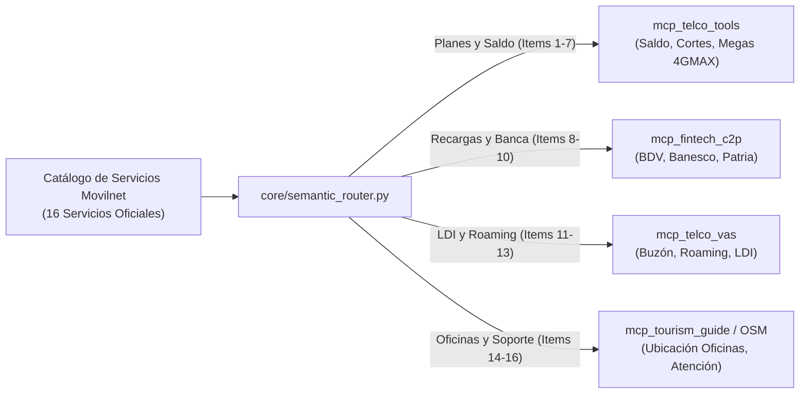

# 📋 Catálogo Completo de Servicios, Planes y Vínculos Comerciales de Movilnet
## Fuente de Referencia: Portal Corporativo Movilnet (`http://www.movilnet.com.ve/sitio/`)
**Operadora:** Telecomunicaciones Movilnet C.A. (Prefijos `0416` y `0426`)  
**Ecosistema:** Telefonía Móvil 4GMAX/GSM, Datos, Internet Inalámbrico, Servicios de Valor Agregado y Banca  
**Fecha:** 2026-09-30  
**Gobernanza:** Fase 0 — Levantamiento de Información Comercial  

---

## 1. 📊 Gran Tabla Maestra de Servicios de Telecomunicaciones Movilnet

| # | Categoría | Servicio / Producto Comercial | Descripción y Alcance Técnico | Tipo de Servicio | Modalidad | Vínculos Comerciales y Aliados | Información Comercial y Publicidad |
|:---:|:---|:---|:---|:---|:---:|:---|:---|
| **1** | **Móvil 4GMAX** | **Inteliplan 10GB 4GMAX** | Plan bandera de navegación. Incluye 10 GB de datos en redes 4G LTE/GSM, 1.000 minutos libres a todas las operadoras y 500 SMS. | Datos + Voz + SMS | Prepago / Pospago | Fabricantes de terminales 4G LTE (ZTE, Huawei, Xiaomi, Infinix) | *Campaña:* "Navega a la velocidad 4GMAX". Plan más publicitado en TV y redes. |
| **2** | **Móvil 4GMAX** | **Inteliplan 3.6GB / 2.1GB / 1.5GB** | Paquetes de navegación básica y media diseñados para usuarios con consumo moderado de mensajería y redes sociales. | Datos + Voz + SMS | Prepago | Distribuidores autorizados de chips USIM | *Campaña:* "Conectado a tu medida". Orientado a planes económicos. |
| **3** | **Móvil Prepago** | **Plan Conectados con Todo** | Plan flexible con saldo acumulativo para llamadas nacionales, mensajes y cupo de megas por demanda. | Voz + SMS + Datos | Prepago | Red nacional de Agentes Autorizados | *Campaña:* "La señal que nos une". Ideal para líneas secundarias. |
| **4** | **Social / Inclusión**| **Plan Patria / Conecta 2.0** | Tarifa social subsidiada para pensionados, estudiantes y beneficiarios carnetizados de programas públicos. | Voz + Datos Básicos | Prepago | Sistema Patria / Vicepresidencia Sectorial | *Campaña:* "Inclusión tecnológica nacional". Afiliación directa vía Plataforma Patria. |
| **5** | **Datos Adicionales** | **Paquetes Extra Datos 4GMAX** | Bolsas de navegación complementarias (1GB, 2GB, 5GB, 10GB) que se activan cuando el usuario agota su cuota antes del corte. | Datos (Bolsa) | Prepago / Pospago | Pasarelas de Pago C2P y Recarga Digital | *Campaña:* "No te quedes sin megas". Notificación proactiva por SMS. |
| **6** | **Internet Fijo/Hogar**| **Módem Inalámbrico 4GMAX (CPE/MiFi)** | Routers inalámbricos WiFi para hogares y PYMES que conectan hasta 32 dispositivos mediante SIM 4G sin cableado de fibra. | Internet Residencial | Prepago / Pospago | Fabricantes de CPEs (ZTE, Huawei, TP-Link) y cadenas de tecnología | *Campaña:* "Internet para tu hogar sin cables". Dirigido a zonas sin cobertura de fibra. |
| **7** | **Corporativo** | **Planes Movilnet Empresa / Negocios** | Planes de datos masivos (25GB, 50GB, 100GB), bolsas compartidas corporativas y líneas flotantes para flotas comerciales. | Corporativo / M2M | Pospago | Cámaras de comercio, industrias y entes públicos | *Campaña:* "Impulsa tu negocio con Movilnet". Atención vía ejecutivos B2B dedicados. |
| **8** | **Banca & Finanzas** | **Recarga por Banca en Línea y Pago Móvil** | Recarga electrónica directa desde cuentas bancarias nacionales en Bolívares. | Transaccional Fintech | Ambos | Banco de Venezuela (BDV), Banesco, Mercantil, Bicentenario, Bancaribe | *Campaña:* "Paga fácil y rápido desde tu banco". Presencia en home banking. |
| **9** | **Banca & Finanzas** | **Recarga por Sistema Patria** | Pago debitado directamente del Monedero Patria utilizando bonificaciones o saldo en cuenta patria. | Transaccional Fintech | Prepago | Plataforma Patria (Gobierno Bolivariano) | *Campaña:* "Recarga con tu Monedero Patria". Canal masivo en sectores populares. |
| **10**| **Comercio Aliado** | **Red de Agentes Autorizados y Farmacias** | Recargas electrónicas presenciales en comercios aliados con puntos de venta y taquillas autorizadas. | Retail / Presencial | Prepago | Farmatodo, Farmahorro, Automercados Plaza's, Agencias de Loterías | *Campaña:* "Puntos de Recarga en todo el país". Publicidad en vitrinas y cajas. |
| **11**| **Servicios VAS** | **Buzón de Mensajes y Llamada en Espera** | Servicios suplementarios tradicionales de red celular: correo de voz, desvío de llamadas y conferencia tripartita. | Valor Agregado (VAS) | Ambos | Proveedores de plataforma de red (Ericsson / Huawei Core) | Servicio estándar incluido en la activación de la línea. |
| **12**| **Internacional** | **Larga Distancia Internacional (LDI)** | Discado directo internacional a más de 100 países aplicando tarifas en Bolívares según destino. | Telefonía LDI | Ambos | Carriers internacionales de interconexión | *Campaña:* "Habla con tus seres queridos en el exterior". |
| **13**| **Internacional** | **Roaming Internacional GSM/LTE** | Uso de la línea Movilnet en el extranjero para recepción de SMS bancarios, voz y datos en itinerancia. | Roaming Global | Pospago | Operadoras internacionales aliadas (Telefónica, Claro, AT&T) | *Campaña:* "Tu línea Movilnet viaja contigo". Activación previa requerida. |
| **14**| **Atención Digital** | **Canales de Autogestión (WhatsApp / Web)** | Consulta de saldo, planes, fechas de corte y atención a reclamos vía plataformas conversacionales. | Atención al Cliente | Ambos | Proveedores Cloud y Meta WhatsApp Business API | *Campaña:* "Movilnet en un clic". Atención 24/7 sin colas. |
| **15**| **Atención Física** | **Oficinas de Servicios Movilnet (OSM)** | Sedes de atención presencial para cambio de chip a USIM 4GMAX, reposición por robo y cambio de titular. | Soporte Presencial | Ambos | Centros comerciales y sedes Cantv/Movilnet a nivel nacional | *Campaña:* "Acércate a nuestras Oficinas de Servicio Movilnet". |
| **16**| **Patrocinios & RSE**| **Eventos Deportivos y Culturales** | Presencia de marca y patrocinios comerciales oficiales en eventos de alta visibilidad nacional. | Marca / Fidelización | Institucional | Liga Venezolana de Béisbol Profesional (LVBP), FITELVEN | *Campaña:* "La señal que nos une". Estadios, vallas publicitarias y eventos tech. |

---

## 2. 🔍 Explicación Detallada de Cada Servicio

### 2.1. Planes Móviles 4GMAX (Telefonía y Datos Celulares)
* **Inteliplan 10GB 4GMAX:** Es el producto estrella del portal. Ofrece conexión en redes de cuarta generación (LTE) con cuotas amplias de navegación para streaming, redes sociales y mensajería.
* **Paquetes Adicionales de Datos (Extra Datos):** Cuando el abonado consume sus megas antes del día de corte mensual (días 15 o 30), puede adquirir bolsas inmediatas que se pagan contra el saldo disponible.

### 2.2. Internet Residencial e Inalámbrico (Módem 4GMAX)
* Diseñado para hogares y oficinas pequeñas en zonas donde no hay disponibilidad de fibra óptica ni cables telefónicos de Cantv. Funciona con un chip SIM 4G conectado a un módem router CPE con alimentación eléctrica que emite WiFi a múltiples computadoras y teléfonos.

### 2.3. Red de Recargas y Vínculos Comerciales Bancarios
Movilnet no opera como entidad bancaria, por lo que **su red comercial depende de alianzas bancarias profundas**:
* **Banco de Venezuela (BDV):** Es el principal socio financiero. Permite recarga por botón de pago, Pago Móvil C2P y débito automático en taquillas.
* **Banca Privada (Banesco, Mercantil, Provincial, Bancaribe):** Conexión vía servicios de multipagos en sus bancas electrónicas.
* **Sistema Patria:** Permite a más de 15 millones de venezolanos utilizar los bonos y subsidios del Estado para pagar directamente su servicio de telefonía.

### 2.4. Canales de Distribución y Comercialización
* **Agentes Autorizados Movilnet:** Pequeños y medianos comerciantes que comercializan líneas nuevas, tarjetas SIM 4GMAX, teléfonos celulares de marcas chinas aliadas (ZTE, Xiaomi, Tecno, Infinix) y recargas electrónicas.
* **Grandes Superficies (Retail):** Cadenas farmacéuticas (Farmatodo, Farmahorro) donde el cajero puede acreditar saldo en la factura de compra.

---

## 3. 🎯 Ejes Publicitarios y Estrategia de Comunicación de Movilnet

El portal `http://www.movilnet.com.ve/sitio/` estructura su publicidad en tres grandes ejes:

1. **"La Señal que nos Une":** Posicionamiento patriótico y emocional que resalta la cobertura de la empresa estatal en los rincones más apartados del país donde las operadoras privadas no llegan (poblados rurales, zonas fronterizas, parques nacionales).
2. **"Pásate a la Red 4GMAX":** Campaña de modernización tecnológica que impulsa a los usuarios con líneas antiguas 3G o CDMA a cambiar su chip por la tarjeta USIM 4GMAX.
3. **Presencia en Grandes Eventos:** Publicidad dominante en transmisiones del béisbol profesional venezolano (LVBP) y en ferias de telecomunicaciones (FITELVEN).

---

## 4. 🤖 ¿Cómo Integra Nuestra Aplicación de IA Todo este Catálogo?

Con la arquitectura que hemos construido:

* El usuario **no necesita memorizar nombres de planes**: puede preguntar *"¿cómo hago para tener internet en mi casa sin cables?"* y la IA le explicará el servicio de **Módem Inalámbrico 4GMAX**.
* Si pregunta *"¿dónde puedo cambiar mi chip viejo por un 4GMAX?"*, la IA le indicará la **Oficina de Servicio Movilnet (OSM)** o Agente Autorizado más cercano a su ubicación.
