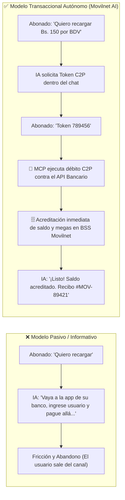
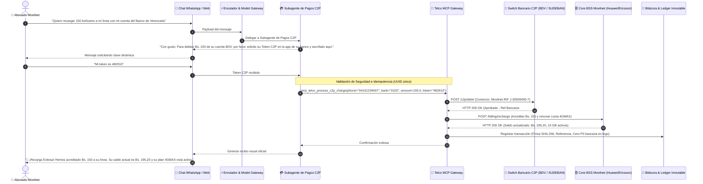

# 💳 Especificación Transaccional: Pagos y Recargas Directas en el Chat (Pago Móvil C2P)
## Proyecto: `AI_Movilnet_300926` — Telecomunicaciones Movilnet C.A.
**Paradigma:** De Asistente Informativo a **Aplicación Cognitiva Transaccional Autónoma**  
**Fecha:** 2026-09-30  
**Versión:** 1.0.0 Maestro  

---

## 1. El Salto Evolutivo: Informativo vs. Transaccional Autónomo



---

## 2. Mecanismo de Cobro Directo: Pago Móvil C2P (Comercio a Persona)

En Venezuela, el protocolo interbancario **C2P (Cobro de Comercio a Persona)** regulado por SUDEBAN permite que un comercio o empresa (en este caso **Telecomunicaciones Movilnet C.A.**) debite directamente fondos de la cuenta del cliente previa autorización con una **clave dinámica o token de un solo uso (OTP)**.

### Datos Necesarios (Cero Fricción):
1. **Banco Emisor del Abonado:** (ej. Banco de Venezuela `0102`, Banesco `0134`, Mercantil `0105`, etc.).
2. **Cédula de Identidad:** Ya validada en el paso de KYC inicial.
3. **Número Telefónico Afiliado al Banco:** Generalmente la misma línea a recargar.
4. **Monto en Bolívares:** Elegido por el usuario o sugerido por el plan.
5. **Token / Clave Dinámica C2P:** Generado por el usuario en segundos desde la app de su banco o recibido por SMS bancario.

---

## 3. Diagrama de Secuencia de la Transacción en el Chat



---

## 4. Simulación Visual de la Conversación Transaccional

```text
┌──────────────────────────────────────────────────────────────┐
│  🟢 Telecomunicaciones Movilnet  ✓ Cuenta Oficial Verificada  │
│  En línea                                                    │
├──────────────────────────────────────────────────────────────┤
│                                                              │
│  [14:17] Usuario:                                            │
│  Quiero recargar 150 bolívares a mi número con mi cuenta      │
│  del Banco de Venezuela, ¿lo puedo hacer por aquí mismo?     │
│                                                              │
│  [14:17] 🤖 Asistente Movilnet AI:                           │
│  ¡Por supuesto! Puede realizar su recarga de forma inmediata │
│  y segura directamente desde este chat mediante Pago Móvil   │
│  C2P, sin necesidad de salir a la página del banco.          │
│                                                              │
│  📋 *RESUMEN DE SU RECARGA:*                                 │
│  • *Línea a recargar:* 0416-1234567                         │
│  • *Titular:* Juan Carlos Rodríguez (V-18456789)             │
│  • *Banco Emisor:* Banco de Venezuela (0102)                │
│  • *Monto:* Bs. 150,00                                       │
│                                                              │
│  Para autorizar el débito inmediato de su cuenta, por favor: │
│  1. Abra su app BDV o envíe un SMS al 2661 con la palabra    │
│     *TOKEN* para generar su clave dinámica C2P.             │
│  2. Escriba aquí el código de 6 dígitos.                     │
│                                                              │
│  [14:18] Usuario:                                            │
│  Listo, el token es 482910                                   │
│                                                              │
│  [14:18] 🤖 Asistente Movilnet AI:                           │
│  ⏳ Procesando su pago con el Banco de Venezuela...          │
│  (Por favor no cierre el chat)                               │
│                                                              │
│  [14:18] 🤖 Asistente Movilnet AI:                           │
│  🎉 *¡PAGO Y RECARGA PROCESADOS CON ÉXITO!*                 │
│  ━━━━━━━━━━━━━━━━━━━━━━━━━━━━━━                              │
│  • *Comprobante Movilnet:* #MOV-20260930-89421              │
│  • *Referencia Bancaria BDV:* #987412563                     │
│  • *Monto Debitado:* Bs. 150,00                              │
│  • *Fecha y Hora:* 30/09/2026 - 14:18:22                     │
│  ━━━━━━━━━━━━━━━━━━━━━━━━━━━━━━                              │
│                                                              │
│  📱 *ESTADO ACTUALIZADO DE SU SERVICIO:*                     │
│  • *Saldo Disponible:* Bs. 195,20                            │
│  • *Plan Renovado:* Inteliplan 10GB 4GMAX                    │
│  • *Megas Disponibles:* 10.00 GB activos para navegación     │
│  • *Próxima Fecha de Corte:* 15 de Noviembre                 │
│                                                              │
│  Hemos enviado un SMS de confirmación a su línea.            │
│  ¿Desea realizar alguna otra consulta?                       │
│                                                              │
│  [14:19] Usuario:                                            │
│  ¡Waooo qué rápido y cómodo! Muchísimas gracias hermano.     │
│                                                              │
│  [14:19] 🤖 Asistente Movilnet AI:                           │
│  ¡Estamos para servirle con la mejor tecnología! Gracias por │
│  preferir a Movilnet, la señal que nos une. 📶🇻🇪            │
└──────────────────────────────────────────────────────────────┘
```

---

## 5. Herramientas MCP y Subagentes Requeridos

| Componente | Tipo | Función Técnica |
|:---|:---|:---|
| `subagent-fintech-payment` | Subagente Especializado | Gobierna el flujo conversacional financiero, valida montos y maneja reintentos seguros. |
| `mcp_telco_process_c2p` | Herramienta MCP | Conector mTLS seguro con la API C2P del banco para solicitar el débito en tiempo real. |
| `mcp_telco_verify_reference` | Herramienta MCP | Verificador alternativo para cuando el usuario realiza un pago manual y solo envía la referencia. |
| `mcp_telco_apply_recharge` | Herramienta MCP | API interna BSS para acreditar saldo y renovar el paquete de datos en la red celular. |
| `idempotency_guard` | Enclave de Seguridad | Impide dobles cobros si el usuario pulsa enviar dos veces o hay latencia de red. |
