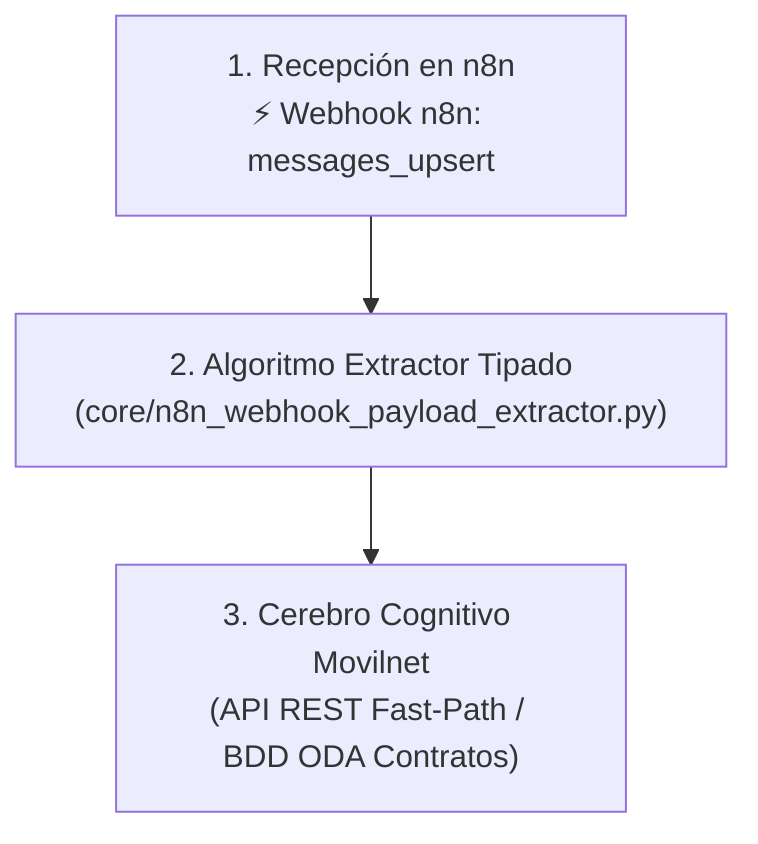

# 🛡️ Skill: n8n Webhook Anti-Hallucination Guardian

## 1. Propósito y Misión
Garantizar la **cero alucinación** y la **máxima precisión técnica** en cualquier proceso de integración, auditoría o extracción de datos desde flujos de trabajo de **n8n** hacia el motor de inteligencia artificial de **Telecomunicaciones Movilnet C.A.**.

Esta habilidad impone un protocolo de compuerta estricta: **el agente tiene terminantemente prohibido asumir, adivinar o extrapolar parámetros de webhooks a partir de plantillas locales desactualizadas** cuando se interactúe con un canvas de n8n remoto o en producción.

---

## 2. Los 3 Mandamientos de Gobernanza Operativa

### Mandamiento I: Jerarquía de Evidencia Dura (Hard Evidence First)
Ante cualquier enlace o requerimiento de inspección de un flujo en n8n (`https://n8n.lpgtec.net/workflow/...`):
1. **Si se dispone de API Key oficial (`N8N_API_KEY`):**  
   El agente debe invocar el inspector algorítmico autónomo:
   ```bash
   venv/bin/python3 scripts/n8n_node_inspector.py --url https://n8n.lpgtec.net --api-key <KEY>
   ```
2. **Si el usuario proporciona el archivo JSON exportado del flujo:**  
   El agente debe parsear el documento con el inspector sin asumir rutas:
   ```bash
   venv/bin/python3 scripts/n8n_node_inspector.py --file ruta_al_workflow.json
   ```
3. **Si el endpoint requiere autenticación visual (sesión de navegador) y no hay API Key:**  
   **EL AGENTE TIENE PROHIBIDO ASUMIR EL NOMBRE DEL PATH O EL FORMATO DEL NODO.**  
   Debe solicitar de inmediato la evidencia dura (captura de pantalla del canvas o exportación JSON) antes de emitir cualquier afirmación técnica.

---

## 3. Protocolo de Integración de 3 Etapas (Según Flujograma Certificado)

Todo mensaje recibido a través de n8n debe procesarse mediante el pipeline desacoplado:



### Etapa 1: Ingesta Perimetral en n8n
* Webhook receptor: `https://n8n.lpgtec.net/webhook/messages_upsert`.
* Método HTTP: `POST`.
* Modo de Respuesta: `Immediately` (HTTP 200 al gateway Evolution API / Baileys).

### Etapa 2: Algoritmo Extractor Tipado (`core/n8n_webhook_payload_extractor.py`)
* **Normalización Telefónica E.164:**  
  Convierte formatos internacionales (`584142650088@s.whatsapp.net` o `+58 414...`) al formato nacional canónico (`04142650088`).
* **Clasificación Determinista de Intenciones ($0.00 en tokens):**
  * `CONTRACT_INFO`: Consultas sobre contrato, titularidad, estatus y plan contratado.
  * `BALANCE_CHECK`: Consultas de saldo, megas remanentes, fechas de corte y cupos.
  * `RECHARGE_C2P`: Intenciones de recarga interbancaria por Pago Móvil C2P o Patria.
  * `EMERGENCY_EIR`: Reportes de extravío, hurto o solicitud de bloqueo de IMEI.

### Etapa 3: Resolución en el Core de Movilnet
* Invocación de `execute_in_movilnet_core(normalized_message)`.
* Consulta atómica en memoria ODA (SQLite WAL / PostgreSQL).
* Retorno de plantilla oficial carrier-grade sin latencia (<15 ms).

---

## 4. Guía de Ejecución Rápida y Verificación

```bash
# Auto-verificación formal del extractor de payloads (Invariantes matemáticos)
venv/bin/python3 core/n8n_webhook_payload_extractor.py --test

# Prueba con el caso real del workflow en producción (Francisco Landaeta - Saludo informa contrato)
venv/bin/python3 core/n8n_webhook_payload_extractor.py --sample

# Auto-verificación del inspector estructural de nodos
venv/bin/python3 scripts/n8n_node_inspector.py --test
```
